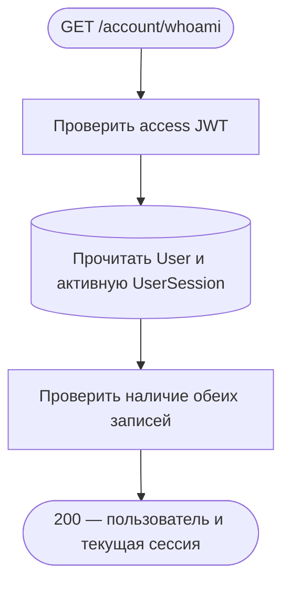
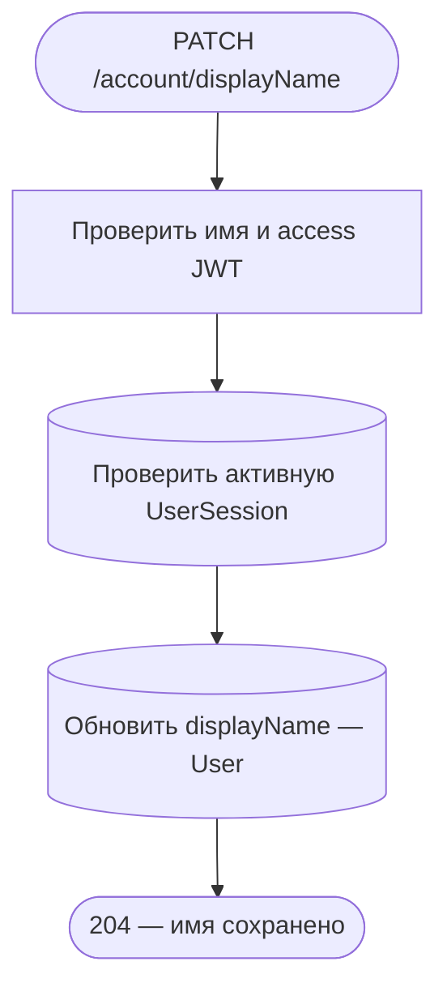
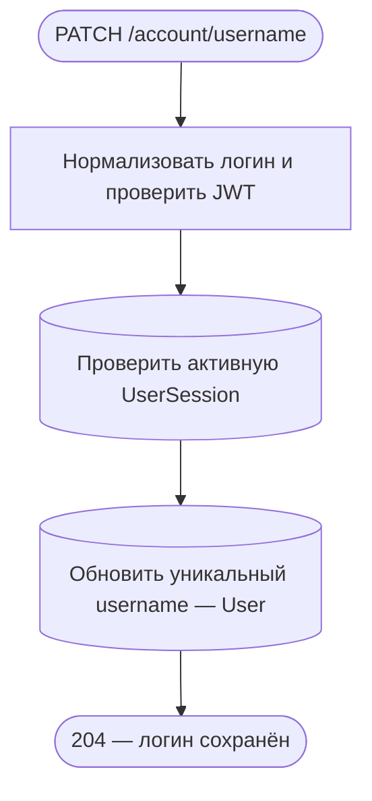
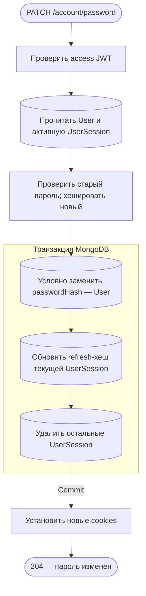
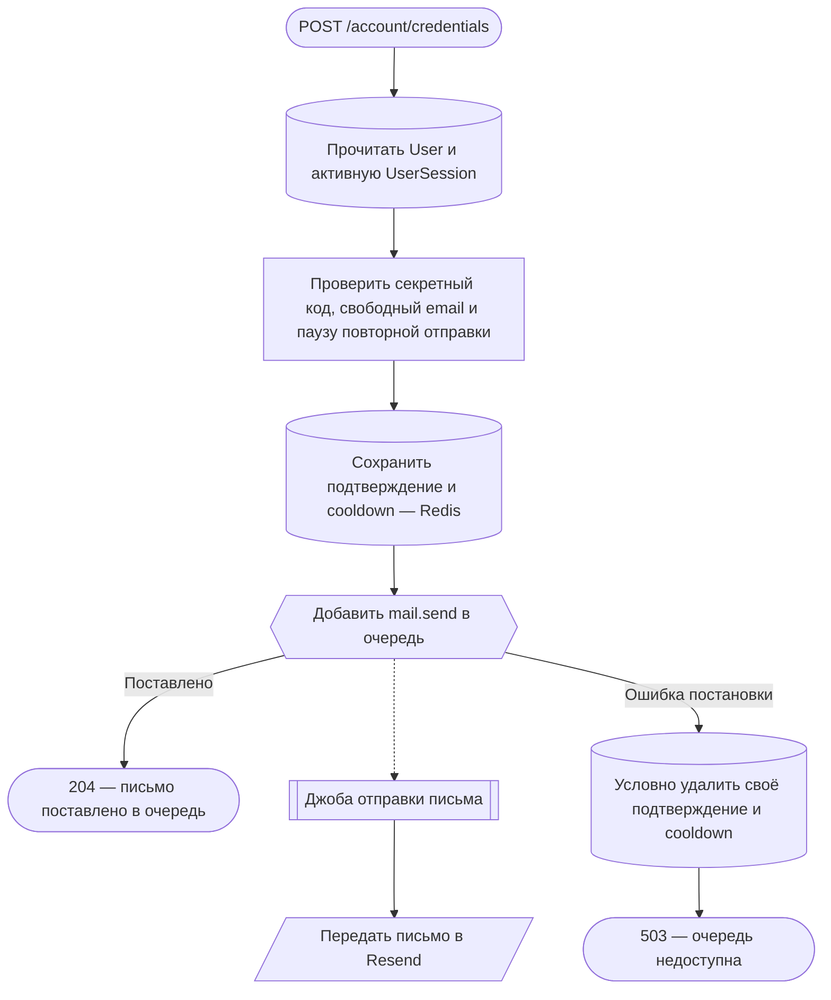
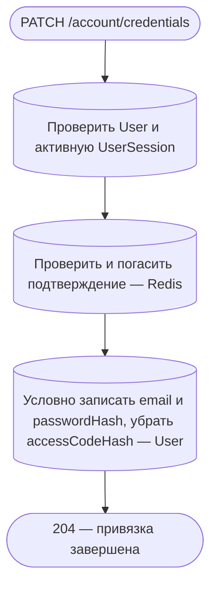
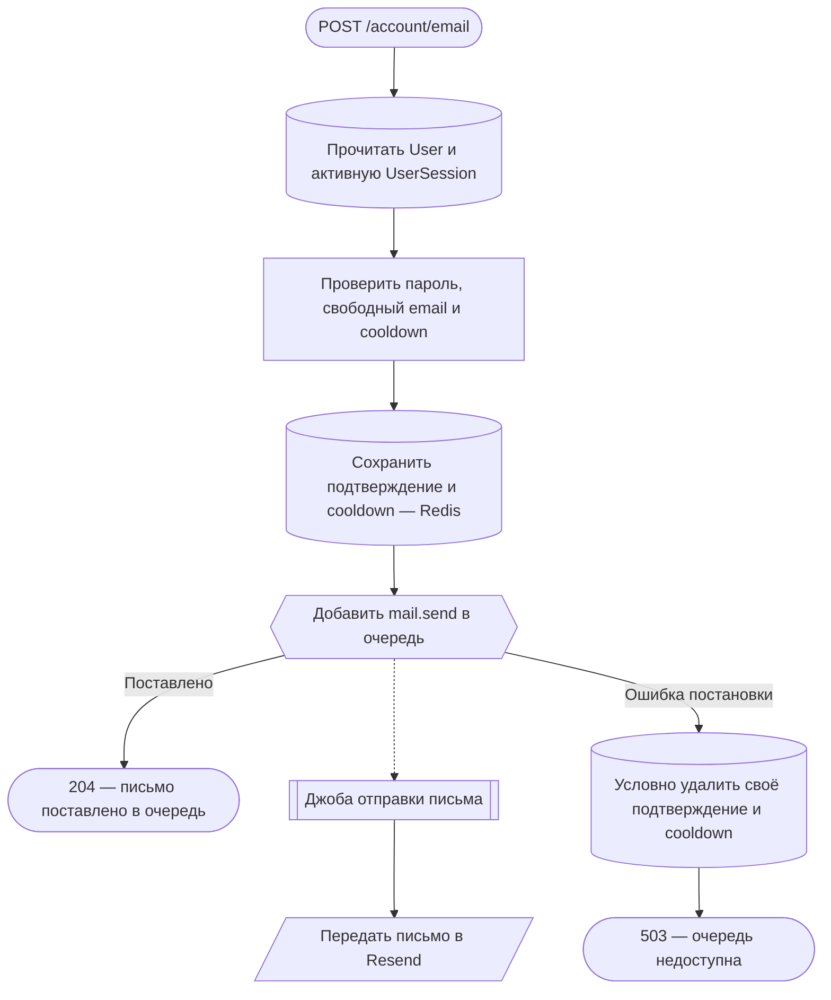
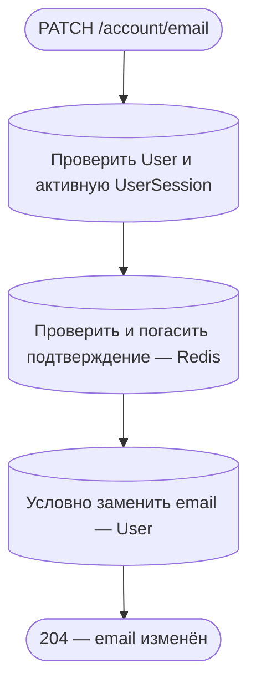

# Аккаунт и профиль

[← Все эндпоинты](../endpoints.md) · [Авторизация и сессии](auth.md) · [Обозначения](readme.md)

Все восемь операций используют access cookie, проверяют подпись/срок JWT, принадлежащую пользователю активную UserSession и существование User. Передаётся cookie `__Host-accessToken`; Bearer-токен не заменяет его. JSON — с `Content-Type: application/json`, неизвестные поля запрещены. Общие ошибки: 400 — входные данные, 401 — нет действующего доступа, 403 — CSRF для изменяющих запросов, 429 — throttling. Все ответы имеют `Cache-Control: no-store`. Событий в этих потоках нет.

## GET /account/whoami

Показать текущего пользователя и сессию. **Пример:** `GET /account/whoami`, без тела, с access cookie. **Ответ:** 200, `user` (id, username, displayName, avatarUrl, role) и `session` (id, country, expiresAt в ISO 8601).

Чтения User и UserSession параллельные, без транзакции и общего snapshot; нет записей, внешних вызовов или фоновой работы. Нет пользователя или сессии — 401. HTTP ждёт обоих чтений и маппинга.

**Технические подробности:** [AccountController.whoami](../../../src/endpoints/account/controllers/account.controller.ts) → [AccountService.whoami](../../../src/endpoints/account/services/account.service.ts) → AuthService.getSession/UserRepository.read.findById. [Response DTO](../../../src/endpoints/account/dto/response/whoami.response.ts).

## PATCH /account/displayName

Изменить отображаемое имя. **Пример:** `PATCH /account/displayName`, тело `{"displayName":"Тихий лис"}`, access cookie. **Ответ:** 204 без тела.

Имя обрезается по краям, должно быть непустым и не длиннее 40 символов. User не читается отдельно: его существование устанавливается результатом атомарного update. Без отдельной транзакции между проверкой сессии и записью. Если User исчез — 401. HTTP ждёт запись; очередей и внешних обращений нет. Потеря ответа не отменяет изменение. Поисковый индекс обновится [независимой синхронизацией](catalog.md#search-sync).

**Технические подробности:** [AccountController.updateDisplayName](../../../src/endpoints/account/controllers/account.controller.ts) → [AccountService.updateDisplayName](../../../src/endpoints/account/services/account.service.ts) → UserRepository.write.updateById. [DTO](../../../src/endpoints/account/dto/body/displayName.body.ts).

## PATCH /account/username

Изменить уникальный логин. **Пример:** `PATCH /account/username`, тело `{"username":"quietfox042"}`, access cookie. **Ответ:** 204 без тела.

Логин обрезается, приводится к нижнему регистру, содержит только латинские строчные буквы, цифры и `_`, максимум 32 символа. Уникальность гарантирует индекс User; конфликт даёт 409. Отсутствие User при update даёт 401. Транзакции между проверкой сессии и update нет, фон/внешние вызовы не запускаются; HTTP ждёт запись. Поиск отражает новое имя после независимой синхронизации индекса.

**Технические подробности:** [AccountController.updateUsername](../../../src/endpoints/account/controllers/account.controller.ts) → [AccountService.updateUsername](../../../src/endpoints/account/services/account.service.ts) → UserRepository.write.updateById. [DTO](../../../src/endpoints/account/dto/body/username.body.ts), [User schema](../../../src/entities/user/schemas/user.schema.ts).

## PATCH /account/password

Изменить существующий пароль, оставить текущее устройство и завершить остальные сессии. **Пример:** `PATCH /account/password`, `{"currentPassword":"old-example-password","newPassword":"new-example-password"}`, access cookie. **Ответ:** 204 без тела и новые access/refresh cookies.

JWT проверяется до чтения. Пароли — минимум 8 символов, максимум 72 UTF-8 байта. Отсутствие пароля у кодового аккаунта — 409, неверный текущий пароль — 401. Условная запись проверяет исходный passwordHash, ротация текущей сессии повторно проверяет владельца и срок. Другие сессии удаляются, включая истёкшие. Любая ошибка внутри транзакции откатывает все три изменения; cookies устанавливаются после commit. Ошибка доставки ответа не отменяет новый пароль/refresh-хеш. Фона и внешних обращений нет; дополнительный лимит — 5 запросов в минуту.

**Технические подробности:** [AccountCredentialsController.updatePassword](../../../src/endpoints/account/controllers/accountCredentials.controller.ts) → [AccountService.updatePassword](../../../src/endpoints/account/services/account.service.ts) → MongoTransactionService.run, UserRepository.write.updateByFilter, AuthService.issueTokens, [UserSessionRepository.updateRefreshToken/deleteOthers](../../../src/entities/userSession/services/userSession.repository.ts), SecurityCookieService.setAuthCookies. [DTO](../../../src/endpoints/account/dto/body/password.body.ts).

## POST /account/credentials

Начать привязку email и пароля к аккаунту, созданному по секретному коду. **Пример:** `POST /account/credentials`, `{"email":"reader@example.com","password":"example-password","accessCode":"AAAAAAAAAAAAAAAAAAAAAAAAAAAAAAAA"}`, access cookie. **Ответ:** 204 без тела после постановки письма в очередь.

У User должны отсутствовать email и passwordHash; иначе 409. Сверяется SHA-256 текущего 32-символьного accessCode, неверный — 401. Занятый email — 409. Email нормализуется; новый пароль хешируется. В Redis сохраняются userId/email/passwordHash/accessCodeHash/codeHash и 3 попытки на 4 часа; cooldown 60 секунд проверяется и сохраняется Lua атомарно. Новый допустимый запрос заменяет предыдущее подтверждение. User пока не меняется.

MongoDB-транзакции нет. MailService напрямую ожидает JobService, без промежуточного события. 429 — cooldown или лимит 5/мин. Ошибка enqueue даёт 503 после условного удаления именно своего pending/cooldown; ошибка cleanup только логируется, данные Redis могут сохраниться до TTL. Успешная постановка не гарантирует доставку письма; HTTP выполнения [общей почтовой джобы](auth.md#mail-job) не ждёт.

**Технические подробности:** [AccountSetupController.requestSetup](../../../src/endpoints/account/controllers/accountSetup.controller.ts) → [AccountSetupService.requestSetup/getSetupUserId](../../../src/endpoints/account/services/accountSetup.service.ts) → UserRepository, Redis.eval, MailService.send. [DTO](../../../src/endpoints/account/dto/body/setup.body.ts), [ACCOUNT_CONFIRMATION](../../../src/endpoints/account/static/ACCOUNT_CONFIRMATION.ts), [MailService](../../../src/infrastructure/mail/services/mail.service.ts).

## PATCH /account/credentials

Подтвердить привязку кодом из письма. **Пример:** `PATCH /account/credentials`, `{"code":"123456"}`, access cookie. **Ответ:** 204 без тела; текущие cookies и сессии сохраняются.

Код — 6 цифр. Проверяются владельцы/TTL/число попыток и bcrypt-хеш; неверная попытка уменьшает счётчик без продления TTL, после третьей подтверждение удаляется. User обновляется только при всё ещё пустых email/passwordHash и совпавшем исходном accessCodeHash. 400 — неверный/истёкший/уже использованный код или изменившийся аккаунт; 409 — аккаунт уже настроен либо email занят. MongoDB-транзакции и общей транзакции с Redis нет: код расходуется до записи, ошибка MongoDB его не восстанавливает. Нужно запросить новый код. HTTP ждёт обе операции; почта, очередь и события здесь не вызываются.

**Технические подробности:** [AccountSetupController.confirmSetup](../../../src/endpoints/account/controllers/accountSetup.controller.ts) → [AccountSetupService.confirmSetup/consumeSetup](../../../src/endpoints/account/services/accountSetup.service.ts) → [ConfirmationService.consume](../../../src/endpoints/auth/services/confirmation.service.ts), [CONFIRMATION_SCRIPT](../../../src/endpoints/auth/static/CONFIRMATION_SCRIPT.ts), UserRepository.write.updateByFilter. [DTO](../../../src/endpoints/account/dto/body/confirmSetup.body.ts).

## POST /account/email

Запросить смену email у аккаунта с паролем. **Пример:** `POST /account/email`, `{"email":"new-reader@example.com","currentPassword":"example-password"}`, access cookie. **Ответ:** 204 без тела после постановки письма на новый email.

User должен иметь email и пароль — иначе 409; неверный пароль — 401; занятый email, включая собственный текущий, — 409. Redis хранит новый и исходный email, исходный passwordHash, userId/codeHash/3 попытки на 4 часа. Cooldown — 60 секунд, лимит — 5/мин. User ещё не меняется. Транзакции нет; ожидание постановки, ошибка 503 и условный cleanup работают [как при привязке](account.md#request-setup). Доставка — [в фоне](auth.md#mail-job), без событий. Возможный сбой Redis-cleanup логируется и не подменяет 503.

**Технические подробности:** [AccountEmailController.requestEmail](../../../src/endpoints/account/controllers/accountEmail.controller.ts) → [AccountEmailService.requestEmail/getAccountCredentials](../../../src/endpoints/account/services/accountEmail.service.ts) → UserRepository, Redis.eval, MailService.send → JobService.add. [DTO](../../../src/endpoints/account/dto/body/email.body.ts), [ACCOUNT_CONFIRMATION](../../../src/endpoints/account/static/ACCOUNT_CONFIRMATION.ts).

## PATCH /account/email

Подтвердить новый адрес. **Пример:** `PATCH /account/email`, `{"code":"123456"}`, access cookie. **Ответ:** 204 без тела, без ротации cookies и удаления сессий.

Account должен иметь пароль и email. Код проверяется и атомарно расходуется [общим механизмом](account.md#confirm-setup). Запись User проверяет исходные email и passwordHash из pending. 400 — неверный код или состояние User изменилось; 409 — привязка не завершена либо новый email занят; 401 — нет доступа. Транзакции между Redis и MongoDB нет, ошибкой записи уже погашенный код не восстанавливается. HTTP ждёт сохранения; внешних вызовов, очередей и событий нет.

**Технические подробности:** [AccountEmailController.confirmEmail](../../../src/endpoints/account/controllers/accountEmail.controller.ts) → [AccountEmailService.confirmEmail/consumeEmail](../../../src/endpoints/account/services/accountEmail.service.ts) → ConfirmationService.consume, UserRepository.write.updateByFilter. [DTO](../../../src/endpoints/account/dto/body/confirmEmail.body.ts), [UserRepository](../../../src/entities/user/services/user.repository.ts), [общий контракт](../accountAndAuthSpec.md).
