# Авторизация и сессии

Схемы описывают текущие вызовы в исходниках, а не трассировку запущенного API. [Каталог маршрутов](../endpoints.md), [контракт аккаунта](../accountAndAuthSpec.md), [операции аккаунта](account.md).

## Общие проверки и границы

Все успешные ответы используют `Cache-Control: no-store`. DTO преобразуют входные данные и отклоняют лишние поля. Глобальные CSRF-проверки могут вернуть 403 для изменяющих запросов; ограничение частоты — 429. У регистрации лимит 2 запроса в минуту, у входа, перевыпуска кода и сброса пароля — 5; остальные операции используют общий лимит 100 в минуту. Лимиты относятся к IP.

**Access-доступ** означает проверку `__Host-accessToken`: подпись, срок, тип JWT и ObjectId в `sub/sessionId`; затем конкретный use case проверяет принадлежащую пользователю `UserSession` с `expiresAt > now`. Проверка пользователя указана отдельно в каждом потоке. Bearer guard здесь не используется. **Refresh-доступ** использует `__Host-refreshToken` и сохранённый SHA-256 хеш текущего refresh-токена.

Контроллер устанавливает/очищает cookies только после успешного завершения сервиса. Обе cookies имеют `HttpOnly`, `Secure`, `SameSite=Strict`, `Path=/`; access живёт 10 минут, refresh — 120 дней. Токены и хеши не попадают в JSON. Создание сессии определяет страну IP локально через GeoIP, без внешнего запроса. Обновление сессии страну и устройство не меняет.

В этих 11 потоках нет публикации прикладных событий. Фоновая работа есть только у запроса сброса пароля: прямая постановка `mail.send` в очередь, без промежуточного события. У остальных операций нет очередей, джоб и внешних вызовов. Ошибки MongoDB/Redis вне специально обработанных ветвей распространяются через общий HTTP-обработчик; отдельная транзакция MongoDB не объединяет Redis, cookies и отправку ответа.

**Общие исходники:** [подключение модулей](../../../src/app/app.module.ts), [AuthModule](../../../src/endpoints/auth/auth.module.ts), [AccountModule](../../../src/endpoints/account/account.module.ts), [HTTP-настройки](../../../src/app/functions/configureApplication/core/configureApplication.ts), [JWT](../../../src/infrastructure/security/services/jwt.service.ts), [cookies](../../../src/infrastructure/security/services/cookie.service.ts), [UserRepository](../../../src/entities/user/services/user.repository.ts), [UserSessionRepository](../../../src/entities/userSession/services/userSession.repository.ts), [MongoWriteRepository](../../../src/infrastructure/database/services/mongoWrite.repository.ts), [MongoBulkRepository](../../../src/infrastructure/database/services/mongoBulk.repository.ts), [транзакции](../../../src/infrastructure/database/services/mongoTransaction.service.ts), [GeoIP](../../../src/entities/userSession/functions/getCountryByIp/core/getCountryByIp.ts).

## POST /auth/register

Создаёт аккаунт без email/пароля и сразу открывает сессию. Доступ без авторизации; тело не требуется. Пример: `POST /auth/register` → `201 {"username":"quietfox042","accessCode":"AbCdEfGhIjKlMnOpQrStUvWxYz012345"}` и обе auth-cookies. Код в примере вымышленный.

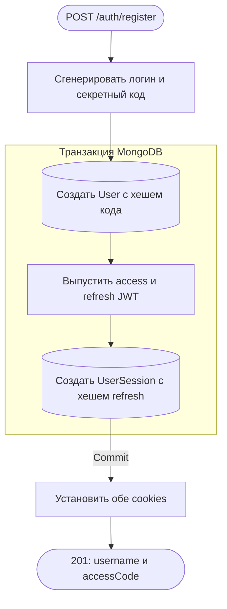

**Данные и проверки:** `UserRepository.createNew` генерирует логин/displayName и 24 случайных байта в виде 32-символьного base64url кода; хранит SHA-256 `accessCodeHash`. `AuthService.createSession` создаёт `UserSession` с userAgent, страной, сроком 120 дней и SHA-256 refresh-хешем. Другие сущности, включая UserSettings, этот поток не создаёт.

**Согласованность и ошибки:** `AuthService.register` повторяет всю регистрацию при конфликте уникального username, максимум 10 попыток; затем 503. Другие ошибки не преобразуются в этот 503. При ошибке внутри транзакции User и UserSession откатываются вместе. Ответ отправляется после commit и установки cookies; фона нет. Ошибка отправки ответа после commit не удаляет созданный аккаунт. Общие 403/429 описаны выше.

**Исходники:** [AuthController.register](../../../src/endpoints/auth/controllers/auth.controller.ts), [AuthService.register/createSession](../../../src/endpoints/auth/services/auth.service.ts), [ответ](../../../src/endpoints/auth/dto/response/register.response.ts), общие репозитории и транзакции выше.

## POST /auth/login

Вход по логину и паролю после настройки аккаунта, без текущей авторизации. Пример: `{"username":"quietfox042","password":"Example-pass-123"}` → `204` без тела и обе auth-cookies.

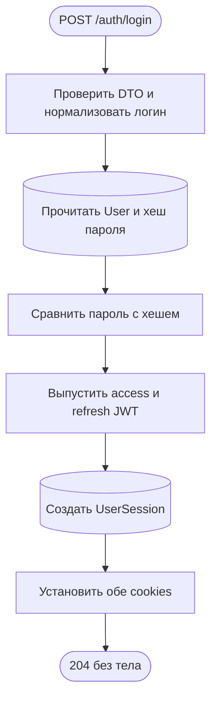

**Данные и проверки:** username обрезается по краям и приводится к нижнему регистру, соответствует `^[a-z0-9_]+$`; пароль — минимум 8 символов, максимум 72 UTF-8 байта, без нормализации. Читаются id, role и passwordHash User; bcrypt проверяет пароль. Создаётся одна UserSession; остальные сохраняются.

**Ошибки и ответ:** неизвестный логин, отсутствие пароля и неверный пароль дают одинаковый 401; DTO — 400, общие 403/429. Транзакции нет: HTTP ждёт сохранения сессии, затем устанавливает cookies. Фона нет; ошибка после сохранения сессии не откатывает её.

**Исходники:** [AuthController.login](../../../src/endpoints/auth/controllers/auth.controller.ts), [AuthService.login/createSession](../../../src/endpoints/auth/services/auth.service.ts), [LoginBodyDto](../../../src/endpoints/auth/dto/body/login.body.ts).

## POST /auth/login/code

Вход по секретному коду до установки пароля, без текущей авторизации. Пример: `{"accessCode":"AbCdEfGhIjKlMnOpQrStUvWxYz012345"}` → `204` без тела и обе auth-cookies.

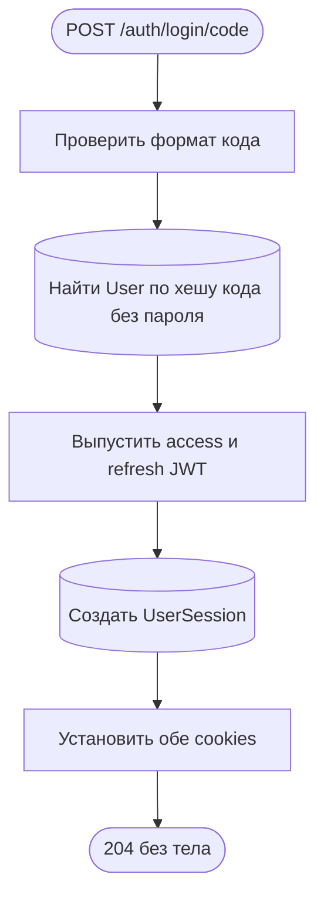

**Данные и проверки:** код — ровно 32 case-sensitive символа base64url; `UserRepository.findByAccessCode` ищет SHA-256 хеш вместе с `passwordHash:null` и выбирает только id/role. Логин не требуется. Новая UserSession создаётся с userAgent и локально определённой страной; остальные сессии сохраняются. Секретный код при входе не расходуется.

**Ошибки и ответ:** неверный код и аккаунт с паролем — одинаковый 401; формат/лишние поля — 400, общие 403/429. Транзакции и фона нет. HTTP ждёт сохранения сессии; ошибка после записи не удаляет её.

**Исходники:** [AuthController.loginByCode](../../../src/endpoints/auth/controllers/auth.controller.ts), [AuthService.loginByCode/createSession](../../../src/endpoints/auth/services/auth.service.ts), [LoginCodeBodyDto](../../../src/endpoints/auth/dto/body/loginCode.body.ts), [UserRepository.findByAccessCode](../../../src/entities/user/services/user.repository.ts).

## PATCH /auth/login/code

Перевыпускает секретный код до установки пароля. Требует access-cookie, действующую собственную сессию и текущий код. Пример: `{"accessCode":"AbCdEfGhIjKlMnOpQrStUvWxYz012345"}` → `200 {"accessCode":"ZyXwVuTsRqPoNmLkJiHgFeDcBa543210"}` и новые auth-cookies.

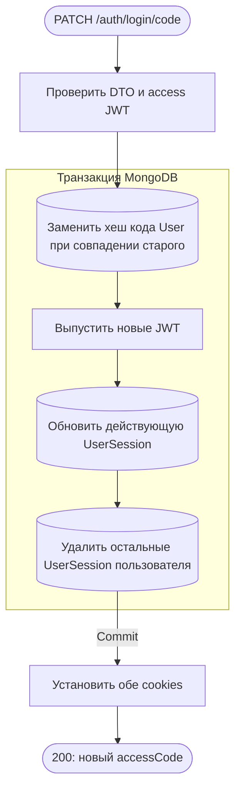

**Данные и проверки:** `UserRepository.reissueAccessCode` атомарно проверяет userId, SHA-256 старого кода и `passwordHash:null`, записывает хеш нового случайного кода. `updateRefreshToken` проверяет принадлежность и явный срок текущей сессии, меняет refresh-хеш, expiresAt на 120 дней и lastRefreshedAt. Её id/userAgent/country сохраняются; `deleteOthers` удаляет все остальные сессии, включая истёкшие.

**Ошибки и ответ:** неверный код, наличие пароля, отсутствующая/истёкшая сессия или JWT — 401; DTO — 400, общие 403/429. Проверка активной сессии здесь выполняется условной записью внутри транзакции, без отдельного предварительного чтения. Ошибка до commit откатывает все изменения; cookies меняются после commit. Параллельное использование старого кода не позволяет обоим запросам успешно заменить его. Фона нет.

**Исходники:** [AccountCredentialsController.reissueCode](../../../src/endpoints/account/controllers/accountCredentials.controller.ts), [AuthService.reissueCode](../../../src/endpoints/auth/services/auth.service.ts), [LoginCodeBodyDto](../../../src/endpoints/auth/dto/body/loginCode.body.ts), [ответ](../../../src/endpoints/auth/dto/response/loginCode.response.ts).

## POST /auth/logout

Завершает текущую сессию. Требует действующий access JWT и соответствующую активную UserSession. Пример: `POST /auth/logout` с access-cookie, без тела → `204`, обе cookies очищены.

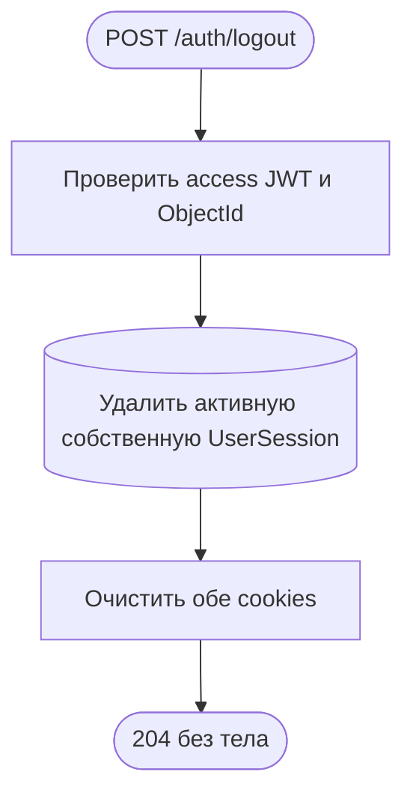

**Данные и проверки:** одна атомарная `deleteActive` фильтрует sessionId, userId и `expiresAt > now`. User отдельно не читается; остальные сессии сохраняются. Транзакции, событий и фона нет.

**Ошибки и ответ:** неверный/истёкший access JWT, отсутствующая/истёкшая сессия и повторный logout — 401, cookies при этом не очищаются. Истёкший access требует сначала refresh. Общие 403/429. HTTP ждёт удаления; если ответ теряется после записи, сессия уже удалена.

**Исходники:** [AuthController.logout](../../../src/endpoints/auth/controllers/auth.controller.ts), [AuthService.logout](../../../src/endpoints/auth/services/auth.service.ts), [UserSessionRepository.deleteActive](../../../src/entities/userSession/services/userSession.repository.ts).

## POST /auth/password/reset

Запрашивает код сброса на подтверждённый email, без авторизации. Пример: `{"email":"reader@example.com"}` → `204` без тела; ответ одинаков для существующего и неизвестного адреса, действующего cooldown и обработанной ошибки постановки письма.

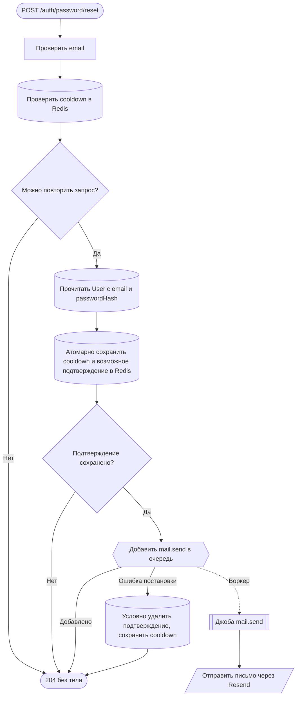

**Данные и проверки:** email обрезается и приводится к нижнему регистру, максимум 254 символа. Ключ Redis — `<appName>:auth:passwordReset:{<sha256(email)>}`, рядом `:cooldown`. Для User с email и passwordHash сохраняются userId, email, исходный passwordHash, bcrypt codeHash шестизначного кода и 3 попытки на 4 часа; cooldown — 60 секунд. Неизвестный/неподходящий аккаунт получает только cooldown. Lua повторно проверяет cooldown атомарно; новый принятый запрос заменяет прежний код.

**Ответ и сбои:** MongoDB не изменяется, транзакции нет. HTTP ожидает `MailService.send` → `JobService.add`, но не доставку. Ошибка enqueue логируется, условно удаляется только подтверждение с тем же codeHash; cooldown остаётся, а ответ всё равно 204. Ошибка cleanup тоже только логируется. Ошибки Redis вне mail catch не скрываются. DTO — 400, общие 403/429. Принятый queue job не доказывает получение письма. Фоновый обработчик описан ниже.

**Исходники:** [PasswordResetController.requestPasswordReset](../../../src/endpoints/auth/controllers/passwordReset.controller.ts), [PasswordResetService.requestReset](../../../src/endpoints/auth/services/passwordReset.service.ts), [PasswordResetBodyDto](../../../src/endpoints/auth/dto/body/passwordReset.body.ts), [Lua и сроки](../../../src/endpoints/auth/static/PASSWORD_RESET.ts), [IPasswordReset](../../../src/endpoints/auth/types/IPasswordReset.ts).

## PATCH /auth/password/reset

Устанавливает новый пароль по email и коду из письма, без access-сессии. Пример: `{"email":"reader@example.com","code":"012345","newPassword":"Example-new-123"}` → `204` без тела, обе cookies очищены.

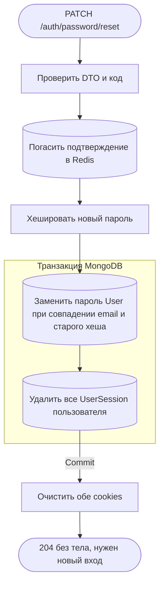

**Данные и проверки:** email нормализуется как при запросе; code — строка из 6 цифр, новый пароль — минимум 8 символов и максимум 72 UTF-8 байта. `ConfirmationService.consume` читает pending, проверяет поля/попытки/email/userId и bcrypt codeHash; Lua атомарно расходует именно текущее подтверждение или уменьшает попытки, не продлевая TTL. Третья ошибка удаляет подтверждение; параллельный запрос не может погасить заменённый код.

**Согласованность и ошибки:** после расходования кода `replacePassword` условно проверяет исходные userId/email/passwordHash. Затем в той же MongoDB-транзакции удаляются все сессии, включая истёкшие. Несовпадение состояния, неверный/истёкший/погашенный код — 400; общие 403/429. Ошибка БД откатывает пароль и удаление сессий вместе, но не восстанавливает Redis-код: требуется новый запрос сброса. Cookies очищаются только после commit, фона нет.

**Исходники:** [PasswordResetController.confirmPasswordReset](../../../src/endpoints/auth/controllers/passwordReset.controller.ts), [PasswordResetService.confirmReset/consumeReset](../../../src/endpoints/auth/services/passwordReset.service.ts), [DTO](../../../src/endpoints/auth/dto/body/confirmPasswordReset.body.ts), [ConfirmationService.consume](../../../src/endpoints/auth/services/confirmation.service.ts), [CONFIRMATION_SCRIPT](../../../src/endpoints/auth/static/CONFIRMATION_SCRIPT.ts), [UserRepository.replacePassword](../../../src/entities/user/services/user.repository.ts).

## GET /auth/session

Возвращает собственные действующие сессии. Требует access JWT, существующего User и текущую сессию среди активных. Пример: `GET /auth/session` с access-cookie → `200 [{"id":"507f1f77bcf86cd799439011","userAgent":null,"country":"unknown","createdAt":"2026-10-29T10:00:00.000Z","expiresAt":"2027-02-26T10:00:00.000Z","lastRefreshedAt":null,"isCurrent":true}]`.

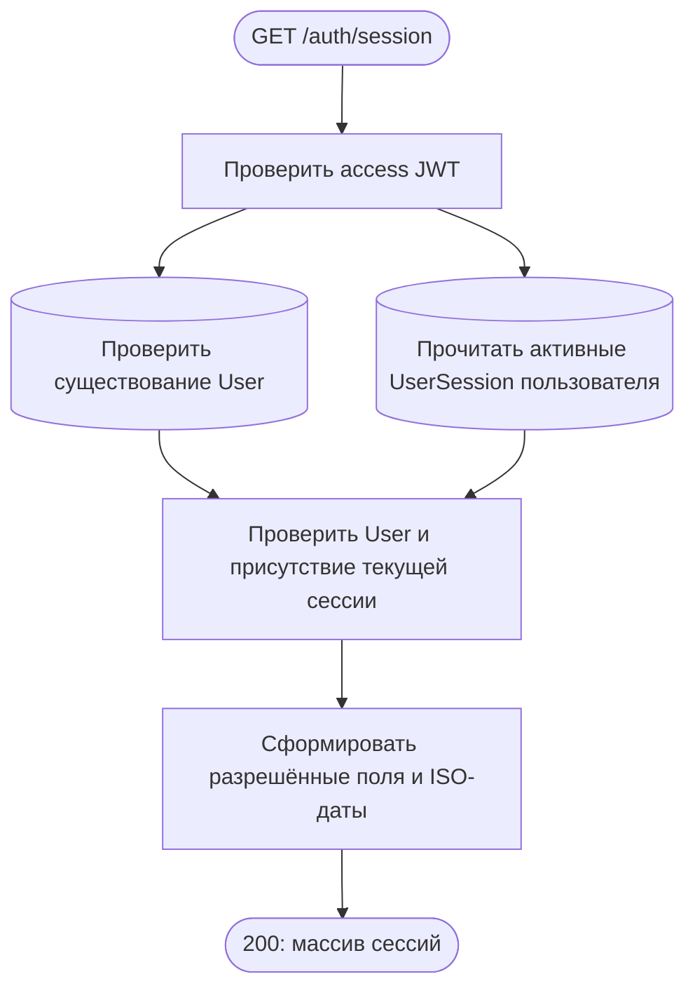

**Данные и проверки:** `findActiveByUser` выбирает только публичные поля с `expiresAt > now`, сортирует createdAt и id по убыванию. Ответ содержит также country и isCurrent, без токенов и хешей. Чтения User и UserSession идут параллельно, без транзакции/общего snapshot; записи, события и фон отсутствуют.

**Ошибки и ответ:** невалидный JWT, отсутствующий User или текущая сессия — 401; общий лимит — 429. HTTP ждёт обоих чтений и маппинга, cookies сохраняются.

**Исходники:** [SessionController.getSessions](../../../src/endpoints/auth/controllers/session.controller.ts), [SessionService.getSessions](../../../src/endpoints/auth/services/session.service.ts), [UserSessionRepository.findActiveByUser](../../../src/entities/userSession/services/userSession.repository.ts), [SessionResponseDto](../../../src/endpoints/auth/dto/response/session.response.ts).

## DELETE /auth/session/others

Завершает остальные сессии аккаунта. Требует access JWT, существующего User и активную собственную текущую сессию. Пример: `DELETE /auth/session/others` без тела с access-cookie → `204` без тела; текущие cookies сохранены.

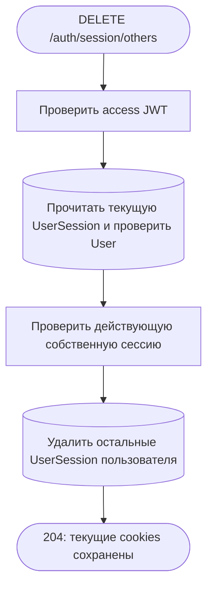

**Данные и проверки:** существование User и текущая UserSession проверяются параллельно; `deleteOthers` использует userId и `_id != currentSessionId`, удаляет в том числе истёкшие записи. Отсутствие других сессий — успешный результат. Статический маршрут `others` объявлен перед `:sessionId`.

**Ошибки и ответ:** нарушение авторизации — 401; общие 403/429. Отдельной транзакции между проверкой и deleteMany нет; уже выполняющиеся запросы не отменяются. HTTP ждёт удаления, cookies не меняет; событий и фона нет.

**Исходники:** [SessionController.deleteOtherSessions](../../../src/endpoints/auth/controllers/session.controller.ts), [SessionService.deleteOtherSessions](../../../src/endpoints/auth/services/session.service.ts), [UserSessionRepository.deleteOthers](../../../src/entities/userSession/services/userSession.repository.ts).

## DELETE /auth/session/:sessionId

Завершает выбранную собственную сессию. Требует access JWT, существующего User и активную текущую сессию. Пример: `DELETE /auth/session/507f1f77bcf86cd799439011` с access-cookie → `204` без тела; при удалении текущей сессии обе cookies очищены.

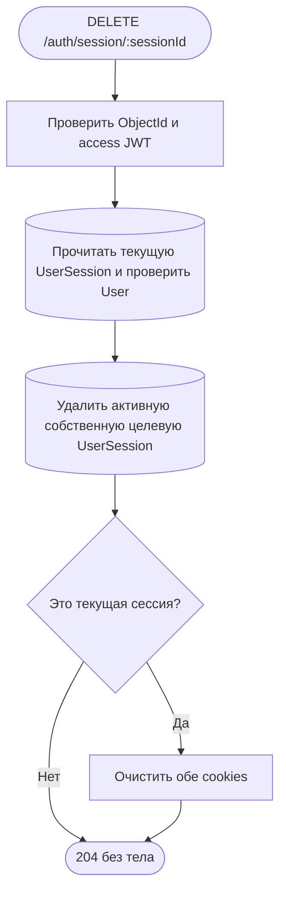

**Данные и проверки:** `MongoObjectIdHandler` проверяет 24 hex-символа параметра. После параллельной проверки User/текущей сессии `deleteActive` атомарно фильтрует целевой id, owner и срок. Сравнение target с JWT sessionId определяет очистку cookies.

**Ошибки и ответ:** неправильный id — 400; нет авторизации — 401; чужая, отсутствующая или истёкшая целевая сессия — одинаковый 404; общие 403/429. Транзакции между предварительной проверкой и удалением нет. HTTP ждёт удаления; фона нет, потеря ответа не восстанавливает запись.

**Исходники:** [SessionController.deleteSession](../../../src/endpoints/auth/controllers/session.controller.ts), [SessionService.deleteSession](../../../src/endpoints/auth/services/session.service.ts), [MongoObjectIdHandler](../../../src/infrastructure/database/handlers/mongoObjectId.handler.ts), [UserSessionRepository.deleteActive](../../../src/entities/userSession/services/userSession.repository.ts).

## PATCH /auth/session/refresh

Ротирует токены и продлевает текущую сессию. Требует refresh-cookie и соответствующий текущий серверный refresh-хеш; действующий access не нужен. Пример: `PATCH /auth/session/refresh` с refresh-cookie, без тела → `204` без тела и обе новые auth-cookies.

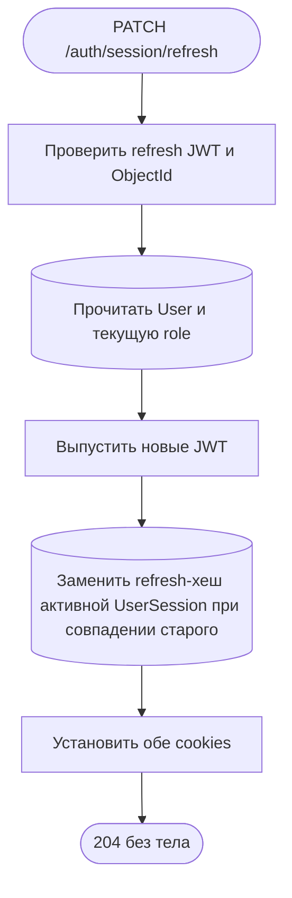

**Данные и проверки:** `updateRefreshToken` фильтрует id, userId, `expiresAt > now` и SHA-256 переданного refresh; записывает новый хеш, срок 120 дней и lastRefreshedAt. JWT refresh содержит случайный jti, поэтому новый токен отличается даже в ту же секунду. Устройство/страна/id сессии и остальные сессии сохраняются.

**Ошибки и ответ:** неверный JWT/ObjectId, отсутствующий User, истёкшая сессия, повторное/параллельное использование прежнего refresh — 401 без установки или очистки cookies; общие 403/429. Одна атомарная запись, без отдельной MongoDB-транзакции и фона. Cookies устанавливаются после успешной ротации; потеря ответа не откатывает новый хеш, старый refresh уже недействителен.

**Исходники:** [SessionController.refresh](../../../src/endpoints/auth/controllers/session.controller.ts), [SessionService.refresh](../../../src/endpoints/auth/services/session.service.ts), [UserSessionRepository.updateRefreshToken](../../../src/entities/userSession/services/userSession.repository.ts), JWT/cookies в общих исходниках.

## Общий фон: доставка письма

`POST /auth/password/reset`, `POST /account/credentials` и `POST /account/email` напрямую вызывают `MailService.send`, который проверяет адрес/тему/содержимое и **ожидает** `JobService.add(SEND_MAIL_JOB, payload)`. Результат `queued` и queue id не означают доставку. Каждая HTTP-схема показывает собственную ветку отказа постановки; фоновый сбой не меняет уже отправленный HTTP-ответ и автоматически не удаляет подтверждение.

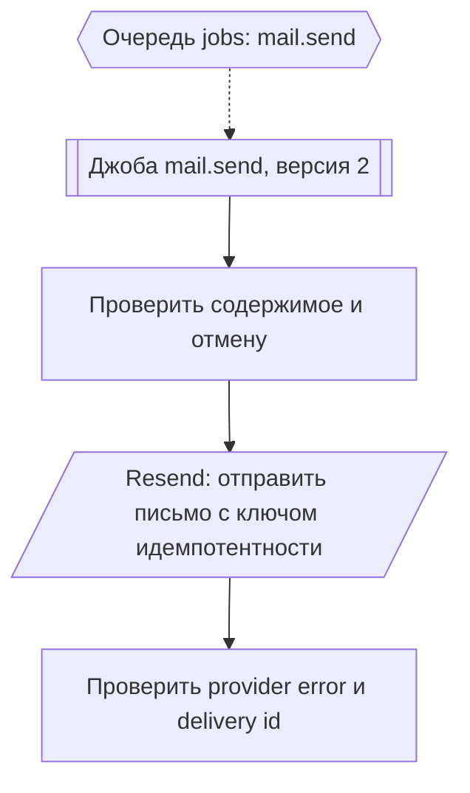

`SendMailJobHandler.handle` использует ключ идемпотентности `mail.send:<queueJobId>`; ошибки провайдера или отсутствие delivery id завершают попытку ошибкой. Определение джобы задаёт повторы через 1, 5 и 30 секунд, всего до 4 попыток; отмена и unrecoverable-ошибки обрабатываются процессором отдельно. Воркер может начать работу до или после HTTP-ответа; подтверждение фактического получения письма пользователем здесь не отслеживается. При успехе результат джобы — `{id: providerDeliveryId, status:"sent"}`. Событий и MongoDB-записей в обработчике нет.

**Исходники:** [MailService.send](../../../src/infrastructure/mail/services/mail.service.ts), [JobService.add](../../../src/infrastructure/jobs/services/job.service.ts), [SEND_MAIL_JOB](../../../src/infrastructure/mail/static/SEND_MAIL_JOB.ts), [SendMailJobHandler.handle](../../../src/infrastructure/mail/handlers/sendMailJob.handler.ts), [JobProcessorService](../../../src/infrastructure/jobs/services/jobProcessor.service.ts).
