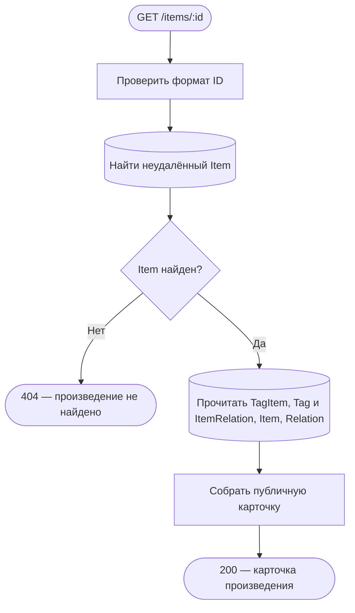
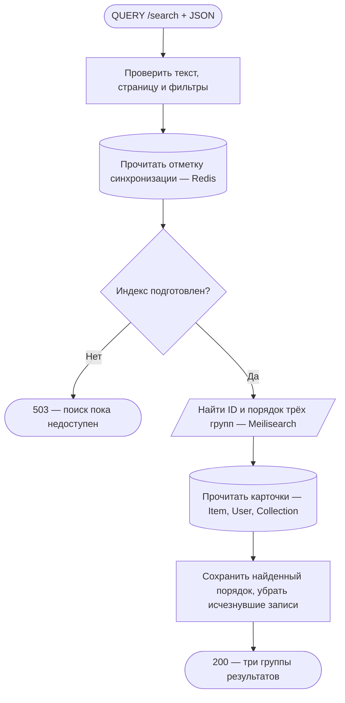
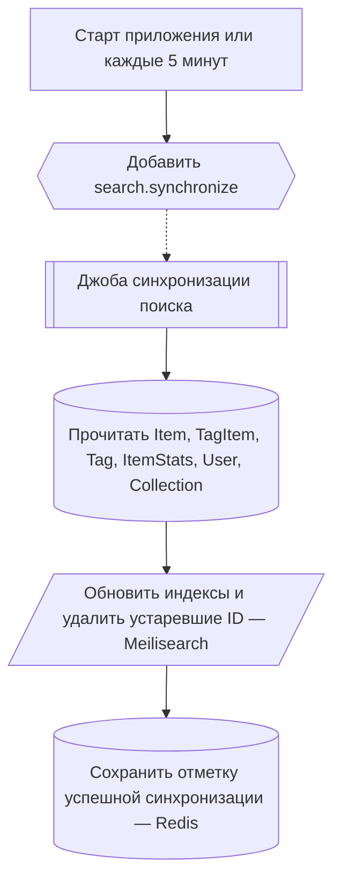

# Каталог и поиск

[← Все эндпоинты](../endpoints.md) · [Обозначения схем](readme.md)

Оба запроса публичные: access/refresh cookies не проверяются. Общие ограничения HTTP перечислены в [каталоге](../endpoints.md#common). Ни один запрос здесь не меняет MongoDB, не публикует события и не ставит задачи. Схемы сверены с production-кодом, а не с трассировкой запущенного API.

## GET /items/:id

Открыть карточку произведения с тегами и связями.

**Пример:** `GET /items/507f1f77bcf86cd799439011` без тела. **Ответ:** 200, объект с id/type, названиями, описанием, aliases, media, tags, relations, releaseDate, ageRestriction и nullable-блоками movie/series/game. Даты — ISO 8601, отсутствующие значения — null; личной библиотеки в ответе нет. `Cache-Control: no-store`.

**Проверки и данные:** параметр должен содержать 24 hex-символа. Item с `deletedAt != null` равнозначен отсутствующему. Одна read-only агрегация читает прямые TagItem/Tag и обе стороны ItemRelation, противоположный Item и его роль Relation. Отсутствующие теги/роли и отсутствующие или удалённые связанные Item отбрасываются. Теги сортируются по relevanceScore, затем id; связи — по id. Читаются только публичные поля, без UserItem, ItemStats, источников и подборок.

**Границы и ошибки:** 400 — невалидный ID; 404 — Item отсутствует или удалён; 429 — общий лимит. HTTP ждёт агрегацию и отображение полей. Транзакции, записей, внешних обращений и фоновых действий нет.

Технические подробности и исходники

Прямой путь: [ItemController.getById](../../../src/endpoints/item/controllers/item.controller.ts) → [ItemService.getById](../../../src/endpoints/item/services/item.service.ts) → [ItemRepository.findDetailsById](../../../src/entities/item/services/item.repository.ts) → MongoAggregationRepository. Формат ID проверяет [MongoObjectIdHandler](../../../src/infrastructure/database/handlers/mongoObjectId.handler.ts). [Контракт карточки](../pages/item.md), [response DTO](../../../src/endpoints/item/dto/response/item.response.ts).

## QUERY /search

Найти произведения, пользователей и подборки одним запросом.

**Пример:** `QUERY /search`, `Content-Type: application/json`, тело `{"search":"космос","page":1,"limit":10,"items":{"sort":"rating","direction":"desc"}}`. **Ответ:** 200, три группы `items`, `users`, `collections`; у каждой `hits` и `estimatedTotalHits`. Даже пустая группа присутствует. `Cache-Control: no-store`, `Accept-Query: application/json`.

**Проверки и данные:** тело должно быть JSON-объектом; неизвестные поля запрещены. Обрезанный по краям текст — 1–200 символов, page от 1, limit 1–50 (по умолчанию 1 и 10). Смещение должно быть меньше 10 000. Фильтры проверяют диапазоны оценок/чисел/дат и уникальность полей. Для Item доступны relevance/title/releaseDate/rating; `recommended` не поддерживается и даёт 400. Обычные фильтры и сортировка применяются в Meilisearch до пагинации. При relevance по возрастанию сервис перебирает все совпадения пакетами и выбирает глобальную страницу; это может быть дороже обычного поиска.

**Границы и ошибки:** отметка готовности читается из Redis, ID — из Meilisearch, карточки — из MongoDB. Общей транзакции или единого snapshot между ними нет. Удалённые/исчезнувшие записи убираются из hits, поэтому фактическая длина страницы может быть меньше limit, а счётчик остаётся оценкой поискового индекса. 400 — тело/поля/фильтры/глубина страницы; 503 — нет отметки или ошибка Redis/Meilisearch/чтения карточек; общие 403/429. HTTP ждёт все три группы и их карточки. Сам запрос не запускает и не ждёт синхронизацию.

Технические подробности и исходники

[SearchController.search](../../../src/endpoints/search/controllers/search.controller.ts) → [SearchBodyInterceptor](../../../src/endpoints/search/interceptors/searchBody.interceptor.ts) и [DTO](../../../src/endpoints/search/dto/body/search.body.ts) → [SiteSearchService.search/searchGroup](../../../src/endpoints/search/services/siteSearch.service.ts). Вызовы идут к CacheService.get, [SearchService.search/iterateMatches](../../../src/infrastructure/search/services/search.service.ts) и read.findMany репозиториев [Item](../../../src/entities/item/services/item.repository.ts), [User](../../../src/entities/user/services/user.repository.ts), [Collection](../../../src/entities/collection/services/collection.repository.ts). Индексы `site_items`, `site_users`, `site_collections`; checkpoint `siteSearch:checkpoint:v2`. [Подробный контракт](../pages/search.md#Реализованный-общий-поиск).

## Независимый фон: синхронизация поиска

Этот процесс обеспечивает данные для QUERY /search, но не является продолжением конкретного HTTP-запроса. При старте приложения и каждые пять минут планировщик ожидает добавления `search.synchronize` в очередь с дедупликацией. Ошибка постановки логируется; HTTP-ответа у планировщика нет.

Item индексируется полным проходом; User/Collection после первого полного прохода выбираются по updatedAt с перекрытием в минуту. Воркер создаёт/настраивает отсутствующие индексы и удаляет записи, которых больше нет в MongoDB. Начальная готовность появляется лишь после успешного обхода всех трёх источников. При последующих сбоях прежняя отметка может оставаться, а индекс — частично обновлённым; это не атомарная замена всех результатов. MongoDB не изменяется, событий нет.

**Исходники:** [SearchSyncSchedulerService.enqueue](../../../src/endpoints/search/services/searchSyncScheduler.service.ts), [SYNC_SEARCH_JOB](../../../src/endpoints/search/static/SYNC_SEARCH_JOB.ts), [SyncSearchJobHandler.handle/synchronize/createSources](../../../src/endpoints/search/handlers/syncSearchJob.handler.ts), [ItemRepository.readSearchIndexBatch](../../../src/entities/item/services/item.repository.ts).
