# Подборки

[← Все эндпоинты](../endpoints.md) · [Контракт подборок](../collectionsSpec.md) · [Обозначения](readme.md)

Публичные чтения не проверяют cookies и не возвращают UserItem. Создание, редактирование, удаление и личные реакции требуют access cookie: JWT → активная собственная UserSession + существующий User. Для изменения/удаления подборки проверяется также author. Все `:id` — ObjectId подборки. JSON — с `Content-Type: application/json`; неизвестные поля запрещены. Все ответы имеют `Cache-Control: no-store`. Общие ошибки: 400 — входные данные/ID, 401 — доступ защищённых операций, 403 — CSRF, 429 — throttling.

Ни один из этих одиннадцати HTTP-потоков не публикует событий, не ставит джоб и не обращается к внешним сервисам. Включение Item в подборку не меняет UserItem и вкус пользователя. Отдельный обработчик изменений TagItem поддерживает автоматические подборки, но эти маршруты его **не вызывают**. Обновление поиска происходит [независимым фоном](catalog.md#search-sync).

## QUERY /collections

Публично получить страницу кратких подборок. **Пример:** `QUERY /collections`, `{"page":1,"limit":20,"type":"custom"}`. **Ответ:** 200, пагинированные `items` с id/type/authorId/title/media и метаданные страницы; `Accept-Query: application/json`.

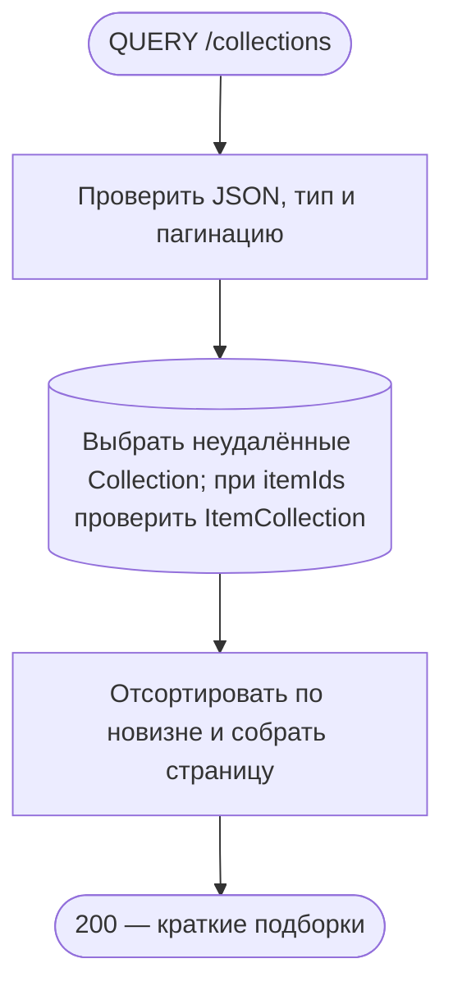

Тело обязательно должно быть объектом, `{}` допустим. page по умолчанию 1, limit 20, максимум 60; небезопасное целочисленное смещение — 400. itemIds — опционально 1–60 уникальных ObjectId: подходит подборка, содержащая **хотя бы один** из них. Item отдельно не читается и его удалённость в этом фильтре не проверяется. type=franchise дополнительно ограничивает author=null. Сортировка createdAt/id по убыванию, страница и total — одна агрегация с facet. Пустая выборка — 200. Нет транзакции и записей; HTTP ждёт агрегацию.

**Технические подробности:** [CollectionReadController.query](../../../src/endpoints/collection/controllers/collectionRead.controller.ts) → [CollectionQueryBodyInterceptor](../../../src/endpoints/collection/interceptors/collectionQueryBody.interceptor.ts) → [CollectionService.query](../../../src/endpoints/collection/services/collection.service.ts) → [CollectionRepository.querySummaries](../../../src/entities/collection/services/collection.repository.ts). [DTO](../../../src/endpoints/collection/dto/body/queryCollections.body.ts).

## GET /collections/:id

Открыть метаданные и блоки подборки. **Пример:** `GET /collections/507f1f77bcf86cd799439011`, без тела. **Ответ:** 200, id/version/authorId/type/title/description/media/blocks/createdAt/updatedAt. Item внутри групп загружаются отдельно.

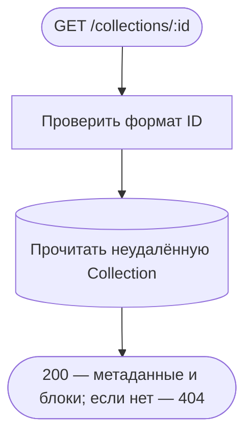

Одна выборка Collection без транзакции, Items/реакции/пользователь не читаются. Отсутствующая и soft-deleted подборка дают одинаковый 404. Даты — ISO, языковые значения и nullable поля отображаются явно. HTTP ждёт чтения и маппинга, записей нет.

**Технические подробности:** CollectionReadController.getById → CollectionService.getById/mapResponse → CollectionRepository.findNotDeletedById. [Контроллер](../../../src/endpoints/collection/controllers/collectionRead.controller.ts), [сервис](../../../src/endpoints/collection/services/collection.service.ts), [репозиторий](../../../src/entities/collection/services/collection.repository.ts), [response DTO](../../../src/endpoints/collection/dto/response/collection.response.ts).

## QUERY /collections/:id/items

Публично получить страницу произведений подборки. **Пример:** `QUERY /collections/507f1f77bcf86cd799439011/items`, `{"page":1,"limit":20,"mode":"flat","sort":"title","language":"ru"}`. **Ответ:** 200, карточки Item с данными включения, метаданные пагинации, mode и displayBlocks (пусты при flat).

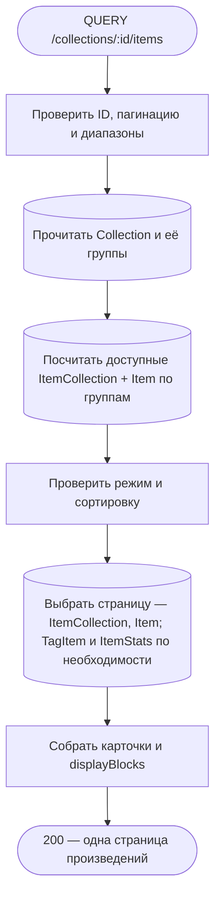

page от 1, limit до 60 (по умолчанию 20). Группа должна принадлежать подборке. grouped доступен при двух непустых группах или наличии текстового блока; иначе только flat. relevanceScore разрешён только type=tag; другие варианты — collection/title. Поддерживаются текстовый фильтр query, tags/excludeTags, диапазоны полей и общей оценки. ItemStats читается для фильтра оценки, TagItem — для фильтров тегов. Фильтры применяются до пагинации; она одна по всем Item, а не отдельная на каждую группу. Удалённые Item исключаются.

Нет Collection — 404; чужая группа, недоступный mode/sort, неправильные диапазоны, повторяющиеся/неизвестные поля и невалидные даты — 400. Контекст, счётчики групп и страница читаются отдельными агрегациями без общей транзакции/snapshot: при параллельном редактировании возможны расхождения. UserCollection/UserItem не читаются. HTTP ждёт все чтения и сборку, записей нет.

**Технические подробности:** CollectionReadController.getItems → [CollectionContentService.getItems/getContentContext/prepareFieldFilters](../../../src/endpoints/collection/services/collectionContent.service.ts) → [CollectionRepository.findNotDeletedById](../../../src/entities/collection/services/collection.repository.ts), [ItemCollectionRepository.countAvailableItemsByGroup/readContentPage](../../../src/entities/itemCollection/services/itemCollection.repository.ts) → [createItemCollectionsPipeline](../../../src/entities/itemCollection/functions/createItemCollectionsPipeline/core/createItemCollectionsPipeline.ts). [DTO](../../../src/endpoints/collection/dto/body/itemCollections.body.ts), [display blocks](../../../src/endpoints/collection/functions/createCollectionDisplayBlocks/index.ts).

## GET /collections/:id/filters

Получить доступные теги, диапазоны полей и режимы отображения для всей подборки. **Пример:** `GET /collections/507f1f77bcf86cd799439011/filters`, без тела и query-параметров. **Ответ:** 200, tags, fields и sorting.availableModes.

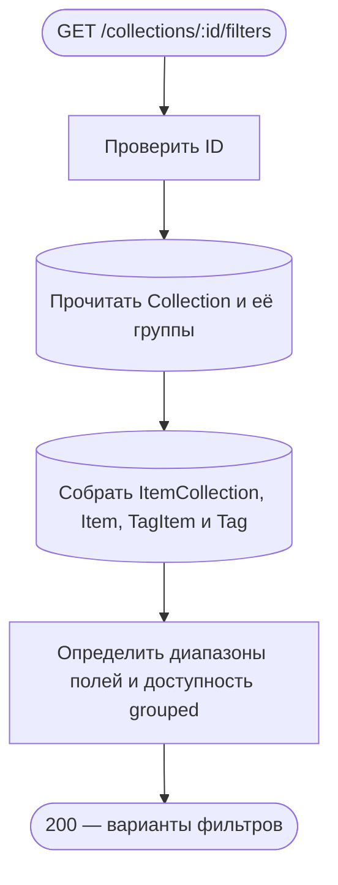

Только неудалённые Item в существующих группах Collection. Диапазоны берутся из характеристик Item, теги — из TagItem/Tag; режим grouped доступен по тем же условиям, что выше. Справочник не зависит от выбранных клиентом фильтров и не принимает groupId или другие query-поля (400). Нет подборки — 404; пустая подборка возвращает пустые варианты и flat. ItemStats/UserItem не читаются. Транзакции нет; HTTP ждёт контекст и агрегацию, записей нет.

**Технические подробности:** CollectionReadController.getFilters → CollectionContentService.getFilters/getContentContext → ItemCollectionRepository.getFilterOptions. [Контроллер](../../../src/endpoints/collection/controllers/collectionRead.controller.ts), [сервис](../../../src/endpoints/collection/services/collectionContent.service.ts), [репозиторий](../../../src/entities/itemCollection/services/itemCollection.repository.ts), [query DTO](../../../src/endpoints/collection/dto/query/collectionFilters.query.ts).

## POST /collections

Создать подборку от текущего пользователя. **Пример:** `POST /collections`, `{"title":{"ru":"Вечернее кино"},"type":"custom"}`, access cookie. **Ответ:** 201, метаданные и blocks новой Collection с version.

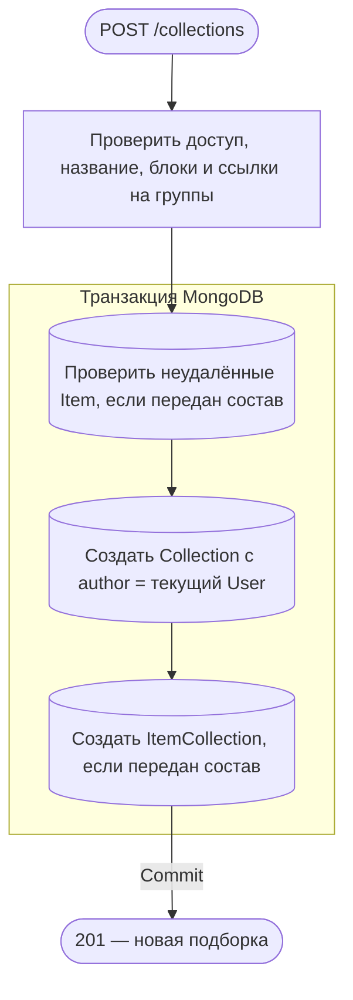

Название должно быть заполнено хотя бы на одном языке. Проверяются уникальные ID блоков/Item, корректность group/text и принадлежность каждого item.groupId итоговой группе. Нет добавляемого Item или он удалён — 404; структура/дубли/пустое название — 400. Collection и весь состав создаются/откатываются вместе; при пустом составе Item/ItemCollection не затрагиваются. После commit выполняется только отображение ответа, enqueue/events нет. Потерянный ответ не откатывает создание.

**Технические подробности:** [CollectionController.create](../../../src/endpoints/collection/controllers/collection.controller.ts) → [CollectionService.create/prepareBlock](../../../src/endpoints/collection/services/collection.service.ts) → CollectionAuthService.authenticate → MongoTransactionService.run → ItemRepository.findNotDeletedByIds, CollectionRepository.write.create, ItemCollectionRepository.createForCollection. [DTO](../../../src/endpoints/collection/dto/body/createCollection.body.ts).

## PATCH /collections/:id

Изменить собственную подборку и её состав с проверкой версии. **Пример:** `PATCH /collections/507f1f77bcf86cd799439011`, `{"version":0,"title":{"ru":"Кино на выходные"}}`, access cookie. **Ответ:** 200, обновлённые метаданные/blocks и version+1.

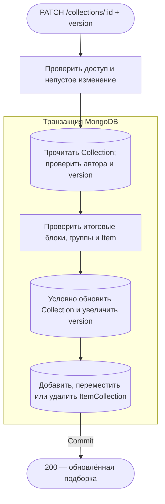

Чужая, автоматическая (author=null), отсутствующая или удалённая Collection — одинаковый 404. Устаревшая версия или предел Number.MAX_SAFE_INTEGER — 409. Проверяются итоговый порядок блоков, уникальность, отсутствие конфликтующих добавлений/удалений, доступные группы, наличие удаляемых memberships и неудалённые добавляемые Item. Невалидная структура/пустое изменение — 400; нет Item — 404. Удаление группы удаляет связанные ItemCollection, кроме перенесённых в сохранённые группы. Все чтения/записи состава и условная запись версии используют одну session; сбой откатывает их вместе. HTTP ждёт commit, очередей и postcommit-вызовов нет.

**Технические подробности:** CollectionController.update → CollectionService.update/prepareUpdatedBlocks → [CollectionRepository.updateVersioned](../../../src/entities/collection/services/collection.repository.ts), [ItemCollectionRepository.findByCollectionAndItems/upsertForCollection/removeForCollection](../../../src/entities/itemCollection/services/itemCollection.repository.ts), ItemRepository.findNotDeletedByIds. [Сервис](../../../src/endpoints/collection/services/collection.service.ts), [DTO](../../../src/endpoints/collection/dto/body/updateCollection.body.ts).

## DELETE /collections/:id

Скрыть собственную подборку через soft delete. **Пример:** `DELETE /collections/507f1f77bcf86cd799439011`, без тела, access cookie. **Ответ:** 204 без тела.

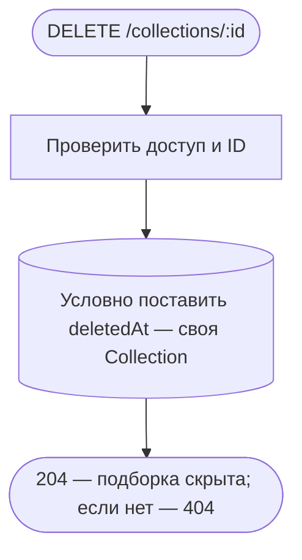

Один atomic update без отдельной MongoDB-транзакции, без version в запросе. Чужая, автоматическая, уже удалённая или отсутствующая подборка — 404. ItemCollection/UserCollection физически остаются; каскадной очистки нет, публичные чтения проверяют deletedAt. HTTP ждёт update, ошибка доставки ответа не отменяет soft delete. Фоновые удаления не запускаются.

**Технические подробности:** CollectionController.remove → CollectionService.remove → CollectionRepository.softDeleteByAuthor (id+author+deletedAt=null). [Контроллер](../../../src/endpoints/collection/controllers/collection.controller.ts), [сервис](../../../src/endpoints/collection/services/collection.service.ts), [репозиторий](../../../src/entities/collection/services/collection.repository.ts).

## GET /collections/:id/user

Прочитать свою реакцию на подборку. **Пример:** `GET /collections/507f1f77bcf86cd799439011/user`, без тела, access cookie. **Ответ:** 200, `{"isFavorite":false,"rating":null,"isHidden":false}` либо сохранённые значения.

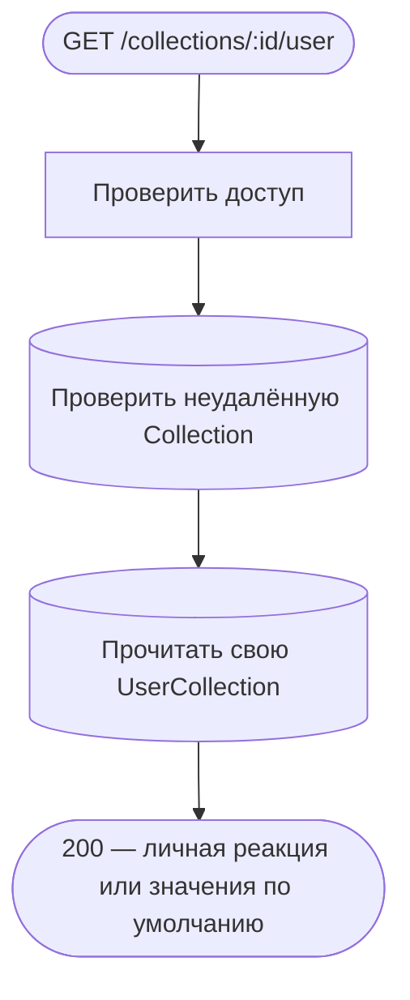

Нет Collection — 404; нет UserCollection — успешный ответ с false/null/false, без создания записи. Проверка Collection и чтение реакции раздельные, общей транзакции/snapshot нет. HTTP ждёт оба чтения; записи и фон отсутствуют.

**Технические подробности:** [CollectionUserController.getUser](../../../src/endpoints/collection/controllers/collectionUser.controller.ts) → [CollectionUserService.getUser/mapResponse](../../../src/endpoints/collection/services/collectionUser.service.ts) → CollectionRepository.checkIsNotDeleted, [UserCollectionRepository.findByUserAndCollection](../../../src/entities/userCollection/services/userCollection.repository.ts).

## PATCH /collections/:id/favorite

Добавить/убрать подборку из избранного. **Пример:** `PATCH /collections/507f1f77bcf86cd799439011/favorite`, `{"isFavorite":true}`, access cookie. **Ответ:** 200, полная личная реакция isFavorite/rating/isHidden.

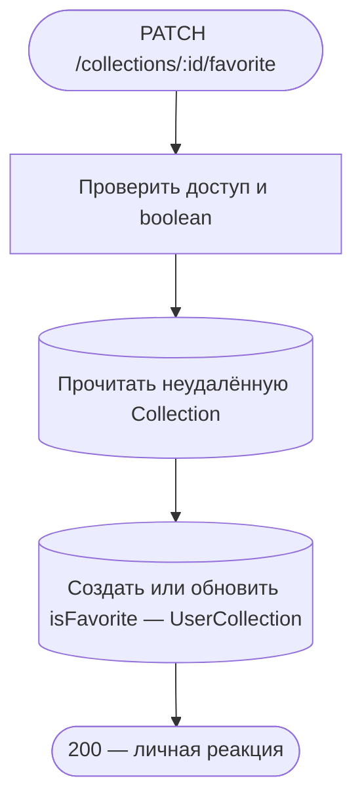

Нет Collection — 404. Допустимо и для своей подборки. Остальные поля существующей реакции сохраняются, при первом upsert получают defaults. Запись атомарна по user+collectionId, но предварительная проверка Collection не включена в транзакцию: одновременное удаление подборки не откатывает реакцию. HTTP ждёт upsert и маппинг; ни статистика Item/Site, ни очереди не вызываются. Ошибка ответа после записи её не отменяет.

**Технические подробности:** CollectionUserController.updateFavorite → CollectionUserService.updateReaction → CollectionRepository.findNotDeletedAuthorById → UserCollectionRepository.upsertReaction. При гонке создания уникальный конфликт повторяется обычным update. [Сервис](../../../src/endpoints/collection/services/collectionUser.service.ts), [репозиторий](../../../src/entities/userCollection/services/userCollection.repository.ts), [DTO](../../../src/endpoints/collection/dto/body/favorite.body.ts).

## PATCH /collections/:id/rating

Оценить чужую подборку или очистить свою оценку. **Пример:** `PATCH /collections/507f1f77bcf86cd799439011/rating`, `{"rating":8}`, access cookie. **Ответ:** 200, личная реакция isFavorite/rating/isHidden.

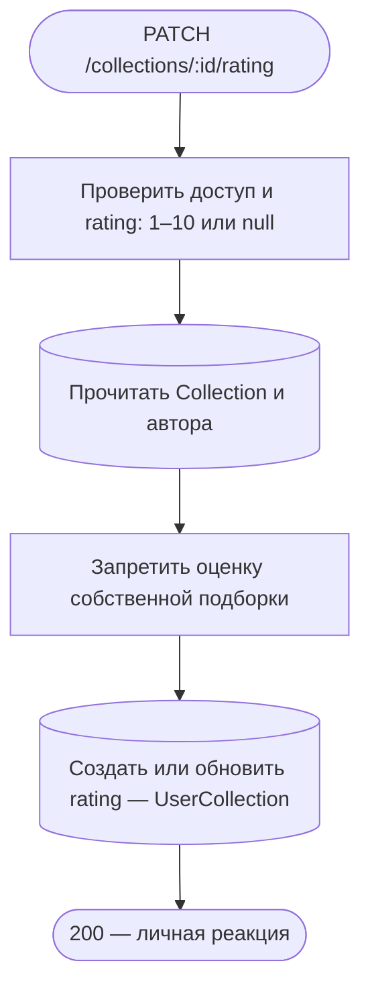

Ненулевая оценка своей подборки — 409; `rating:null` допускается и очищает оценку. Отсутствующая/удалённая Collection — 404, неверный диапазон/нецелое/отсутствующее rating — 400. Остальные реакции сохраняются. Предварительное чтение и atomic upsert без общей транзакции, с теми же границами гонки, что у favorite. ItemStats/SiteStats не затрагиваются — это оценка Collection, а не Item. HTTP ждёт upsert, фона нет.

**Технические подробности:** CollectionUserController.updateRating → CollectionUserService.updateReaction → CollectionRepository.findNotDeletedAuthorById, UserCollectionRepository.upsertReaction. [Контроллер](../../../src/endpoints/collection/controllers/collectionUser.controller.ts), [сервис](../../../src/endpoints/collection/services/collectionUser.service.ts), [DTO](../../../src/endpoints/collection/dto/body/rating.body.ts).

## PATCH /collections/:id/hidden

Сохранить личный флаг скрытия подборки. **Пример:** `PATCH /collections/507f1f77bcf86cd799439011/hidden`, `{"isHidden":true}`, access cookie. **Ответ:** 200, личная реакция isFavorite/rating/isHidden.

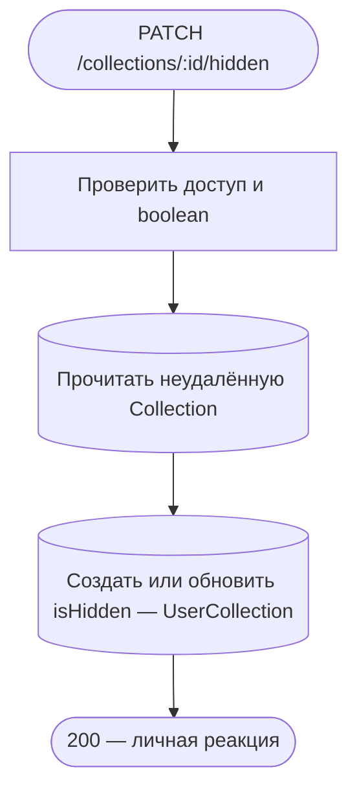

Флаг не удаляет Collection и не делает её приватной, не меняет состав и реакции других пользователей. Публичные QUERY /collections и QUERY /search не используют этот личный флаг. Нет Collection — 404. Atomic upsert без общей транзакции с предварительной проверкой; другие поля реакции сохраняются. HTTP ждёт запись, фон/внешние обращения отсутствуют.

**Технические подробности:** CollectionUserController.updateHidden → CollectionUserService.updateReaction → CollectionRepository.findNotDeletedAuthorById, UserCollectionRepository.upsertReaction. [Контроллер](../../../src/endpoints/collection/controllers/collectionUser.controller.ts), [сервис](../../../src/endpoints/collection/services/collectionUser.service.ts), [DTO](../../../src/endpoints/collection/dto/body/hidden.body.ts), [проверка доступа](../../../src/endpoints/collection/services/collectionAuth.service.ts).
