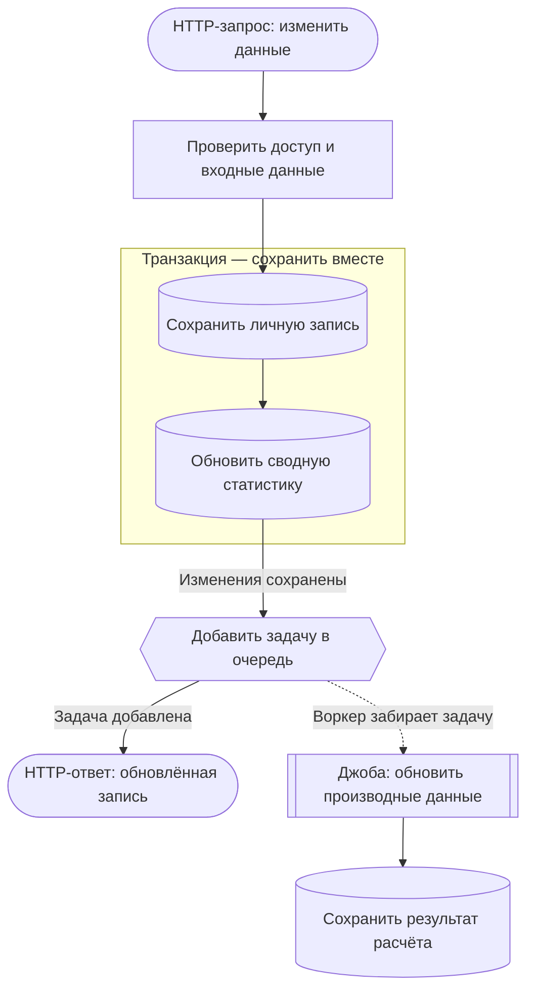
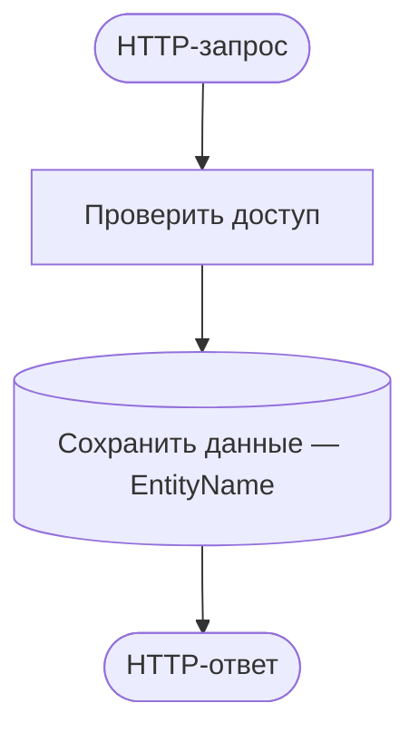

# Как проходят запросы

[Каталог «Эндпоинты API»](../endpoints.md) ведёт к схемам всех 40 подключённых продуктовых операций и четырёх служебных маршрутов: что проверяется, какие данные читаются и изменяются, что выполняется до ответа и что уходит в фон.

Сценарии: [вход и сессии](auth.md), [аккаунт](account.md), [каталог и поиск](catalog.md), [библиотека](userItems.md), [подборки](collections.md), [служебные маршруты](service.md). Эта страница — руководство по обозначениям и поддержке схем. Учебный пример ниже не описывает существующий маршрут API.

## Учебный пример



Под схемой показана короткая легенда только тех типов блоков, которые в ней используются. Полные обозначения — ниже. Если схема шире экрана, её область можно прокрутить горизонтально, в том числе с клавиатуры после фокусировки. Исходник доступен в раскрываемом блоке; при ошибке отображения он раскрывается автоматически.

## Как читать схему

Читай сверху вниз. В блоке сначала указано понятное действие, затем — название сущности или задачи, если оно помогает найти код. Цвет дополняет форму и подпись.

| Блок                                                                  | Форма                 | Значение                                                 | Класс в исходнике |
| --------------------------------------------------------------------- | --------------------- | -------------------------------------------------------- | ----------------- |
| <span class="diagram-key diagram-key--http">HTTP</span>               | Скруглённый блок      | Запрос пользователя или ответ API                        | `http`            |
| <span class="diagram-key diagram-key--action">Действие</span>         | Прямоугольник         | Проверка, расчёт или прямой вызов сервиса                | `action`          |
| <span class="diagram-key diagram-key--data">Данные</span>             | Цилиндр               | Чтение или изменение данных; подпись уточняет операцию   | `data`            |
| <span class="diagram-key diagram-key--queue">Очередь</span>           | Шестиугольник         | Поставить задачу в очередь                               | `queue`           |
| <span class="diagram-key diagram-key--job">Джоба</span>               | Двойной прямоугольник | Выполнить задачу фоновым обработчиком                    | `job`             |
| <span class="diagram-key diagram-key--event">Ивент</span>             | Флажок                | Опубликовать событие, на которое подписаны обработчики   | `event`           |
| <span class="diagram-key diagram-key--external">Внешний сервис</span> | Параллелограмм        | Обращение к почте, поиску, хранилищу или другому сервису | `external`        |

- **Сплошная стрелка `-->`** — прямой вызов: текущий код ждёт завершения шага.
- **Пунктирная стрелка `-.->`** — передача работы в фон: результат этой ветки не требуется для HTTP-ответа.
- **Рамка «Транзакция»** — изменения сохраняются вместе или откатываются вместе.
- **Ромб** — условие с подписанными выходами, например «Найдена?» → «Да» / «Нет».

Цвет не определяет ожидание: внешний вызов может быть прямым, а ивент может вызывать обработчики синхронно. Стрелки и подписи должны отражать проверенное поведение. Добавление задачи в очередь тоже может ожидаться; выполнение самой джобы идёт отдельно и может начаться до или после HTTP-ответа.

## Как добавлять схемы эндпоинтов

Схемы хранятся в Markdown в этой папке и доступны в `knowledge`. Имя файла — по области API в camelCase, например `userItems.md` или `collections.md`. Несколько простых маршрутов одной области могут находиться в одном файле с отдельным заголовком для каждого метода и пути. Новую страницу добавляй в [боковое меню](../../../knowledge/sidebar.md) рядом с этим разделом: меню также задаёт страницы для поиска Docsify.

Для каждого эндпоинта укажи:

1. **Метод и путь**, назначение и небольшой пример входных данных без секретов.
2. **Схему основного сценария**: проверки, чтение/запись с названиями сущностей, границы транзакции, очередь, реальные ивенты, джобы, внешние вызовы и HTTP-ответ.
3. **Короткие примечания**: условия запуска фоновых действий, основные ошибки и существенные границы согласованности. Если очередь может отказать после сохранения данных, явно укажи это.
4. **Источники**: ссылки на контракт, контроллер, сервис и используемые обработчики. Имена методов и технические подробности оставляй здесь, чтобы схема оставалась понятной.

Одна схема описывает один сценарий. Ветвления добавляй, только если они меняют результат, затронутые данные или запуск фоновой работы. Большие процессы разбивай на основную схему и отдельную схему фонового обработчика. Общие middleware перечисляй кратко; показывай их блоками, когда они важны для сценария.

Проверяй схему по подключённому контроллеру, вызовам сервисов и репозиториев, транзакциям, публикации событий и обработчикам задач. Импорт модуля не доказывает вызов, а наличие джобы не доказывает, что эндпоинт её запускает. Не добавляй ивент между сервисом и очередью, если код ставит задачу напрямую. Если операция не реализована, не выдавай её схему за текущее поведение.

### Минимальный шаблон

Скопируй содержимое блока в новую страницу и замени учебные подписи проверенными действиями. Классы `http`, `action`, `data`, `queue`, `job`, `event`, `external` получают цвета автоматически в `knowledge`; повторять `classDef` в документах не нужно. За пределами `knowledge` цветовая палитра может отличаться, но формы и подписи сохраняют смысл.

````markdown
# Изменение данных

## PATCH /example/:id

Учебный маршрут. Замени метод, путь и описание фактическим контрактом.



**Читает:** ...

**Изменяет:** ...

**Фоновые действия:** ...

**Основные ошибки и ограничения:** ...

**Источники:** контракт, контроллер, сервис, обработчики
````

Дополнительные формы для исходника: `Q{{"Добавить задачу"}}:::queue`, `J[["Выполнить джобу"]]:::job`, `E>"Опубликовать событие"]:::event`, `S[/"Обратиться к сервису"/]:::external`, `D{"Условие?"}:::action`. Строки с `accTitle` и `accDescr` задают доступные название и описание диаграммы. Начинай блок с `flowchart TD`; используй обычные текстовые подписи без HTML и локальных настроек Mermaid.

## Когда обновлять

Обновляй соответствующую схему **вместе с кодом**, если меняются доступ, проверки, вызываемые сервисы, чтение/запись сущностей, транзакции, события, очереди, джобы, внешние обращения или момент отправки ответа. Изменение фонового обработчика требует проверить все схемы, которые на него ссылаются. При добавлении, переименовании или удалении маршрута обновляй [каталог](../endpoints.md), заголовки, ссылки и меню. Внутренний рефакторинг без изменения показанного поведения не требует перерисовки.

Перед завершением изменения сверь схему с кодом, открой её в `knowledge`, проверь повторный переход на страницу, читаемость и фоновые ветки. Если показ в браузере не проверен, укажи это отдельно. Эти схемы описывают реализацию; они не являются трассировкой конкретного запроса и не подтверждают доступность сервисов или производительность.

## Почему такой формат

Используем простые схемы действий в Mermaid внутри Markdown: текст схемы хранится рядом с описанием и меняется в том же diff, а изображение строится локально в браузере. [Mermaid](https://mermaid.js.org/config/usage.html) предоставляет такой рендеринг, а [хуки Docsify](https://docsify.js.org/#/write-a-plugin) позволяют запускать его после перехода между страницами.

[Динамические диаграммы C4](https://c4model.com/diagrams/dynamic) также описывают взаимодействие частей системы в рамках сценария; для этого справочника используем более простые подписи действий. Диаграммы последовательностей оставляем для случаев, где без точного порядка обмена трудно понять поведение. [PlantUML](https://plantuml.com/starting) поддерживает более формальные UML-схемы, но для текущего формата отдельный путь генерации изображений не нужен. [Compodoc](https://compodoc.app/) полезен для документации структуры Nest-приложения; такой граф сам по себе не объясняет бизнес-сценарий, условия вызовов и границы транзакций.
