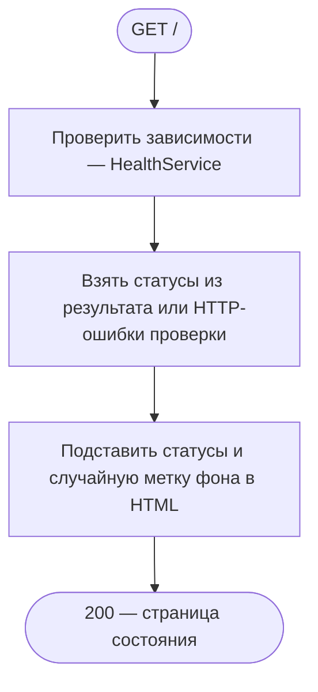
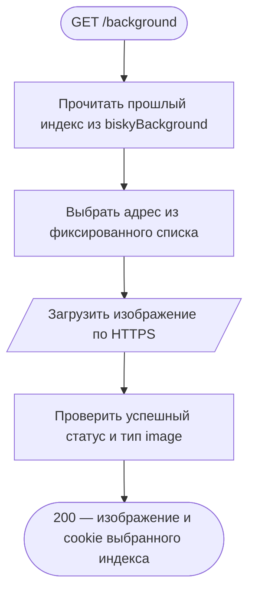
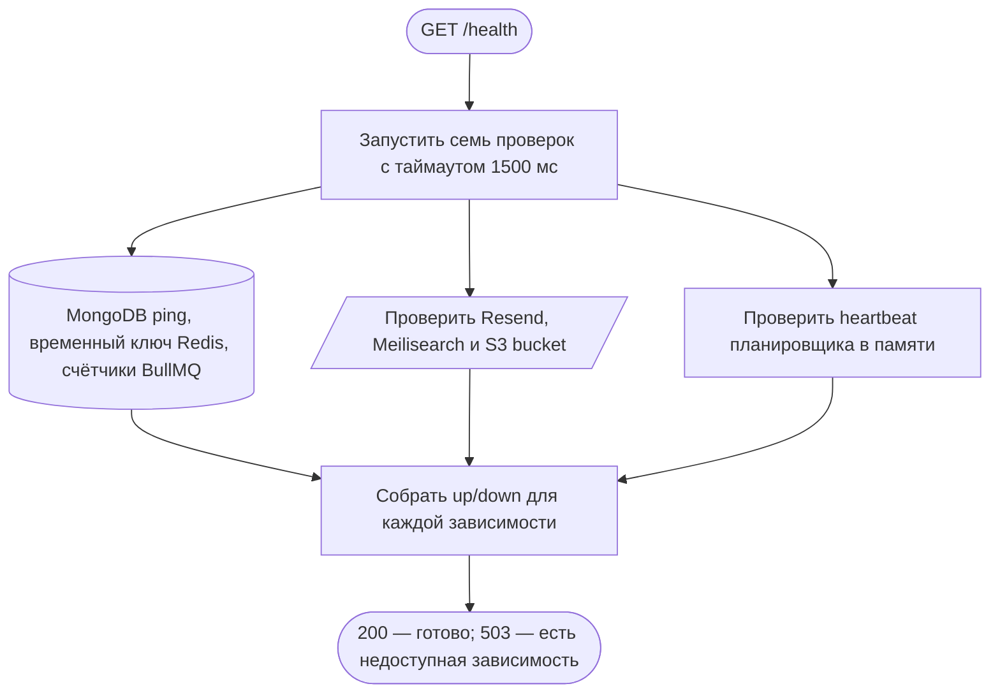
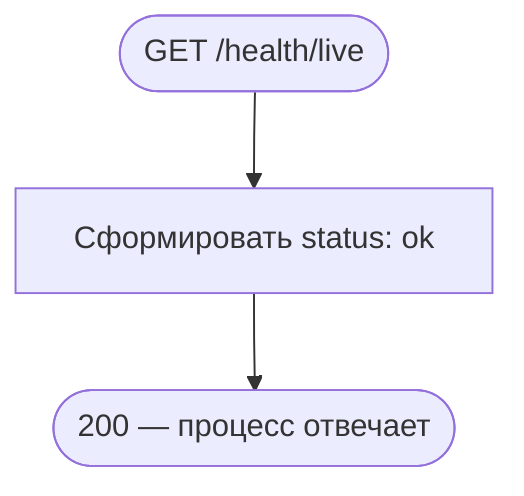

# Служебные маршруты

[← Все эндпоинты](../endpoints.md) · [Обозначения схем](readme.md)

Эти четыре маршрута подключены отдельно от продуктовых операций. Все публичные, без проверки Bisky cookies. Общий throttling может вернуть 429. Статические файлы `/knowledge/` и Swagger `/docs` описаны как интерфейсы документации, а не как продуктовые сценарии.

## GET /

Показать HTML-страницу состояния приложения. **Пример:** `GET /` без тела. **Ответ:** 200, `text/html; charset=utf-8`, `Cache-Control: no-store`.

**Данные и границы:** выполняется та же [проверка зависимостей](service.md#health), что у GET /health, включая временную запись Redis. HTTP-ошибка готовности перехватывается и становится статусами внутри HTML; неожиданная ошибка продолжает распространяться. MongoDB-транзакции, событий и очередей нет. В HTML есть загрузка `/background`: это отдельный последующий запрос браузера, его завершения GET / не ждёт.

**Технические подробности:** [AppController.getHomePage](../../../src/app/controllers/app.controller.ts) → HealthService.checkHealth → шаблоны [HOME_PAGE_HTML](../../../src/app/static/HOME_PAGE_HTML.ts) и [SERVICE_HEALTH_HTML](../../../src/app/static/SERVICE_HEALTH_HTML.ts). Маршрут исключён из Swagger.

## GET /background

Получить случайную картинку для служебной страницы. **Пример:** `GET /background` без тела. **Ответ:** 200, байты изображения с upstream Content-Type и `Cache-Control: no-store`; cookie `biskyBackground` запоминает выбранный индекс.

**Проверки и границы:** URL не берётся из пользовательского ввода. Если cookie указывает на существующий фон, он исключается из следующего выбора. Запрос ждёт fetch и чтение всего arrayBuffer; фона в смысле очередей здесь нет. User/UserSession, MongoDB и Redis не читаются и не меняются. Транзакций и событий нет. Cookie — HttpOnly, SameSite=Lax, session, Path=/background. Ошибочный upstream статус или Content-Type даёт 502; сетевые ошибки fetch отдельно не преобразуются этим контроллером. Ошибка чтения тела также может произойти до отправки ответа.

**Исходники:** [AppController.getBackground](../../../src/app/controllers/app.controller.ts), [getRandomBackground](../../../src/app/functions/getRandomBackground/index.ts), [фиксированный список BACKGROUNDS](../../../src/app/static/BACKGROUNDS.ts). Маршрут исключён из Swagger.

## GET /health

Проверить готовность зависимостей. **Пример:** `GET /health` без тела. **Ответ:** 200 при успехе, объект `status`, `error`, `details` без дублирующего `info`; отказ проверки даёт 503 через обработчик ошибок.

**Фактические обращения:** MongoDB admin ping; Redis set/get/delete уникального временного ключа с TTL 10 секунд; BullMQ getJobCounts; Resend domains.list (письма не отправляются); Meilisearch health; S3 HeadBucket (bucket не создаётся); проверка времени последнего heartbeat SchedulerHealthService в памяти процесса. Планировщик пишет heartbeat каждые 10 минут независимо от HTTP.

**Границы и ошибки:** каждая проверка ограничена ожиданием 1500 мс. Исключение или таймаут становятся down; Promise.race не отменяет сам внешний запрос — тот может завершиться уже после HTTP-ответа. Продуктовые записи MongoDB не меняются. Redis-проба пытается удалить свой ключ и при ошибке; TTL ограничивает срок его жизни. Ни MongoDB-транзакции, ни постановки джоб, ни событий нет. Проверка доступности не доказывает работоспособность каждого продуктового сценария.

Технические подробности и исходники

[HealthController.getHealth](../../../src/infrastructure/health/controllers/health.controller.ts) → [HealthService.checkHealth/createIndicator/runWithTimeout](../../../src/infrastructure/health/services/health.service.ts) → [MongoHealthService](../../../src/infrastructure/database/services/mongoHealth.service.ts), [CacheHealthService](../../../src/infrastructure/cache/services/cacheHealth.service.ts), [JobsHealthService](../../../src/infrastructure/jobs/services/jobsHealth.service.ts), [MailHealthService](../../../src/infrastructure/mail/services/mailHealth.service.ts), [SearchHealthService](../../../src/infrastructure/search/services/searchHealth.service.ts), [StorageHealthService](../../../src/infrastructure/storage/services/storageHealth.service.ts), [SchedulerHealthService](../../../src/infrastructure/scheduler/services/schedulerHealth.service.ts).

## GET /health/live

Убедиться, что процесс отвечает по HTTP. **Пример:** `GET /health/live` без тела. **Ответ:** 200, `{"status":"ok"}`.

**Границы:** нет чтения/записи данных, транзакций, внешних вызовов, событий и джоб. Ответ не зависит от HealthService и состояния MongoDB/Redis/поиска/почты/S3, но проходит обычный HTTP-стек и общий throttling. Отдельных бизнес-ошибок нет.

**Исходник:** [HealthController.getLiveness](../../../src/infrastructure/health/controllers/health.controller.ts); подключение — [HealthModule](../../../src/infrastructure/health/health.module.ts) в [AppModule](../../../src/app/app.module.ts).
