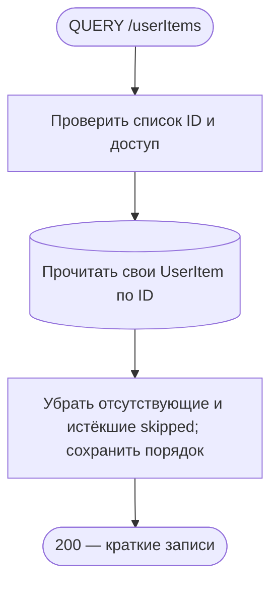
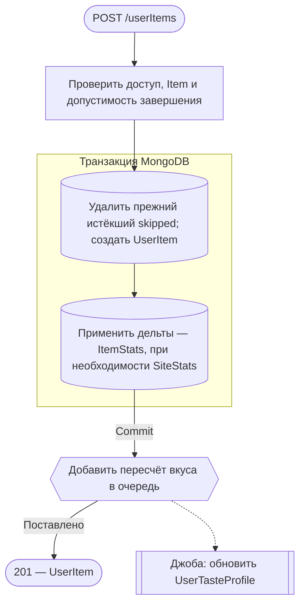
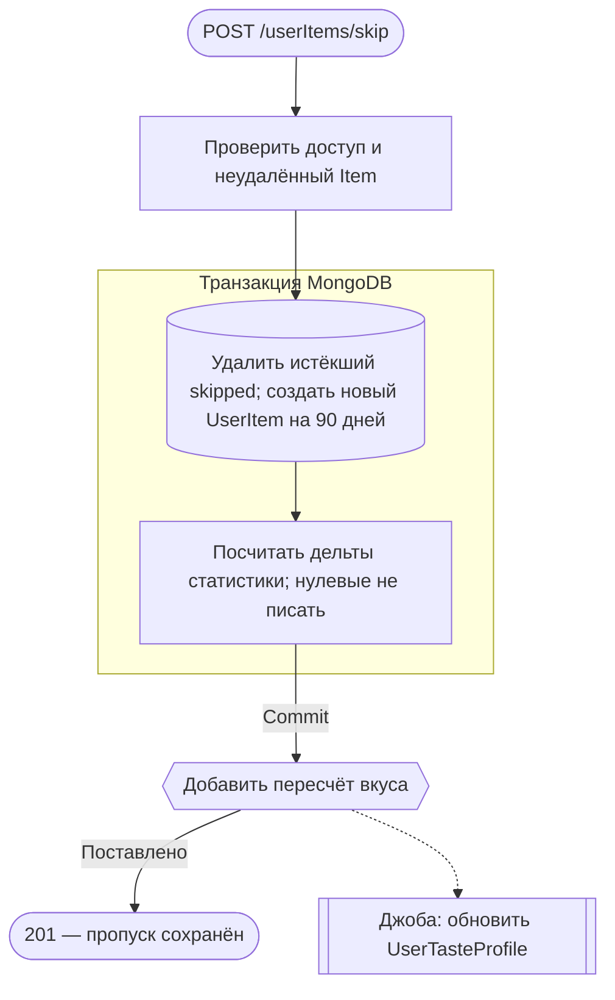
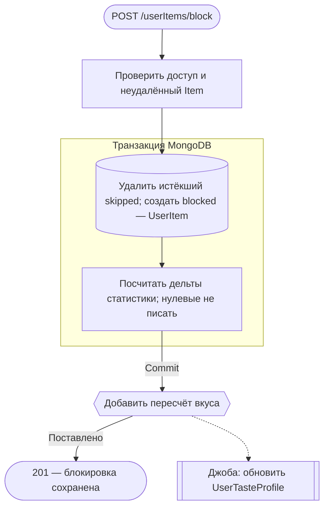
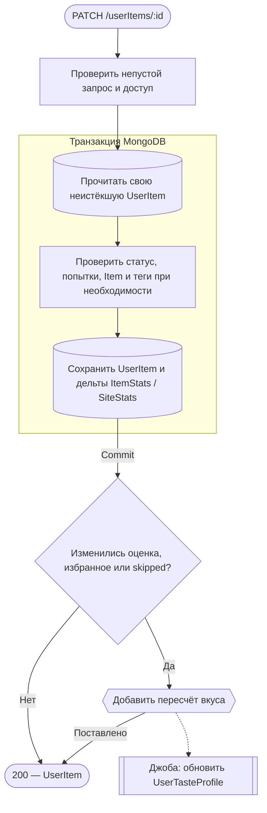
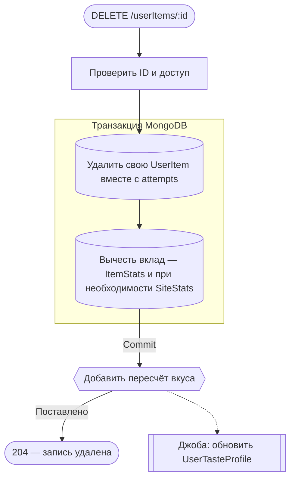
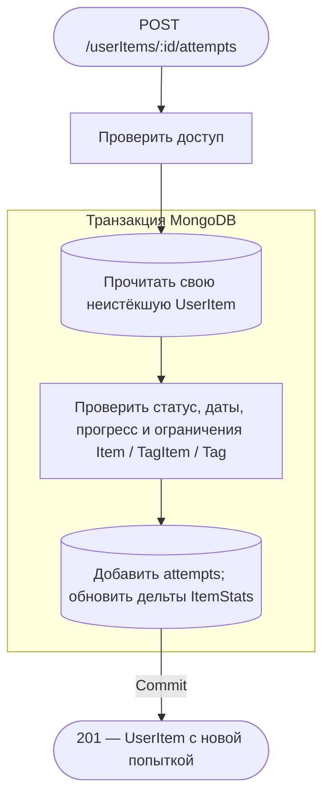
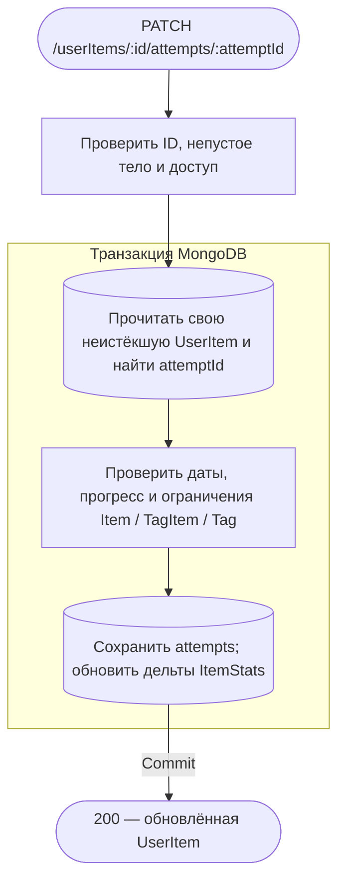
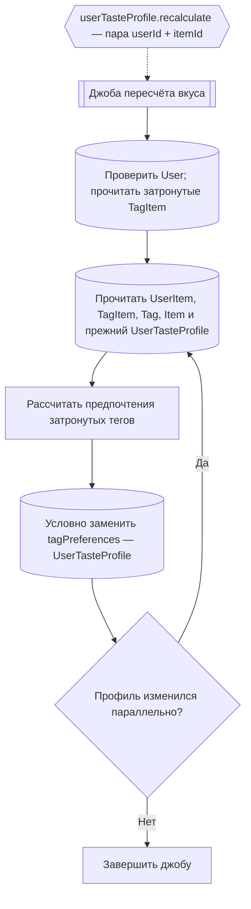

# Личная библиотека

[← Все эндпоинты](../endpoints.md) · [Контракт библиотеки](../librarySpec.md) · [Обозначения](readme.md)

Все восемь операций проверяют access cookie: JWT → активную принадлежащую пользователю UserSession и существующий User. `:id` — **ID UserItem**, а `itemId` в создании — ID произведения Item. JSON передаётся с `Content-Type: application/json`; неизвестные поля запрещены. Общие ошибки: 400 — DTO/формат ObjectId; 401 — доступ; 403 — CSRF; 429 — throttling. Все ответы — `Cache-Control: no-store`.

Изменения UserItem и его статистики выполняются одной MongoDB-транзакцией. ItemStats получает только ненулевые дельты оценок, избранного, завершённых попыток и обычных библиотечных статусов. SiteStats (тип SiteRatingsStats) обновляется только при изменении суммы/числа оценок. Событий между сервисом, статистикой и очередью **нет**. Постановка пересчёта вкуса, когда нужна, ожидается **после commit**; её ошибка может дать неуспешный HTTP-ответ при уже сохранённых данных. Фоновый пересчёт ответа не блокирует.

**Ответ записи:** id, itemId, status, expiresAt (ISO/null), rating, isFavorite, note и attempts с id/isCompleted/progress/unit/startedAt/completedAt. Это UserItem, а не полная карточка Item.

## QUERY /userItems

Получить краткие собственные записи по их ID. **Пример:** `QUERY /userItems`, `{"ids":["507f1f77bcf86cd799439011"]}`, access cookie. **Ответ:** 200, массив id/itemId/rating/isFavorite/status; заголовок `Accept-Query: application/json`.

1–60 уникальных ObjectId, регистр hex не делает ID различными. Чужие/отсутствующие записи и skipped с истёкшим expiresAt пропускаются без 404; порядок оставшихся совпадает с запросом. Item не читается. Нет транзакции, записей, событий, очередей и внешних вызовов; HTTP ждёт чтения и маппинга. Это не чтение всей библиотеки и не поиск по itemId.

**Технические подробности:** [UserItemController.query](../../../src/endpoints/userItem/controllers/userItem.controller.ts) → [UserItemService.query/authenticate](../../../src/endpoints/userItem/services/userItem.service.ts) → UserItemRepository.read.findMany. [DTO](../../../src/endpoints/userItem/dto/body/queryUserItems.body.ts), [summary DTO](../../../src/endpoints/userItem/dto/response/userItemSummary.response.ts).

## POST /userItems

Добавить произведение в библиотеку с обычным статусом. **Пример:** `POST /userItems`, `{"itemId":"507f1f77bcf86cd799439011","status":"planned"}`, access cookie. **Ответ:** 201, полная запись UserItem.

До транзакции проверяется неудалённый Item; для completed — ограничения завершения. Для inProgress/onHold/completed/dropped автоматически создаётся первая попытка; completed помечает её завершённой. Просроченный skipped той же пары user/item удаляется внутри транзакции; другая существующая запись не заменяется — 409 уникальности. Нет Item — 404; недопустимое завершение — 409. Пересчёт вкуса ставится всегда, даже если оценок пока нет. HTTP ждёт commit и enqueue, не джобу; [ошибка очереди после commit](userItems.md#taste-job) не откатывает UserItem.

**Технические подробности:** UserItemController.create → UserItemService.create/createWithStatus/runMutation → ItemRepository.read.checkIsExists, UserItemRepository.write.deleteByFilter/create, UserItemStatsService.update, UserTasteProfileRecalculationService.enqueue. [Сервис](../../../src/endpoints/userItem/services/userItem.service.ts), [create DTO](../../../src/endpoints/userItem/dto/body/createUserItem.body.ts), [допустимые статусы создания](../../../src/endpoints/userItem/dto/body/status.body.ts).

## POST /userItems/skip

Отложить рекомендацию произведения на 90 дней. **Пример:** `POST /userItems/skip`, `{"itemId":"507f1f77bcf86cd799439011"}`, access cookie. **Ответ:** 201, UserItem со status=skipped и expiresAt.

Создаётся новая запись без оценки, избранного, заметки и попыток. Свежий skipped/другая существующая запись пары user/item даёт 409, отсутствующий/удалённый Item — 404. Чистый skipped не вносит вклад в ItemStats/SiteStats, поэтому вызов расчёта дельт обычно ничего туда не пишет. MongoDB TTL позже физически удаляет просроченные skipped независимо от запроса; это не BullMQ-джоба и не обещание удаления ровно в expiresAt. HTTP ждёт commit/enqueue; возможен отказ очереди после commit.

**Технические подробности:** UserItemController.skip → UserItemService.skip/createWithStatus, общий путь создания выше. [Exclusion DTO](../../../src/endpoints/userItem/dto/body/createExclusion.body.ts), [TTL-индекс](../../../src/entities/userItem/schemas/userItem.schema.ts), [срок](../../../src/endpoints/userItem/static/USER_ITEM_SKIP_DURATION_MS.ts).

## POST /userItems/block

Бессрочно исключить произведение из рекомендаций. **Пример:** `POST /userItems/block`, `{"itemId":"507f1f77bcf86cd799439011"}`, access cookie. **Ответ:** 201, UserItem со status=blocked, expiresAt=null.

Создание blocked не заменяет действующую запись пары user/item: 409. Для изменения существующей записи нужен PATCH /userItems/:id. Нет доступного Item — 404. Чистый blocked не входит в обычные счётчики библиотеки и не несёт оценки/избранного, поэтому ненулевых дельт статистики нет. TTL не применяется. Пересчёт вкуса ставится всегда после commit, внешних вызовов нет; ошибка enqueue может прийти после сохранения блокировки.

**Технические подробности:** UserItemController.block → UserItemService.block/createWithStatus → те же репозитории и enqueue, что в создании. [Контроллер](../../../src/endpoints/userItem/controllers/userItem.controller.ts), [сервис](../../../src/endpoints/userItem/services/userItem.service.ts), [статусы счётчиков](../../../src/entities/userItem/static/USER_ITEM_LIBRARY_STATUSES.ts).

## PATCH /userItems/:id

Изменить статус, оценку, избранное или заметку. **Пример:** `PATCH /userItems/507f1f77bcf86cd799439012`, `{"rating":8,"isFavorite":true}`, access cookie. **Ответ:** 200, полная UserItem после изменения.

rating — целое 1–10 или null для очистки; note допускает null. completed помечает последнюю попытку завершённой; переход в требующий попытку статус создаёт её, если попыток нет. skipped несовместим с оценкой/избранным/заметкой/попытками — 409. expiresAt обнуляется при выходе из skipped, при входе назначается 90 дней. Неверные даты/проценты/единицы попыток — 400; недопустимое завершение — 409. Отсутствующая, чужая или истёкшая skipped — одинаковый 404. Note-only и обычные смены статуса не ставят taste job; ItemStats может измениться синхронно. HTTP ждёт нужного enqueue; его ошибка после commit не откатывает изменения.

**Технические подробности:** UserItemController.update → UserItemService.update/mutate/changeStatus/validateUserItem/validateCompletion; UserItemRepository.read.findOne/write.updateByFilter фильтруют владельца и срок. [Сервис](../../../src/endpoints/userItem/services/userItem.service.ts), [DTO](../../../src/endpoints/userItem/dto/body/updateUserItem.body.ts).

## DELETE /userItems/:id

Физически удалить личную запись и все её вложенные попытки. **Пример:** `DELETE /userItems/507f1f77bcf86cd799439012`, без тела, access cookie. **Ответ:** 204 без тела.

Нет/чужая запись — 404; повторное удаление тоже 404. Удаление разрешено и для просроченного skipped, если TTL ещё не удалил его. Item не проверяется и не удаляется. Статистика вычитается из возвращённой удалённой записи в той же транзакции; очередь всегда после commit. Неуспешный enqueue не восстанавливает UserItem. HTTP выполнения джобы не ждёт; внешних вызовов нет.

**Технические подробности:** UserItemController.remove → UserItemService.remove/runMutation → UserItemRepository.write.deleteByFilter, UserItemStatsService.update(previous, null), enqueue. [Сервис](../../../src/endpoints/userItem/services/userItem.service.ts), [репозиторий](../../../src/entities/userItem/services/userItem.repository.ts).

## POST /userItems/:id/attempts

Добавить попытку просмотра или прохождения. **Пример:** `POST /userItems/507f1f77bcf86cd799439012/attempts`, `{"progress":30,"unit":"minute"}`, access cookie. **Ответ:** 201, вся UserItem с новой попыткой.

Новая попытка разрешена только inProgress/onHold/completed/dropped, иначе 409. По умолчанию isCompleted=false, progress=null, unit=minute, даты=null; `{}` допустим. Попытка **не меняет статус UserItem**. unit=episode разрешён только сериалам; percent не выше 100; завершение игры без определённого конца и незавершённого сезона запрещено по TagItem/Tag. Ошибки формата/дат/единиц — 400, ограничения завершения — 409, нет собственной активной записи — 404. Общий mutate пересчитывает статистику; taste-сигнал здесь не меняется, поэтому очередь фактически не ставится. Нет внешних обращений; HTTP ждёт commit.

**Технические подробности:** UserItemController.createAttempt → UserItemService.createAttempt/mutate/validateCompletion → UserItemRepository и при необходимости ItemRepository/TagItemRepository.checkHasTagKeys → UserItemStatsService.update. [Сервис](../../../src/endpoints/userItem/services/userItem.service.ts), [DTO](../../../src/endpoints/userItem/dto/body/createAttempt.body.ts).

## PATCH /userItems/:id/attempts/:attemptId

Изменить прогресс, даты или завершённость конкретной попытки. **Пример:** `PATCH /userItems/507f1f77bcf86cd799439012/attempts/507f1f77bcf86cd799439013`, `{"progress":60}`, access cookie. **Ответ:** 200, вся обновлённая UserItem.

Пустое изменение — 400; неизвестная попытка/отсутствующая или чужая UserItem — 404. Те же ограничения дат/единиц/процентов и завершения, что при создании попытки; изменение попытки не меняет статус UserItem. В отличие от создания, отдельной проверки допустимости статуса для добавления здесь нет. ItemStats обновляется только при ненулевой дельте, например изменении числа завершённых попыток; SiteStats и taste job при обычном редактировании attempts не меняются. HTTP ждёт commit; внешних обращений и событий нет.

**Технические подробности:** UserItemController.updateAttempt → UserItemService.updateAttempt/mutate/validateUserItem/validateCompletion. [Контроллер](../../../src/endpoints/userItem/controllers/userItem.controller.ts), [сервис](../../../src/endpoints/userItem/services/userItem.service.ts), [DTO](../../../src/endpoints/userItem/dto/body/updateAttempt.body.ts).

## Общий фон: пересчёт вкуса

Постановка идёт напрямую через UserTasteProfileRecalculationService → JobService.add, без событий. Дедупликация привязана к userId/itemId с keepLastIfActive: активная джоба не отменяется, сохраняется последний повторный запуск. Если User исчез или у Item нет TagItem, обработчик завершает работу без записи. Расчёт берёт актуальные не-skipped UserItem с оценкой/избранным, соответствующие теги с relevanceScore и допустимые группы/типы. Запись сохраняет явные веса и незатронутые теги; конфликт предыдущего массива предпочтений приводит к повторному чтению/расчёту. Общей транзакции с исходным HTTP-запросом нет. Внешних обращений нет, кроме MongoDB/Redis очереди. Джоба может начаться до или после отправки HTTP-ответа и не изменяет уже отправленный результат.

**Исходники:** [UserItemStatsService](../../../src/endpoints/userItem/services/userItemStats.service.ts), [ItemStatsRepository.applyChanges](../../../src/entities/itemStats/services/itemStats.repository.ts), [SiteRatingsStatsRepository.applyChanges](../../../src/entities/siteStats/services/siteRatingsStats.repository.ts), [UserTasteProfileRecalculationService.enqueue/recalculate](../../../src/entities/userTasteProfile/services/userTasteProfileRecalculation.service.ts), [handler](../../../src/entities/userTasteProfile/handlers/recalculateUserTasteProfileJob.handler.ts), [job definition](../../../src/entities/userTasteProfile/static/RECALCULATE_USER_TASTE_PROFILE_JOB.ts), [UserTasteProfileRepository.tryReplaceCalculatedPreferences](../../../src/entities/userTasteProfile/services/userTasteProfile.repository.ts), [UserItemRepository.getTasteInputs](../../../src/entities/userItem/services/userItem.repository.ts), [TagItemRepository](../../../src/entities/tagItem/services/tagItem.repository.ts).
