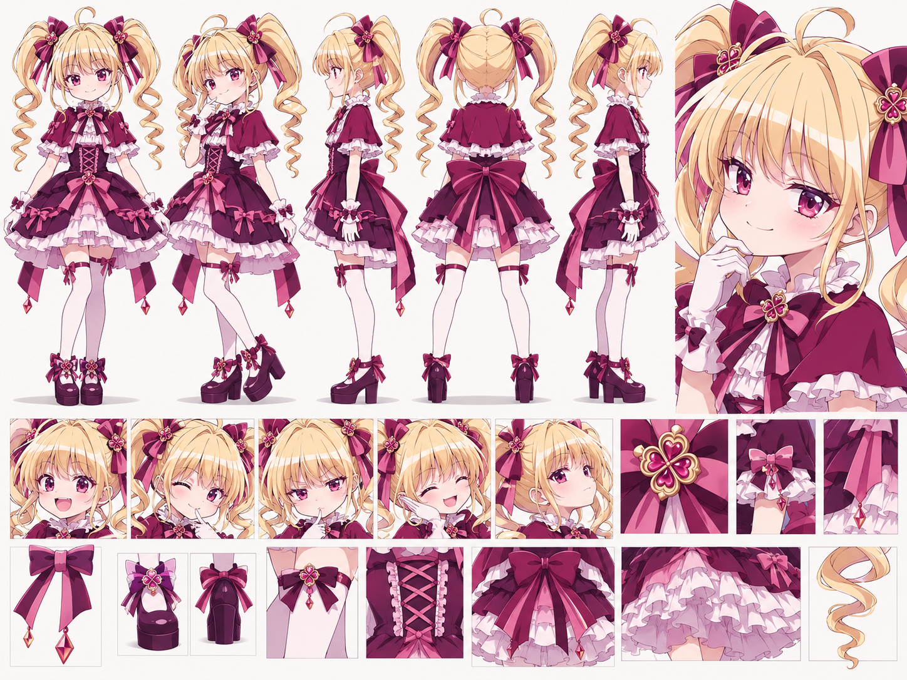

# Bisky — маскот приложения

> Каноническое описание маскота платформы Bisky. Использовать вместе с утверждённым референс-листом персонажа: изображение имеет приоритет при уточнении визуальных деталей.

## 1. Общая информация

- **Имя:** Bisky (Биски).
- **Роль:** маскот и виртуальная проводница платформы персонализированных рекомендаций медиа.
- **Архетип:** элегантная аниме-героиня в эстетике *gothic lolita / elegant cute*.
- **Характер:** умная, уверенная, немного хитрая, озорная и обаятельная.
- **Общее впечатление:** миниатюрная, изящная, с узнаваемым силуэтом и выразительной мимикой.
- **Визуальный стиль:** чистая аниме-иллюстрация с аккуратным контуром и cel shading; без перехода в реализм.

## 2. Лицо и глаза

- Кругловатое, мягкое лицо с аккуратными чертами.
- Большие выразительные глаза **розово-фиолетового / ягодно-сливового цвета**, с несколькими характерными бликами.
- Густые ресницы, лёгкий румянец на щеках.
- Базовая эмоция: уверенная, слегка хитрая улыбка.
- Допустимые эмоции: восторг, задумчивость, подмигивание, лёгкое недовольство, гордость, смущение, радость.

## 3. Волосы

- **Цвет:** светлый тёплый золотистый блонд с кремовыми бликами.
- **Причёска:** два высоких симметричных хвоста (*twin tails*).
- Хвосты объёмные у основания и заканчиваются длинными выразительными **спиральными локонами**.
- Густая ровная чёлка с прядями у лица.
- На основаниях хвостов — крупные тёмно-ягодные банты с декоративными украшениями.
- Допустим небольшой торчащий завиток (*ahoge*) на макушке.

**Нельзя менять:** число и высоту хвостов, спиральную форму кончиков, общий силуэт причёски, цвет волос.

## 4. Одежда — основной костюм

- **Стиль:** оригинальное многослойное платье gothic lolita.
- **Верх:** тёмно-сливовая накидка/короткие пышные рукава с белыми оборками.
- **Воротник:** высокий белый воротник с рюшами.
- **Лиф:** приталенный, с контрастной розовой **крестовой корсетной шнуровкой** спереди.
- **Юбка:** пышная, многослойная; тёмно-ягодный верх, розовые вставки и бело-розовые нижние оборки.
- **Спереди:** декоративный бант на талии.
- **Сзади:** большой объёмный ягодно-розовый бант с длинными лентами.
- **Руки:** белые манжеты или перчатки с небольшими бантами.
- **Ноги:** белые чулки выше колена с ягодными лентами/бантами.
- **Обувь:** тёмно-сливовые туфли Mary Jane на устойчивой платформе с бантиками и декоративными элементами.

## 5. Фирменные украшения

- На волосах и/или груди — **симметричный четырёхлепестковый цветочный/клеверный орнамент** с розово-ягодной вставкой и тонкой золотистой оправой.
- Допускаются небольшие подвески в форме ромбовидных кристаллов на концах лент.
- Украшения служат узнаваемым повторяющимся мотивом и должны выглядеть одинаково во всех изображениях.

## 6. Цветовая палитра

Палитра основана на интерфейсе Bisky. Точные HEX-коды следует зафиксировать отдельно из исходных дизайн-токенов сайта; приведённые названия — визуальные ориентиры.

| Назначение | Цвет |
|---|---|
| Главный акцент | яркий розовый |
| Вторичный акцент | малиновый / ягодный |
| Основная ткань платья | сливовый / бордово-фиолетовый |
| Тёмные элементы | глубокий баклажановый / почти чёрный фиолетовый |
| Светлые детали | белый / молочный / нежно-розовый |
| Волосы | тёплый светло-золотистый блонд |
| Глаза | розово-фиолетовый |
| Фурнитура | приглушённое золото |

**Правило:** сохранять характерное сочетание светлых волос, розово-сливовых глаз и ягодно-фиолетового костюма.

## 7. Пропорции и силуэт

- Компактное, миниатюрное телосложение.
- Голова слегка увеличена относительно тела в аниме-стилистике.
- Основные признаки силуэта: **два высоких спиральных хвоста, пышная юбка, крупный задний бант и платформенные туфли**.
- В нейтральной позе силуэт должен быть узнаваем даже без мелких деталей.
- Для обычных иллюстраций сохранять пропорции референса; переход к экстремальному chibi использовать только как отдельную, явно обозначенную стилизацию.

## 8. Характер и поведение

- Уверенная в своём вкусе и рекомендациях.
- Умная, наблюдательная, любознательная.
- Игриво-ехидная, но не злая и не высокомерная до отталкивающего впечатления.
- Может подмигивать, показывать одобрение, задумчиво прикладывать палец к подбородку, радоваться удачной находке.
- **Смысл образа:** «Я знаю, что тебе понравится».

## 9. Неизменяемые признаки (обязательный канон)

1. Два **высоких** золотистых хвоста с длинными спиральными концами.
2. Крупные ягодно-фиолетовые банты у оснований хвостов.
3. Большие розово-фиолетовые глаза.
4. Миниатюрный аниме-силуэт и характерные черты лица.
5. Готик-лолита платье в розовой, ягодной, сливовой и тёмно-фиолетовой палитре.
6. Белые оборки, корсетная шнуровка спереди, большой бант сзади.
7. Повторяющийся четырёхлепестковый декоративный мотив.
8. Белые высокие чулки и тёмные платформенные туфли.
9. Аккуратная аниме-отрисовка, без фотореализма.

## 10. Что можно менять

- Позу, направление взгляда, эмоцию.
- Ракурс и кадрирование.
- Освещение, фон и окружение.
- Предметы, с которыми персонаж взаимодействует.
- Тематические аксессуары для конкретной сцены.
- Одежду **только в явно обозначенных альтернативных образах**; основной костюм остаётся неизменным.

## 11. Что нельзя менять

- Менять цвет волос или глаз.
- Убирать/укорачивать хвосты либо делать их прямыми.
- Существенно менять форму лица, пропорции или рост персонажа относительно референса.
- Заменять основной костюм случайным платьем без явного запроса на альтернативный образ.
- Терять основные банты, переднюю шнуровку и ключевые украшения.
- Менять визуальный стиль между изображениями без специального указания.
- Воспроизводить узнаваемые уникальные детали чужого персонажа вместо собственного дизайна Bisky.

## 12. Применение

- Состояния интерфейса: приветствие, загрузка, пустой результат, ошибка, подсказка, успех.
- Онбординг и обучение пользователя.
- Подборки и персональные рекомендации.
- Эмоциональные реакции и стикеры.
- Рекламные материалы и обложки.
- Анимированные ролики и видео-сцены.

## 13. Набор референсов для будущих генераций

**Основной референс:** утверждённый character sheet с несколькими полноростовыми ракурсами, портретом, эмоциями и крупными планами одежды и аксессуаров.

Для повышения повторяемости дополнительно сохранять:

1. Полноростовой вид **спереди**.
2. Полноростовой вид **сзади**.
3. Профили **слева и справа**.
4. Ракурсы **¾ спереди и сзади**.
5. Крупный план лица и причёски.
6. Детали бантов, орнаментов, шнуровки, обуви.
7. Лист выражений лица.

**Важно:** одно текстовое описание не гарантирует идентичный результат генерации. Для каждой новой картинки или видео прикладывать основной референс-лист; для максимально строгой консистентности в будущем полезна фиксированная 3D-модель.

## 14. Краткое описание для промптов

> Bisky is an original petite anime gothic-lolita mascot girl with warm golden-blonde hair in two very high voluminous twin tails ending in long corkscrew curls, large sparkling pink-violet eyes, and a confident, slightly mischievous smile. She wears a richly layered burgundy-plum and pink gothic-lolita dress with a frilled white collar, puffed capelet sleeves, pink corset lacing, a layered ruffle skirt, a large bow at the back, white thigh-high stockings, and dark plum platform Mary Jane shoes. Her accessories include large berry-colored hair bows and a distinctive four-petal rose-gold ornamental motif with pink gemstone accents. Preserve the exact same face, hairstyle, silhouette, costume details, accessories, proportions, and anime cel-shaded art style as in the attached canonical reference sheet.
