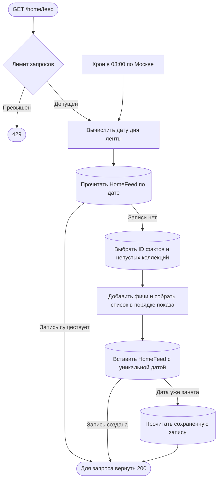
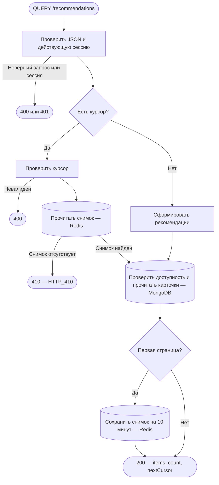
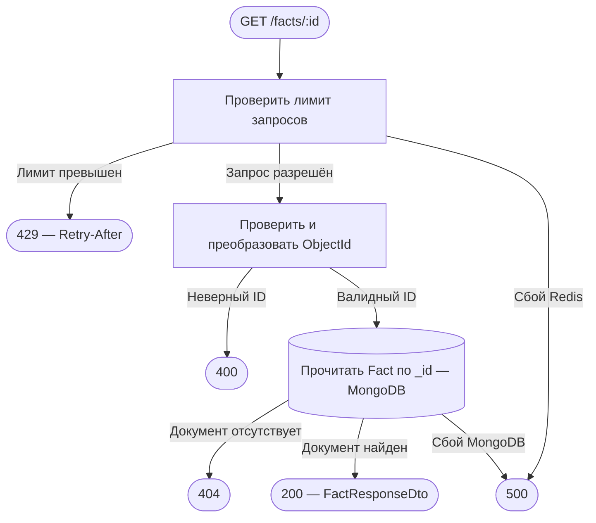
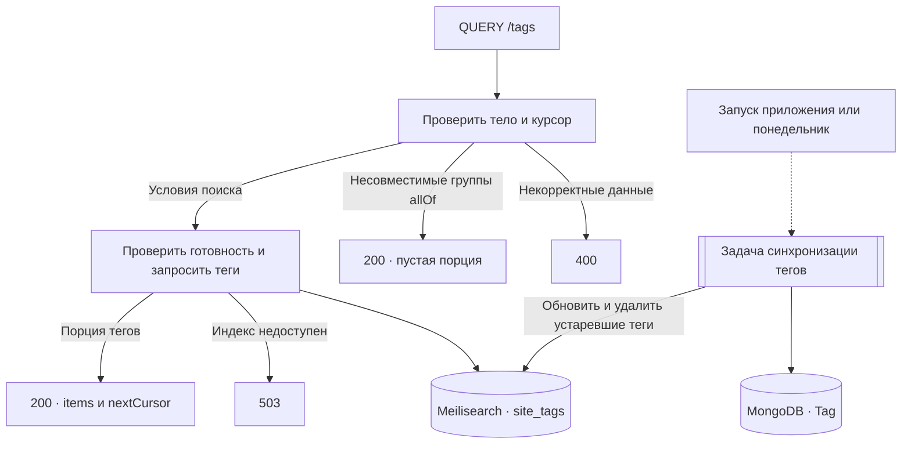
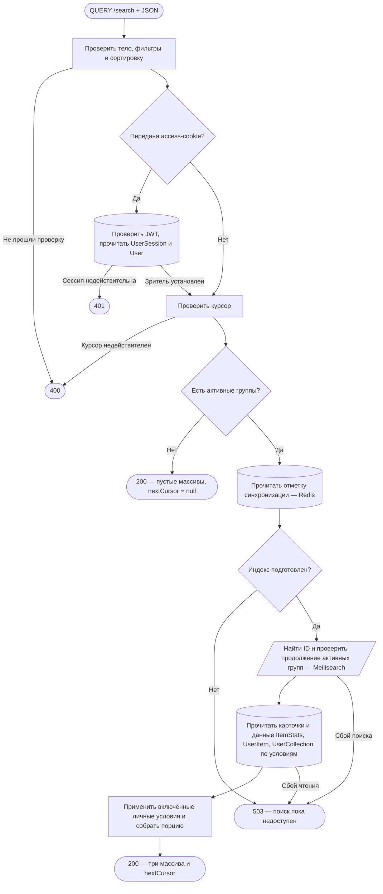
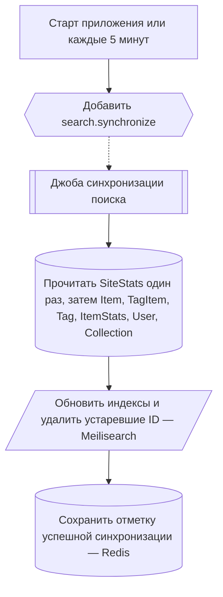

# Каталог и поиск

<a id="home-feed"></a>

## GET /home/feed

Публичный запрос без тела и параметров. Cookie и авторизация не влияют на результат. Ответ `200` содержит дату начала дня ленты и массив блоков в порядке показа. День начинается в 03:00 по `Europe/Moscow`. Заголовок `Cache-Control: no-store`.

```json
{
  "date": "2026-11-19",
  "blocks": [
    { "type": "fact", "id": "673ca2e4bf12d94201000001" },
    { "type": "collection", "id": "673ca2e4bf12d94201000002" },
    { "type": "feature", "id": "pick" }
  ]
}
```



Порядок полного набора — факт → 3 коллекции → фича → 3 коллекции → факт → 3 коллекции → фича → 3 коллекции → факт → 3 коллекции. Недостающие позиции пропускаются. ID каждого типа уникальны в пределах дня. ID факта и коллекции — строки Mongo ObjectId в нижнем регистре. ID фичи — ключ из статического пула `pick`, `battle`, `rating`. Коллекции сайта типа `tag` или `feature` участвуют, пока у них есть хотя бы один неудалённый Item в существующей группе.

Первый запрос после пропущенного запуска формирует запись текущего дня. Пустой массив сохраняется по тем же правилам. Пагинации и nullable-полей нет. Сбой чтения или подготовки возвращает запросу `500`, а ошибка крона записывается в лог. При превышении лимита ответ `429` включает `Retry-After`. Ошибки используют общий объект `error` с полями `code`, `message`, `details` и `requestId`.

При подключении главной массив нужно держать до обновления страницы. Факт и состав коллекции догружаются по ID. Если отдельное чтение вернуло `404` либо коллекция скрылась или осталась без видимых Item, главная пропускает блок и сохраняет порядок остальных. Ключи фич сопоставляются с компонентами на фронте, неизвестный ключ пропускается.

[HomeController](../../../../src/endpoints/home/controllers/homeController/core/home.controller.ts) · [HomeFeedService](../../../../src/endpoints/home/services/homeFeedService/core/homeFeed.service.ts) · [HomeFeedRepository](../../../../src/entities/homeFeed/services/homeFeedRepository/core/homeFeed.repository.ts)

<a id="recommendations"></a>

## QUERY /recommendations

Запрос для вошедшего пользователя. Параметров пути и строки запроса нет. Нужны cookie `__Host-accessToken`, `Content-Type: application/json` и JSON-объект. Тело `{}` запрашивает первые 20 рекомендаций вне библиотеки.

| Поле              | Правила                                                                                                                                                                                                                                                                                      |
| ----------------- | -------------------------------------------------------------------------------------------------------------------------------------------------------------------------------------------------------------------------------------------------------------------------------------------- |
| `cursor`          | Необязательная строка длиной 1–256 символов. Без неё формируется список                                                                                                                                                                                                                      |
| `limit`           | Необязательное целое из `10`, `20`, `50`, по умолчанию `20`                                                                                                                                                                                                                                  |
| `filter.types`    | 1–7 уникальных значений: `movie`, `series`, `animatedMovie`, `animatedSeries`, `animeSeries`, `animeMovie`, `game`. По умолчанию все типы                                                                                                                                                    |
| `filter.tags`     | 0–10 групп. Каждая содержит необязательные массивы `allOf`, `anyOf`, `noneOf` по 1–100 ObjectId, уникальных без учёта регистра. Условия и группы соединяются через И. Пустая группа условий не добавляет, отсутствующий тег не считается назначенным                                         |
| `filter.statuses` | Необязательные массивы `allOf`, `anyOf`, `noneOf` по 1–6 уникальных значений из `outside`, `planned`, `inProgress`, `onHold`, `completed`, `dropped`. Условия проверяются по одному статусу. Отсутствие объекта означает `{"anyOf":["outside"]}`, пустой объект разрешает все шесть значений |

`filter` и все перечисленные поля необязательны. Явный `null` и неизвестные поля запрещены. Без `filter.tags` фильтрация по тегам не применяется.

На главной включённый переключатель личных фильтров передаётся через `library: {"noneOf":["completed","dropped"]}`, выключенный — через `library: {}`. При любом значении исключаются `blocked`, действующие `skipped`, удалённые произведения, глобальные запреты и запреты для страны сессии. Просроченный `skipped` считается `outside`. Гость блок рекомендаций не запрашивает.

```http
QUERY /recommendations HTTP/1.1
Host: api.example.com
Cookie: __Host-accessToken=<JWT>
Content-Type: application/json

{"limit":10,"filter":{"types":["movie","series"],"statuses":{"noneOf":["completed","dropped"]}}}
```

```json
{
  "items": [
    {
      "id": "655f2ab09e1c427b40f604a1",
      "type": "movie",
      "title": { "ru": "После дождя", "en": null },
      "media": [],
      "ratingAverage": 8.2,
      "userRating": null,
      "userStatus": "planned"
    }
  ],
  "count": 1,
  "nextCursor": null
}
```

Ответ `200` отправляется с `Cache-Control: no-store` и `Accept-Query: application/json`. Все поля примера обязательны. `id` — ObjectId произведения в виде строки. `title.ru` и `title.en` — строки или `null`. В `media` только постеры `{src: string, language: string | null, type: "poster"}`. Общая оценка `ratingAverage` и личная `userRating` могут быть `null`. Личная оценка целая, обе оценки находятся в диапазоне 1–10. `userStatus` — один из пяти библиотечных статусов или `null` для `outside`.

`count` равен длине текущего массива `items`. `nextCursor` — строка или `null`. Для продолжения передайте курсор с теми же фильтрами и лимитом. Снимок ID хранится в Redis 10 минут без продления, курсор привязан к пользователю, стране и условиям. Каждая порция перечитывает актуальные карточки и применяет фильтры к фиксированному отрезку списка. Даже при `count: 0` курсор может указывать на следующую порцию. Конец выдачи определяется по `nextCursor: null`.



**Ошибки.** `400 BAD_REQUEST` — ошибка тела, фильтра или курсора. `401 UNAUTHORIZED` — недействительная авторизация, сессия или отсутствующий пользователь. `410 HTTP_410` — снимок отсутствует, начать заново без курсора. Действуют также `403 FORBIDDEN` для CSRF, `413 HTTP_413` и `415 HTTP_415` для ошибок формата тела, `429 TOO_MANY_REQUESTS` с `Retry-After` и `500 INTERNAL_ERROR` при необработанном сбое. Ошибки имеют форму `{error: {code, message, details, requestId}}`. При ошибке валидации DTO `details` содержит `{errors: string[]}`, в остальных описанных случаях — `null`.

[Контроллер](../../../../src/endpoints/recommendations/controllers/recommendationsController/core/recommendations.controller.ts) · [Сервис ленты](../../../../src/endpoints/recommendations/services/recommendationFeedService/core/recommendationFeed.service.ts) · [ItemRepository](../../../../src/entities/item/services/itemRepository/core/item.repository.ts)

<a id="fact"></a>

## GET /facts/:id

Публичное чтение одного факта. Параметр `id` обязателен и содержит ровно 24 шестнадцатеричных символа в любом регистре. Query-параметров, тела, авторизации и пагинации нет.

```http
GET /facts/655f2ab09e1c427b40f604a1 HTTP/1.1
Host: api.example.com
Accept: application/json
```

```http
HTTP/1.1 200 OK
Content-Type: application/json
Cache-Control: no-store

{"id":"655f2ab09e1c427b40f604a1","text":{"ru":"Первый показ прошёл в Париже","en":null},"sourceUrl":null}
```

В ответе обязательны `id` в нижнем регистре, объект `text` с обоими ключами `ru` и `en` и поле `sourceUrl`. Каждый перевод и ссылка имеют тип `string | null`.



**Ошибки.** `400 BAD_REQUEST` — неверный формат `id`, `404 NOT_FOUND` — факт отсутствует, `429 TOO_MANY_REQUESTS` — сработало общее ограничение 100 запросов за 60 секунд на маршрут и ключ IP, `500 INTERNAL_ERROR` — необработанный сбой. При `429` заголовок `Retry-After` содержит время ожидания в секундах. Для этих ошибок `details` равен `null`.

```json
{
  "error": {
    "code": "NOT_FOUND",
    "message": "Факт не найден",
    "details": null,
    "requestId": "req-17"
  }
}
```

**Главная.** При догрузке блока `fact` клиент использует ID из дневной ленты. При `404` пропускает этот блок до обновления ленты и сохраняет порядок остальных. `429` и `500` обрабатываются как ошибки загрузки блока.

**Исходники:** [FactController](../../../../src/endpoints/fact/controllers/factController/core/fact.controller.ts), [FactService](../../../../src/endpoints/fact/services/factService/core/fact.service.ts), [FactRepository](../../../../src/entities/fact/services/factRepository/core/fact.repository.ts).

<a id="tags"></a>

## QUERY /tags

Публичный запрос с JSON-телом. Пример первой порции: `{"groups":{"anyOf":["genre","subgenre"]},"limit":20}`.



Отметка успешной синхронизации записывается после обновления индекса и удаления отсутствующих тегов. Запросы читают текущую версию индекса. Подробности фильтров и пагинации приведены в [контракте справочника](../pages/search.md#справочник-тегов).

[TagController](../../../../src/endpoints/tag/controllers/tagController/core/tag.controller.ts) · [TagSearchService](../../../../src/endpoints/tag/services/tagSearchService/core/tagSearch.service.ts) · [SyncTagSearchJobHandler](../../../../src/endpoints/tag/services/syncTagSearchJobHandler/core/syncTagSearchJob.handler.ts)

[← Все эндпоинты](../endpoints.md) · [Обозначения схем](readme.md)

Поисковый запрос публичный. Сервер проверяет переданную access-cookie. Без неё запрос гостевой. Общие ограничения HTTP перечислены в [каталоге](../endpoints.md#common). Поисковый запрос не меняет MongoDB, не публикует события и не ставит задачи. Схемы сверены с production-кодом, а не с трассировкой запущенного API.

<a id="search"></a>

## QUERY /search

Найти произведения, пользователей и подборки или получить новинки и популярное на главной.

Пример тела запроса — `{"search":"космос","limit":10,"items":{"sort":"rating","direction":"desc"}}`. Ответ `200` содержит массивы `items`, `collections`, `users` и `nextCursor` (строка или `null`). Заголовки `Cache-Control: no-store` и `Accept-Query: application/json`.



**Проверки и данные.** Тело — JSON-объект с известными полями. Необязательный `search` содержит 1–200 символов после обрезки пробелов. Главная выбирает только Item через `entities` и опускает текст. Лимит на группу — 10, 20 или 50, по умолчанию 20. Курсор хранит позиции отдельных групп и привязан к условиям, а также к проверенному зрителю или гостю. Для новинок фиксируется время первой страницы. Обратная релевантность ранжирует совпадения после пакетного прохода индекса.

**Границы и ошибки.** Глубина ограничена 10 000 кандидатами на группу. Для новинок, рейтинга Item без текста и групп с действующей личной фильтрацией до выбора страницы проверяются до 200 кандидатов на группу. Короткая или пустая порция может иметь курсор продолжения. Ошибки `400` относятся к телу, фильтрам и курсору, `401` — к недействительным учётным данным, `503` — к готовности индекса или сбою Redis, Meilisearch либо MongoDB. Действуют общие `403` и `429`.

<details>
<summary>Технические подробности и исходники</summary>

[SearchController.search](../../../../src/endpoints/search/controllers/searchController/core/search.controller.ts) → [SearchBodyInterceptor](../../../../src/endpoints/search/services/searchBodyInterceptor/core/searchBody.interceptor.ts) и [DTO](../../../../src/endpoints/search/services/siteSearchService/dto/search.body.ts) → [SiteSearchService.search/readGroupPage](../../../../src/endpoints/search/services/siteSearchService/core/siteSearch.service.ts). Сервис переиспользует [AuthService](../../../../src/endpoints/auth/services/authService/core/auth.service.ts), CacheService, CursorService, [SearchService.search/iterateMatches](../../../../src/infrastructure/search/services/searchService/core/search.service.ts) и репозитории сущностей. Индексы `site_items`, `site_users`, `site_collections`. Отметка готовности `siteSearch:checkpoint:v4`. [Подробный контракт](../contracts/searchSpec.md#search).

</details>

<a id="search-sync"></a>

## Независимый фон: синхронизация поиска

Этот процесс обеспечивает данные для QUERY /search, но не является продолжением конкретного HTTP-запроса. При старте приложения и каждые пять минут планировщик ожидает добавления `search.synchronize` в очередь с дедупликацией. Ошибка постановки логируется; HTTP-ответа у планировщика нет.



Item индексируется полным проходом с пересчётом рейтингового балла по единому среднему сайта на задачу. В том же проходе индексируется дата новинки из Item или даты последней вышедшей серии. Записи User/Collection после первого полного прохода выбираются по updatedAt с перекрытием в минуту. Воркер настраивает индексы и удаляет записи, которых больше нет в MongoDB. Начальная готовность появляется после успешного обхода всех трёх источников. При последующих сбоях прежняя отметка может оставаться, а индекс — частично обновлённым. MongoDB не изменяется, событий нет.

**Исходники:** [SearchSyncSchedulerService.enqueue](../../../../src/endpoints/search/services/searchSyncSchedulerService/core/searchSyncScheduler.service.ts), [SYNC_SEARCH_JOB](../../../../src/endpoints/search/static/SYNC_SEARCH_JOB.ts), [SyncSearchJobHandler.handle/synchronize/createSources](../../../../src/endpoints/search/services/syncSearchJobHandler/core/syncSearchJob.handler.ts), [ItemRepository.readSearchIndexBatch](../../../../src/entities/item/services/itemRepository/core/item.repository.ts).
