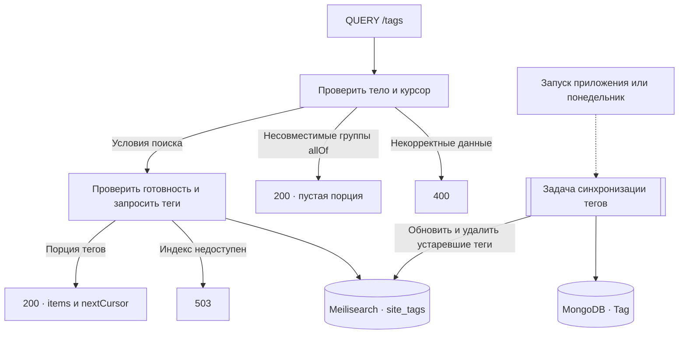
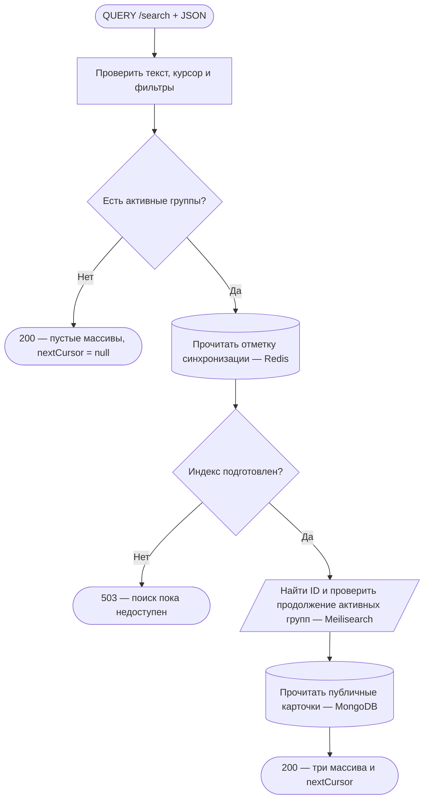
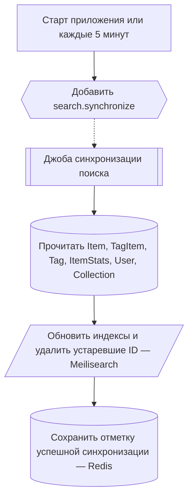

# Каталог и поиск

## QUERY /tags

Публичный запрос с JSON-телом. Пример первой порции: `{"group":{"anyOf":["genre","subgenre"]},"limit":20}`.

Отметка успешной синхронизации записывается после обновления индекса и удаления отсутствующих тегов. Запросы читают текущую версию индекса. Подробности фильтров и пагинации приведены в [контракте справочника](../pages/search.md#справочник-тегов).

[TagController](../../../../src/endpoints/tag/controllers/tagController/core/tag.controller.ts) · [TagSearchService](../../../../src/endpoints/tag/services/tagSearchService/core/tagSearch.service.ts) · [SyncTagSearchJobHandler](../../../../src/endpoints/tag/services/syncTagSearchJobHandler/core/syncTagSearchJob.handler.ts)

[← Все эндпоинты](../endpoints.md) · [Обозначения схем](readme.md)

Поисковый запрос публичный. Access/refresh cookies не проверяются. Общие ограничения HTTP перечислены в [каталоге](../endpoints.md#common). Поисковый запрос не меняет MongoDB, не публикует события и не ставит задачи. Схемы сверены с production-кодом, а не с трассировкой запущенного API.

## QUERY /search

Найти произведения, пользователей и подборки одним запросом.

Пример тела запроса — `{"search":"космос","limit":10,"items":{"sort":{"type":"rating","direction":"desc"}}}`. Ответ `200` содержит массивы `items`, `collections`, `users` и `nextCursor` (строка или `null`). Заголовки `Cache-Control: no-store` и `Accept-Query: application/json`.

**Проверки и данные.** Тело — JSON-объект с известными полями. Текст после обрезки пробелов содержит 1–200 символов. Лимит на группу — 10, 20 или 50, по умолчанию 20. Курсор привязан к параметрам поиска и хранит отдельную позицию каждой выбранной группы. Обратная релевантность ранжирует совпадения после пакетного прохода индекса.

**Границы и ошибки.** Глубина ограничена 10 000 совпадений на группу. Наличие следующей порции определяется дополнительным совпадением. Удалённые и исчезнувшие записи пропускаются, поэтому короткая или пустая порция может иметь курсор продолжения. Ошибки `400` относятся к телу, фильтрам и курсору, `503` — к готовности индекса или сбою Redis, Meilisearch либо MongoDB. Действуют общие `403` и `429`. Запрос ожидает все активные группы и их карточки.

Технические подробности и исходники

[SearchController.search](../../../../src/endpoints/search/controllers/searchController/core/search.controller.ts) → [SearchBodyInterceptor](../../../../src/endpoints/search/services/searchBodyInterceptor/core/searchBody.interceptor.ts) и [DTO](../../../../src/endpoints/search/services/siteSearchService/dto/search.body.ts) → [SiteSearchService.search/searchGroup](../../../../src/endpoints/search/services/siteSearchService/core/siteSearch.service.ts). Вызовы идут к CacheService.get, [SearchService.search/iterateMatches](../../../../src/infrastructure/search/services/searchService/core/search.service.ts) и read.findMany репозиториев [Item](../../../../src/entities/item/services/itemRepository/core/item.repository.ts), [User](../../../../src/entities/user/services/userRepository/core/user.repository.ts), [Collection](../../../../src/entities/collection/services/collectionRepository/core/collection.repository.ts). Индексы `site_items`, `site_users`, `site_collections`; checkpoint `siteSearch:checkpoint:v2`. [Подробный контракт](../pages/search.md#реализованный-общий-поиск).

## Независимый фон: синхронизация поиска

Этот процесс обеспечивает данные для QUERY /search, но не является продолжением конкретного HTTP-запроса. При старте приложения и каждые пять минут планировщик ожидает добавления `search.synchronize` в очередь с дедупликацией. Ошибка постановки логируется; HTTP-ответа у планировщика нет.

Item индексируется полным проходом; User/Collection после первого полного прохода выбираются по updatedAt с перекрытием в минуту. Воркер создаёт/настраивает отсутствующие индексы и удаляет записи, которых больше нет в MongoDB. Начальная готовность появляется лишь после успешного обхода всех трёх источников. При последующих сбоях прежняя отметка может оставаться, а индекс — частично обновлённым; это не атомарная замена всех результатов. MongoDB не изменяется, событий нет.

**Исходники:** [SearchSyncSchedulerService.enqueue](../../../../src/endpoints/search/services/searchSyncSchedulerService/core/searchSyncScheduler.service.ts), [SYNC_SEARCH_JOB](../../../../src/endpoints/search/static/SYNC_SEARCH_JOB.ts), [SyncSearchJobHandler.handle/synchronize/createSources](../../../../src/endpoints/search/services/syncSearchJobHandler/core/syncSearchJob.handler.ts), [ItemRepository.readSearchIndexBatch](../../../../src/entities/item/services/itemRepository/core/item.repository.ts).
