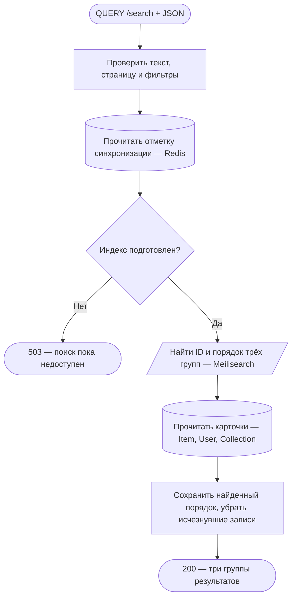
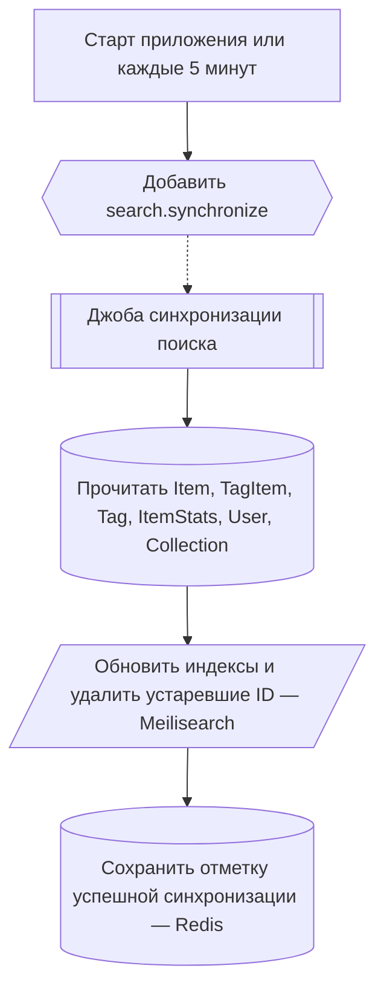

# Каталог и поиск

[← Все эндпоинты](../endpoints.md) · [Обозначения схем](readme.md)

Поисковый запрос публичный. Access/refresh cookies не проверяются. Общие ограничения HTTP перечислены в [каталоге](../endpoints.md#common). Поисковый запрос не меняет MongoDB, не публикует события и не ставит задачи. Схемы сверены с production-кодом, а не с трассировкой запущенного API.

## QUERY /search

Найти произведения, пользователей и подборки одним запросом.

**Пример:** `QUERY /search`, `Content-Type: application/json`, тело `{"search":"космос","page":1,"limit":10,"items":{"sort":"rating","direction":"desc"}}`. **Ответ:** 200, три группы `items`, `users`, `collections`; у каждой `hits` и `estimatedTotalHits`. Даже пустая группа присутствует. `Cache-Control: no-store`, `Accept-Query: application/json`.

**Проверки и данные:** тело должно быть JSON-объектом; неизвестные поля запрещены. Обрезанный по краям текст — 1–200 символов, page от 1, limit 10/20/50 (по умолчанию 1 и 50). Смещение должно быть меньше 10 000. Фильтры проверяют диапазоны оценок/чисел/дат и уникальность полей. Для Item доступны relevance/title/releaseDate/rating; `recommended` не поддерживается и даёт 400. Обычные фильтры и сортировка применяются в Meilisearch до пагинации. При relevance по возрастанию сервис перебирает все совпадения пакетами и выбирает глобальную страницу; это может быть дороже обычного поиска.

**Границы и ошибки:** отметка готовности читается из Redis, ID — из Meilisearch, карточки — из MongoDB. Общей транзакции или единого snapshot между ними нет. Удалённые/исчезнувшие записи убираются из hits, поэтому фактическая длина страницы может быть меньше limit, а счётчик остаётся оценкой поискового индекса. 400 — тело/поля/фильтры/глубина страницы; 503 — нет отметки или ошибка Redis/Meilisearch/чтения карточек; общие 403/429. HTTP ждёт все три группы и их карточки. Сам запрос не запускает и не ждёт синхронизацию.

Технические подробности и исходники

[SearchController.search](../../../../src/endpoints/search/controllers/searchController/core/search.controller.ts) → [SearchBodyInterceptor](../../../../src/endpoints/search/services/searchBodyInterceptor/core/searchBody.interceptor.ts) и [DTO](../../../../src/endpoints/search/services/siteSearchService/dto/search.body.ts) → [SiteSearchService.search/searchGroup](../../../../src/endpoints/search/services/siteSearchService/core/siteSearch.service.ts). Вызовы идут к CacheService.get, [SearchService.search/iterateMatches](../../../../src/infrastructure/search/services/searchService/core/search.service.ts) и read.findMany репозиториев [Item](../../../../src/entities/item/services/itemRepository/core/item.repository.ts), [User](../../../../src/entities/user/services/userRepository/core/user.repository.ts), [Collection](../../../../src/entities/collection/services/collectionRepository/core/collection.repository.ts). Индексы `site_items`, `site_users`, `site_collections`; checkpoint `siteSearch:checkpoint:v2`. [Подробный контракт](../pages/search.md#Реализованный-общий-поиск).

## Независимый фон: синхронизация поиска

Этот процесс обеспечивает данные для QUERY /search, но не является продолжением конкретного HTTP-запроса. При старте приложения и каждые пять минут планировщик ожидает добавления `search.synchronize` в очередь с дедупликацией. Ошибка постановки логируется; HTTP-ответа у планировщика нет.

Item индексируется полным проходом; User/Collection после первого полного прохода выбираются по updatedAt с перекрытием в минуту. Воркер создаёт/настраивает отсутствующие индексы и удаляет записи, которых больше нет в MongoDB. Начальная готовность появляется лишь после успешного обхода всех трёх источников. При последующих сбоях прежняя отметка может оставаться, а индекс — частично обновлённым; это не атомарная замена всех результатов. MongoDB не изменяется, событий нет.

**Исходники:** [SearchSyncSchedulerService.enqueue](../../../../src/endpoints/search/services/searchSyncSchedulerService/core/searchSyncScheduler.service.ts), [SYNC_SEARCH_JOB](../../../../src/endpoints/search/static/SYNC_SEARCH_JOB.ts), [SyncSearchJobHandler.handle/synchronize/createSources](../../../../src/endpoints/search/services/syncSearchJobHandler/core/syncSearchJob.handler.ts), [ItemRepository.readSearchIndexBatch](../../../../src/entities/item/services/itemRepository/core/item.repository.ts).
