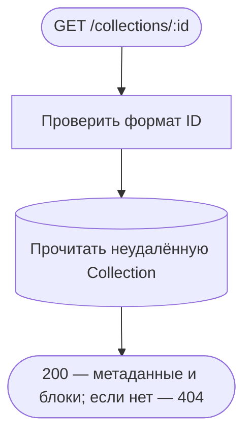
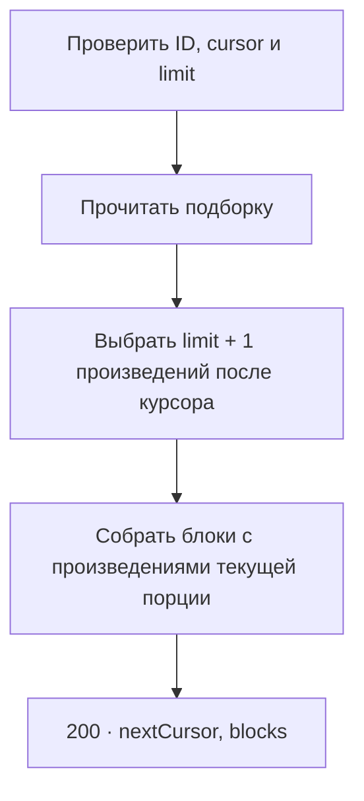
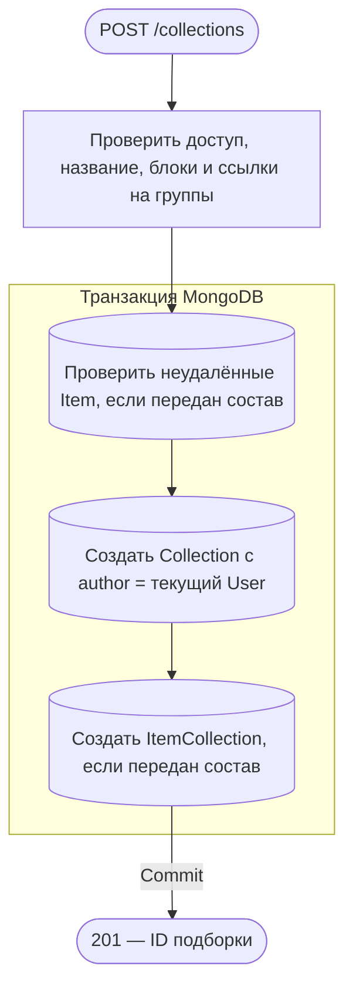
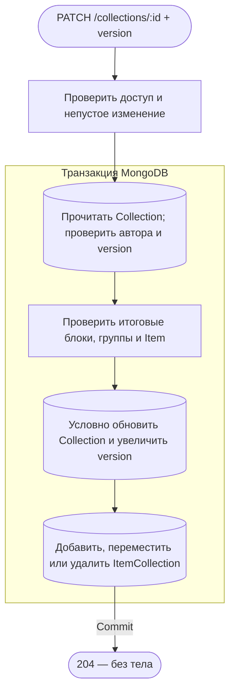
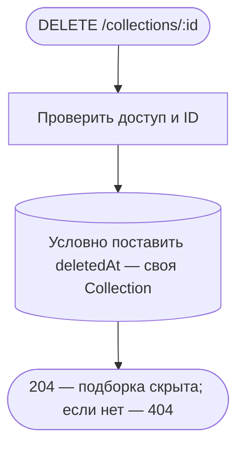
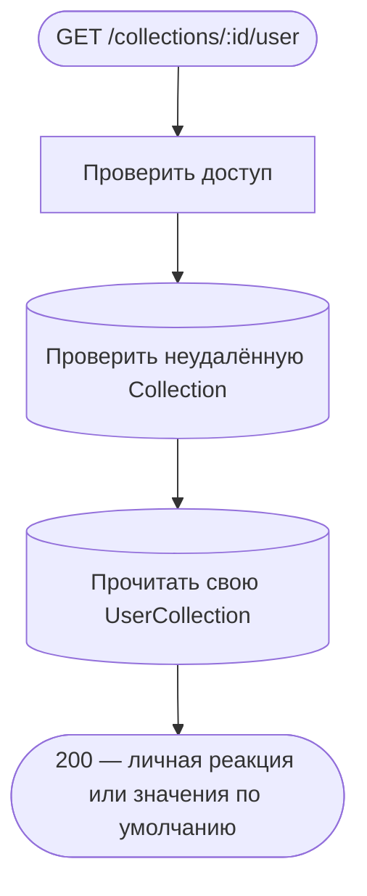
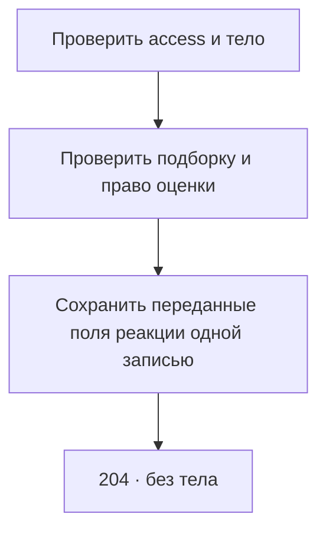
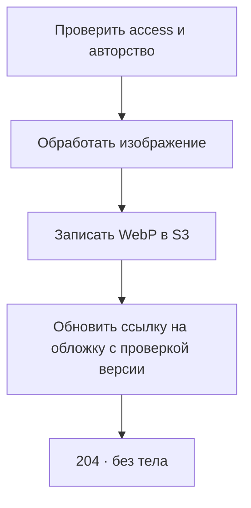

# Подборки

[← Все эндпоинты](../endpoints.md) · [Контракт подборок](../collectionsSpec.md) · [Обозначения](readme.md)

Публичные чтения не проверяют cookies и не возвращают UserItem. Создание, редактирование, удаление и личные реакции требуют access cookie: JWT → активная собственная UserSession + существующий User. Для изменения/удаления подборки проверяется также author. Все `:id` — ObjectId подборки. JSON — с `Content-Type: application/json`; неизвестные поля запрещены. Все ответы имеют `Cache-Control: no-store`. Общие ошибки: 400 — входные данные/ID, 401 — доступ защищённых операций, 403 — CSRF, 429 — throttling.

Ни один из этих одиннадцати HTTP-потоков не публикует событий, не ставит джоб и не обращается к внешним сервисам. Включение Item в подборку не меняет UserItem и вкус пользователя. Отдельный обработчик изменений TagItem поддерживает автоматические подборки, но эти маршруты его **не вызывают**. Обновление поиска происходит [независимым фоном](catalog.md#search-sync).

## GET /collections/:id

Открыть метаданные и блоки подборки. **Пример:** `GET /collections/507f1f77bcf86cd799439011`, без тела. **Ответ:** 200, id/version/author/type/title/description/media/blocks/createdAt/updatedAt. Автор — {id, avatar, displayName} или null. Item внутри групп загружаются отдельно.

Одна выборка Collection без транзакции, Items/реакции/пользователь не читаются. Отсутствующая и soft-deleted подборка дают одинаковый 404. Даты — ISO, языковые значения и nullable поля отображаются явно. HTTP ждёт чтения и маппинга, записей нет.

**Технические подробности:** CollectionReadController.getById → CollectionService.getById/mapResponse → CollectionRepository.findNotDeletedById. [Контроллер](../../../../src/endpoints/collection/controllers/collectionReadController/core/collectionRead.controller.ts), [сервис](../../../../src/endpoints/collection/services/collectionService/core/collection.service.ts), [репозиторий](../../../../src/entities/collection/services/collectionRepository/core/collection.repository.ts), [response DTO](../../../../src/endpoints/collection/services/collectionService/dto/collection.response.ts).

## QUERY /collections/:id/items

Первый запрос передаёт {} или limit. Следующие передают cursor из nextCursor. Ответ 200 содержит nextCursor (строка или null) и blocks. В группах blocks идут карточки текущей порции с note. Изменение версии подборки делает старый курсор недействительным и возвращает 400.

## POST /collections

Создать подборку от текущего пользователя. **Пример:** `POST /collections`, `{"title":{"ru":"Вечернее кино"},"type":"custom"}`, access cookie. **Ответ:** 201, объект {id}.

Название должно быть заполнено хотя бы на одном языке. Проверяются уникальные ID блоков/Item, корректность group/text и принадлежность каждого item.groupId итоговой группе. Нет добавляемого Item или он удалён — 404; структура/дубли/пустое название — 400. Collection и весь состав создаются/откатываются вместе; при пустом составе Item/ItemCollection не затрагиваются. После commit выполняется только отображение ответа, enqueue/events нет. Потерянный ответ не откатывает создание.

**Технические подробности:** [CollectionController.create](../../../../src/endpoints/collection/controllers/collectionController/core/collection.controller.ts) → [CollectionService.create/prepareBlock](../../../../src/endpoints/collection/services/collectionService/core/collection.service.ts) → CollectionAuthService.authenticate → MongoTransactionService.run → ItemRepository.findNotDeletedByIds, CollectionRepository.write.create, ItemCollectionRepository.createForCollection. [DTO](../../../../src/endpoints/collection/services/collectionService/dto/createCollection.body.ts).

## PATCH /collections/:id

Изменить собственную подборку и её состав с проверкой версии. Поля blocks и items группируют операции add, update, move и remove. **Пример:** `PATCH /collections/507f1f77bcf86cd799439011`, `{"version":0,"title":{"ru":"Кино на выходные"}}`, access cookie. **Ответ:** 204 без тела. Версия увеличивается при сохранении.

Чужая, автоматическая (author=null), отсутствующая или удалённая Collection — одинаковый 404. Устаревшая версия или предел Number.MAX_SAFE_INTEGER — 409. Проверяются итоговый порядок блоков, уникальность, отсутствие конфликтующих добавлений/удалений, доступные группы, наличие удаляемых memberships и неудалённые добавляемые Item. Невалидная структура/пустое изменение — 400; нет Item — 404. Удаление группы удаляет связанные ItemCollection, кроме перенесённых в сохранённые группы. Все чтения/записи состава и условная запись версии используют одну session; сбой откатывает их вместе. HTTP ждёт commit, очередей и postcommit-вызовов нет.

**Технические подробности:** CollectionController.update → CollectionService.update/prepareUpdatedBlocks → [CollectionRepository.updateVersioned](../../../../src/entities/collection/services/collectionRepository/core/collection.repository.ts), [ItemCollectionRepository.findByCollectionAndItems/upsertForCollection/removeForCollection](../../../../src/entities/itemCollection/services/itemCollectionRepository/core/itemCollection.repository.ts), ItemRepository.findNotDeletedByIds. [Сервис](../../../../src/endpoints/collection/services/collectionService/core/collection.service.ts), [DTO](../../../../src/endpoints/collection/services/collectionService/dto/updateCollection.body.ts).

## DELETE /collections/:id

Скрыть собственную подборку через soft delete. **Пример:** `DELETE /collections/507f1f77bcf86cd799439011`, без тела, access cookie. **Ответ:** 204 без тела.

Один atomic update без отдельной MongoDB-транзакции, без version в запросе. Чужая, автоматическая, уже удалённая или отсутствующая подборка — 404. ItemCollection/UserCollection физически остаются; каскадной очистки нет, публичные чтения проверяют deletedAt. HTTP ждёт update, ошибка доставки ответа не отменяет soft delete. Фоновые удаления не запускаются.

**Технические подробности:** CollectionController.remove → CollectionService.remove → CollectionRepository.softDeleteByAuthor (id+author+deletedAt=null). [Контроллер](../../../../src/endpoints/collection/controllers/collectionController/core/collection.controller.ts), [сервис](../../../../src/endpoints/collection/services/collectionService/core/collection.service.ts), [репозиторий](../../../../src/entities/collection/services/collectionRepository/core/collection.repository.ts).

## GET /collections/:id/user

Прочитать свою реакцию на подборку. **Пример:** `GET /collections/507f1f77bcf86cd799439011/user`, без тела, access cookie. **Ответ:** 200, `{"isFavorite":false,"rating":null,"isHidden":false}` либо сохранённые значения.

Нет Collection — 404; нет UserCollection — успешный ответ с false/null/false, без создания записи. Проверка Collection и чтение реакции раздельные, общей транзакции/snapshot нет. HTTP ждёт оба чтения; записи и фон отсутствуют.

**Технические подробности:** [CollectionUserController.getUser](../../../../src/endpoints/collection/controllers/collectionUserController/core/collectionUser.controller.ts) → [CollectionUserService.getUser/mapResponse](../../../../src/endpoints/collection/services/collectionUserService/core/collectionUser.service.ts) → CollectionRepository.checkIsNotDeleted, [UserCollectionRepository.findByUserAndCollection](../../../../src/entities/userCollection/services/userCollectionRepository/core/userCollection.repository.ts).

## PATCH /collections/:id/user

Принимает одно или несколько полей isFavorite, rating, isHidden. Пропущенные поля сохраняются, rating: null снимает оценку. Пустое тело отклоняется с 400. Автор не может поставить своей подборке оценку. Успех — 204 без тела.

## PUT /collections/:id/poster

Автор передаёт одно изображение в multipart-поле file. Сервер обрабатывает его в WebP и сохраняет по ключу collections/<id>/poster/<uuid>.webp. Успех — 204 без тела. POST /collections принимает JSON без media.

