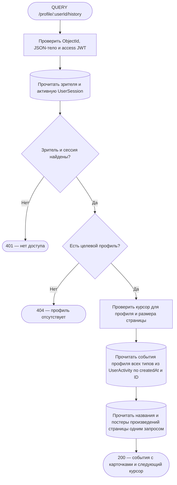

# Профиль

[← Все эндпоинты](../endpoints.md) · [Аккаунт](account.md) · [Обозначения](readme.md)

## QUERY /profile/:userId/history

Для блока последних действий отправь `QUERY /profile/507f191e810c19729de860ea/history` с cookie `__Host-accessToken`, заголовком `Content-Type: application/json` и телом `{"limit":10}`. `userId` — обязательный MongoDB ObjectId своего или чужого профиля. Для следующей страницы передай полученный `nextCursor` в поле `cursor` и сохрани тот же `userId` и `limit`.

Сессия определяет зрителя. Сервер читает все типы событий из `UserActivity` по `userId` из пути. Сейчас модель хранит добавления в библиотеку и изменения статуса, оценки или избранного. Сервер формирует поля ответа для каждого типа. Он сортирует события по `createdAt` и ID по убыванию и читает на одну запись больше лимита. Для событий страницы добавляются актуальное название и первый постер. Отсутствующее или удалённое произведение даёт `item: null`, событие сохраняется в выдаче.

Ответ содержит `items` и `nextCursor`. Значение `nextCursor: null` означает конец журнала. Заголовки ответа — `Cache-Control: no-store` и `Accept-Query: application/json`. Неверный ObjectId, JSON, параметры строки запроса или курсор дают 400. Недействительный доступ даёт 401. Общая проверка CSRF может вернуть 403, превышение лимита запросов — 429.

**Технические подробности.** [Контракт](../contracts/librarySpec.md#история-профиля) · [ProfileHistoryController](../../../../src/endpoints/profile/controllers/profileHistoryController/core/profileHistory.controller.ts) · [ProfileHistoryService](../../../../src/endpoints/profile/services/profileHistoryService/core/profileHistory.service.ts) · [UserActivityRepository](../../../../src/entities/userActivity/services/userActivityRepository/core/userActivity.repository.ts)
