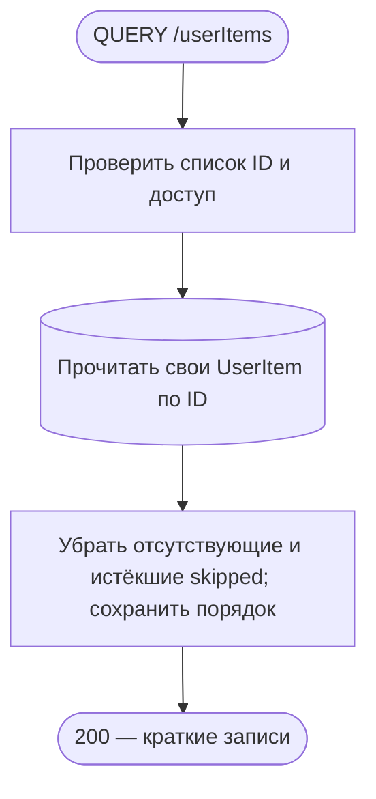
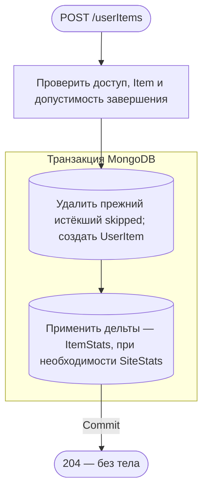
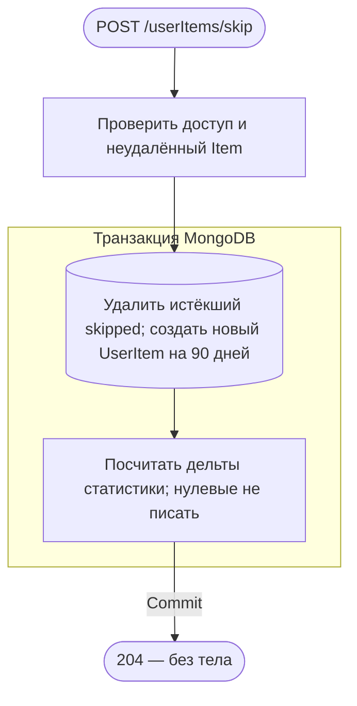
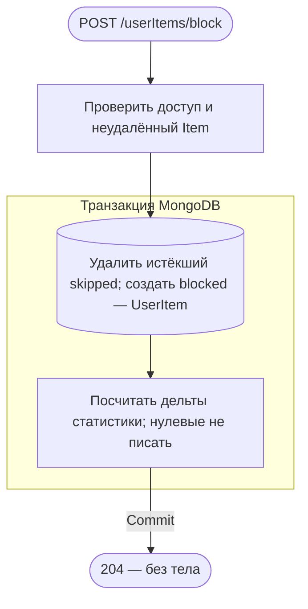
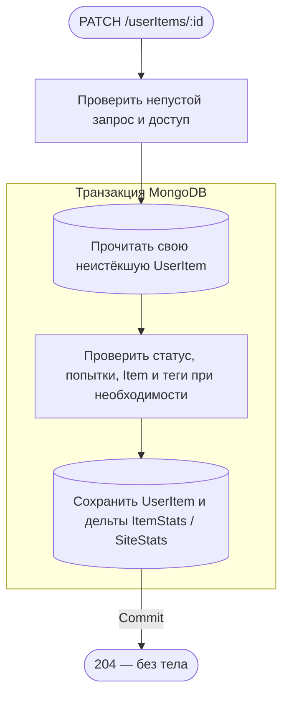
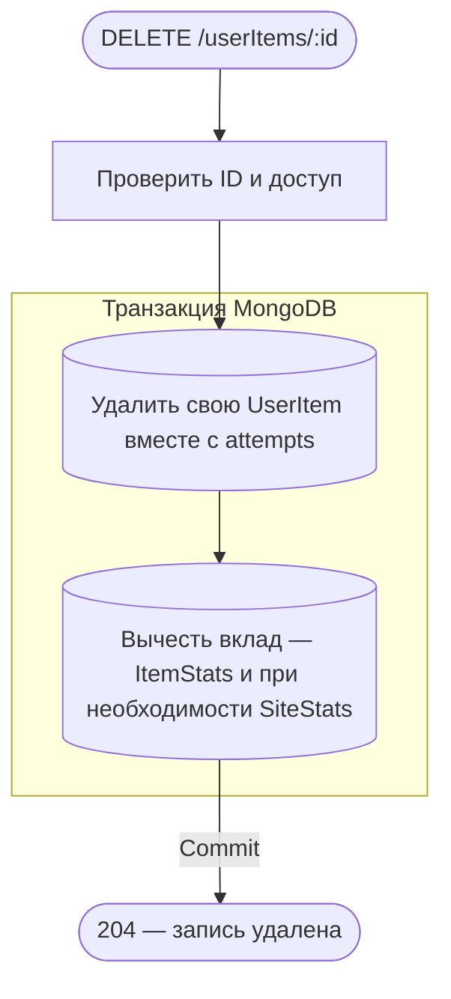
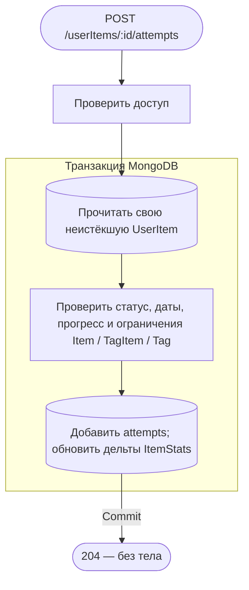
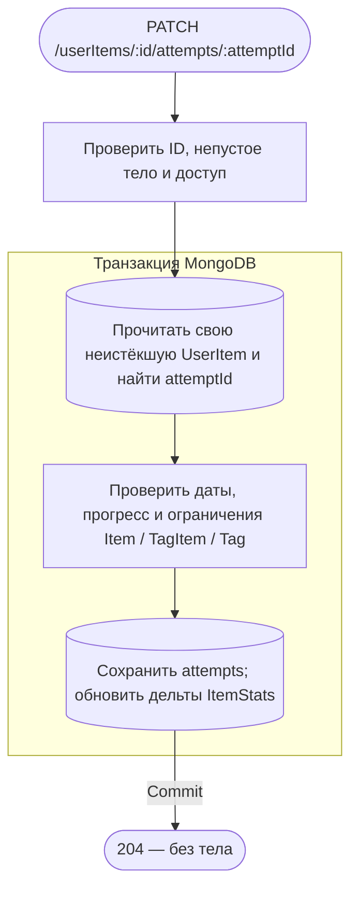

# Личная библиотека

[← Все эндпоинты](../endpoints.md) · [Контракт библиотеки](../contracts/librarySpec.md) · [Обозначения](readme.md)

Все восемь операций проверяют access cookie: JWT → активную принадлежащую пользователю UserSession и существующий User. `:id` — **ID UserItem**, а `itemId` в создании — ID произведения Item. JSON передаётся с `Content-Type: application/json`; неизвестные поля запрещены. Общие ошибки: 400 — DTO/формат ObjectId; 401 — доступ; 403 — CSRF; 429 — throttling. Все ответы — `Cache-Control: no-store`.

Изменения UserItem и его статистики выполняются одной MongoDB-транзакцией. ItemStats получает только ненулевые дельты оценок, избранного, завершённых попыток и обычных библиотечных статусов. SiteStats (тип SiteRatingsStats) обновляется только при изменении суммы/числа оценок. Старая подсистема рекомендаций удалена; очереди вкуса нет. HTTP ждёт завершения транзакции.

Изменяющие операции отвечают 204 без тела. Для чтения кратких записей используется QUERY.

## QUERY /userItems

Получить краткие собственные записи по их ID. **Пример:** `QUERY /userItems`, `{"ids":["507f1f77bcf86cd799439011"]}`, access cookie. **Ответ:** 200, массив id/itemId/rating/isFavorite/status; заголовок `Accept-Query: application/json`.

1–60 уникальных ObjectId, регистр hex не делает ID различными. Чужие/отсутствующие записи и skipped с истёкшим expiresAt пропускаются без 404; порядок оставшихся совпадает с запросом. Item не читается. Нет транзакции, записей, событий, очередей и внешних вызовов; HTTP ждёт чтения и маппинга. Это не чтение всей библиотеки и не поиск по itemId.

**Технические подробности:** [UserItemController.query](../../../../src/endpoints/userItem/controllers/userItemController/core/userItem.controller.ts) → [UserItemService.query/authenticate](../../../../src/endpoints/userItem/services/userItemService/core/userItem.service.ts) → UserItemRepository.read.findMany. [DTO](../../../../src/endpoints/userItem/services/userItemService/dto/queryUserItems.body.ts), [summary DTO](../../../../src/endpoints/userItem/services/userItemService/dto/userItemSummary.response.ts).

## POST /userItems

Добавить произведение в библиотеку с обычным статусом. **Пример:** `POST /userItems`, `{"itemId":"507f1f77bcf86cd799439011","status":"planned"}`, access cookie. **Ответ:** 204 без тела.

До транзакции проверяется неудалённый Item; для completed — ограничения завершения. Для inProgress/onHold/completed/dropped автоматически создаётся первая попытка; completed помечает её завершённой. Просроченный skipped той же пары user/item удаляется внутри транзакции; другая существующая запись не заменяется — 409 уникальности. Нет Item — 404; недопустимое завершение — 409. HTTP ждёт commit.

**Технические подробности:** UserItemController.create → UserItemService.create/createWithStatus/runMutation → ItemRepository.read.checkIsExists, UserItemRepository.write.deleteByFilter/create, UserItemStatsService.update. [Сервис](../../../../src/endpoints/userItem/services/userItemService/core/userItem.service.ts), [create DTO](../../../../src/endpoints/userItem/services/userItemService/dto/createUserItem.body.ts), [допустимые статусы создания](../../../../src/endpoints/userItem/services/userItemService/dto/status.body.ts).

## POST /userItems/skip

Отложить рекомендацию произведения на 90 дней. **Пример:** `POST /userItems/skip`, `{"itemId":"507f1f77bcf86cd799439011"}`, access cookie. **Ответ:** 204 без тела.

Создаётся новая запись без оценки, избранного, заметки и попыток. Свежий skipped/другая существующая запись пары user/item даёт 409, отсутствующий/удалённый Item — 404. Чистый skipped не вносит вклад в ItemStats/SiteStats, поэтому вызов расчёта дельт обычно ничего туда не пишет. MongoDB TTL позже физически удаляет просроченные skipped независимо от запроса; это не BullMQ-джоба и не обещание удаления ровно в expiresAt. HTTP ждёт commit.

**Технические подробности:** UserItemController.skip → UserItemService.skip/createWithStatus, общий путь создания выше. [Exclusion DTO](../../../../src/endpoints/userItem/services/userItemService/dto/createExclusion.body.ts), [TTL-индекс](../../../../src/entities/userItem/schemas/userItem.schema.ts), [срок](../../../../src/endpoints/userItem/services/userItemService/static/USER_ITEM_SKIP_DURATION_MS.ts).

## POST /userItems/block

Бессрочно исключить произведение из рекомендаций. **Пример:** `POST /userItems/block`, `{"itemId":"507f1f77bcf86cd799439011"}`, access cookie. **Ответ:** 204 без тела.

Создание blocked не заменяет действующую запись пары user/item: 409. Для изменения существующей записи нужен PATCH /userItems/:id. Нет доступного Item — 404. Чистый blocked не входит в обычные счётчики библиотеки и не несёт оценки/избранного, поэтому ненулевых дельт статистики нет. TTL не применяется. HTTP ждёт commit; внешних вызовов нет.

**Технические подробности:** UserItemController.block → UserItemService.block/createWithStatus → те же репозитории, что в создании. [Контроллер](../../../../src/endpoints/userItem/controllers/userItemController/core/userItem.controller.ts), [сервис](../../../../src/endpoints/userItem/services/userItemService/core/userItem.service.ts), [статусы счётчиков](../../../../src/entities/userItem/static/USER_ITEM_LIBRARY_STATUSES.ts).

## PATCH /userItems/:id

Изменить статус, оценку, избранное или заметку. **Пример:** `PATCH /userItems/507f1f77bcf86cd799439012`, `{"rating":8,"isFavorite":true}`, access cookie. **Ответ:** 204 без тела.

rating — целое 1–10 или null для очистки; note допускает null. completed помечает последнюю попытку завершённой; переход в требующий попытку статус создаёт её, если попыток нет. skipped несовместим с оценкой/избранным/заметкой/попытками — 409. expiresAt обнуляется при выходе из skipped, при входе назначается 90 дней. Неверные даты/проценты/единицы попыток — 400; недопустимое завершение — 409. Отсутствующая, чужая или истёкшая skipped — одинаковый 404. ItemStats обновляется синхронно в транзакции. HTTP ждёт commit.

**Технические подробности:** UserItemController.update → UserItemService.update/mutate/changeStatus/validateUserItem/validateCompletion; UserItemRepository.read.findOne/write.updateByFilter фильтруют владельца и срок. [Сервис](../../../../src/endpoints/userItem/services/userItemService/core/userItem.service.ts), [DTO](../../../../src/endpoints/userItem/services/userItemService/dto/updateUserItem.body.ts).

## DELETE /userItems/:id

Физически удалить личную запись и все её вложенные попытки. **Пример:** `DELETE /userItems/507f1f77bcf86cd799439012`, без тела, access cookie. **Ответ:** 204 без тела.

Нет/чужая запись — 404; повторное удаление тоже 404. Удаление разрешено и для просроченного skipped, если TTL ещё не удалил его. Item не проверяется и не удаляется. Статистика вычитается из возвращённой удалённой записи в той же транзакции; HTTP ждёт commit, внешних вызовов нет.

**Технические подробности:** UserItemController.remove → UserItemService.remove/runMutation → UserItemRepository.write.deleteByFilter, UserItemStatsService.update(previous, null). [Сервис](../../../../src/endpoints/userItem/services/userItemService/core/userItem.service.ts), [репозиторий](../../../../src/entities/userItem/services/userItemRepository/core/userItem.repository.ts).

## POST /userItems/:id/attempts

Добавить попытку просмотра или прохождения. **Пример:** `POST /userItems/507f1f77bcf86cd799439012/attempts`, `{"progress":30,"unit":"minute"}`, access cookie. **Ответ:** 204 без тела.

Новая попытка разрешена только inProgress/onHold/completed/dropped, иначе 409. По умолчанию isCompleted=false, progress=null, unit=minute, даты=null; `{}` допустим. Попытка **не меняет статус UserItem**. unit=episode разрешён только сериалам; percent не выше 100; завершение игры без определённого конца и незавершённого сезона запрещено по TagItem/Tag. Ошибки формата/дат/единиц — 400, ограничения завершения — 409, нет собственной активной записи — 404. Общий mutate обновляет статистику в той же транзакции. Нет внешних обращений; HTTP ждёт commit.

**Технические подробности:** UserItemController.createAttempt → UserItemService.createAttempt/mutate/validateCompletion → UserItemRepository и при необходимости ItemRepository/TagItemRepository.checkHasTagKeys → UserItemStatsService.update. [Сервис](../../../../src/endpoints/userItem/services/userItemService/core/userItem.service.ts), [DTO](../../../../src/endpoints/userItem/services/userItemService/dto/createAttempt.body.ts).

## PATCH /userItems/:id/attempts/:attemptId

Изменить прогресс, даты или завершённость конкретной попытки. **Пример:** `PATCH /userItems/507f1f77bcf86cd799439012/attempts/507f1f77bcf86cd799439013`, `{"progress":60}`, access cookie. **Ответ:** 204 без тела.

Пустое изменение — 400; неизвестная попытка/отсутствующая или чужая UserItem — 404. Те же ограничения дат/единиц/процентов и завершения, что при создании попытки; изменение попытки не меняет статус UserItem. В отличие от создания, отдельной проверки допустимости статуса для добавления здесь нет. ItemStats обновляется только при ненулевой дельте, например изменении числа завершённых попыток; SiteStats при обычном редактировании attempts не меняется. HTTP ждёт commit; внешних обращений и событий нет.

**Технические подробности:** UserItemController.updateAttempt → UserItemService.updateAttempt/mutate/validateUserItem/validateCompletion. [Контроллер](../../../../src/endpoints/userItem/controllers/userItemController/core/userItem.controller.ts), [сервис](../../../../src/endpoints/userItem/services/userItemService/core/userItem.service.ts), [DTO](../../../../src/endpoints/userItem/services/userItemService/dto/updateAttempt.body.ts).

**Исходники статистики:** [UserItemStatsService](../../../../src/endpoints/userItem/services/userItemStatsService/core/userItemStats.service.ts), [ItemStatsRepository.applyChanges](../../../../src/entities/itemStats/services/itemStatsRepository/core/itemStats.repository.ts), [SiteRatingsStatsRepository.applyChanges](../../../../src/entities/siteStats/services/siteRatingsStatsRepository/core/siteRatingsStats.repository.ts).
