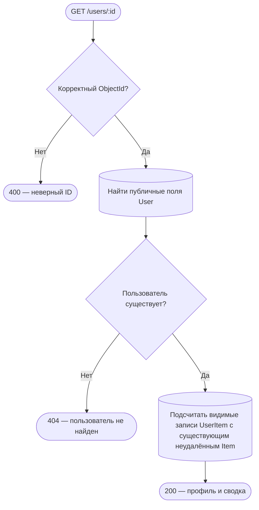
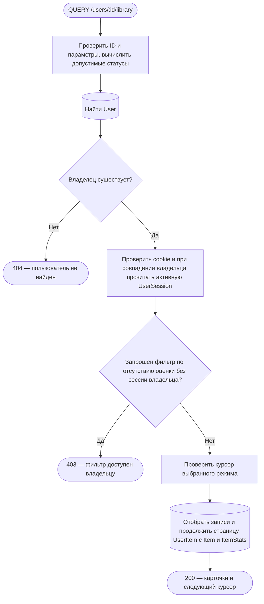
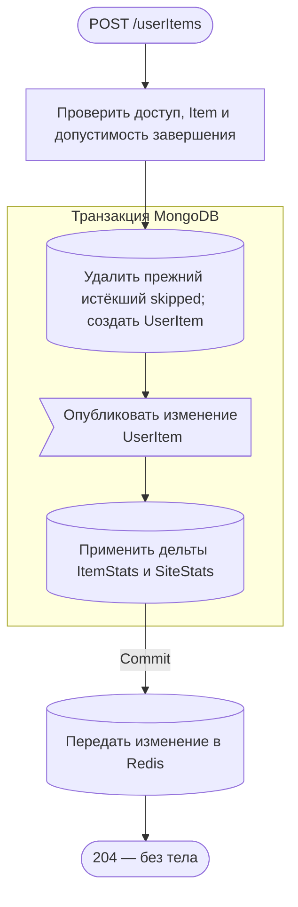
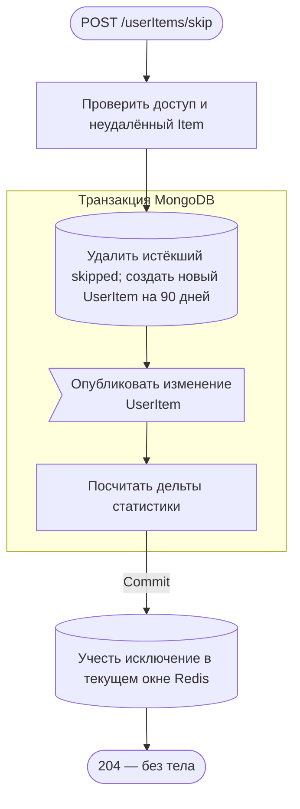
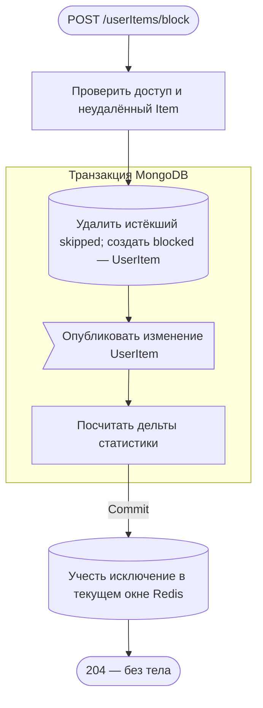
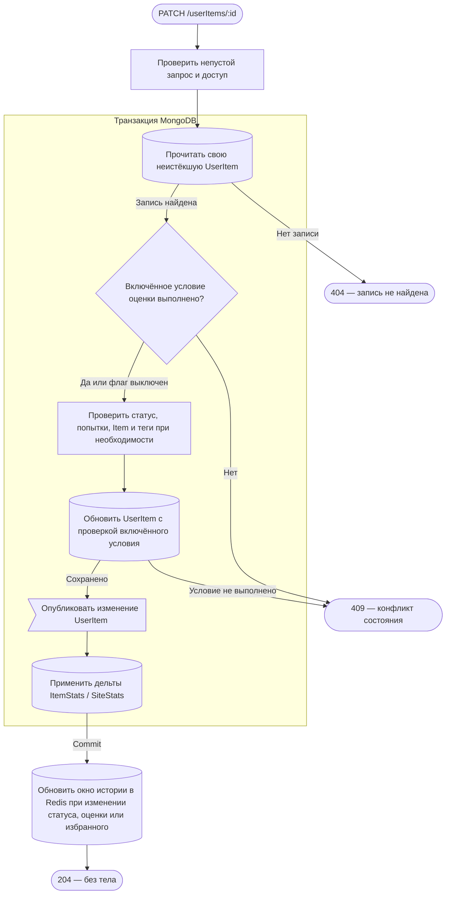
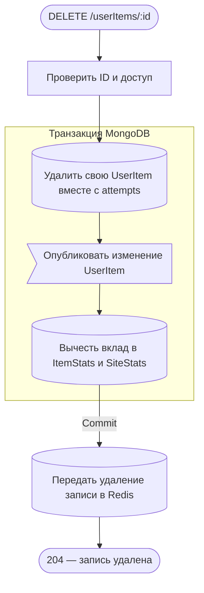
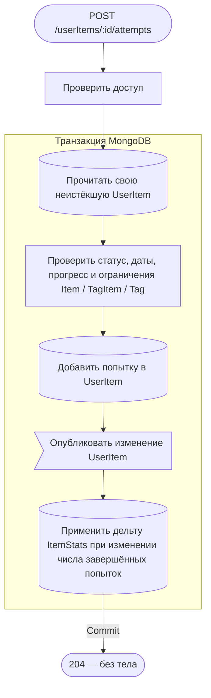
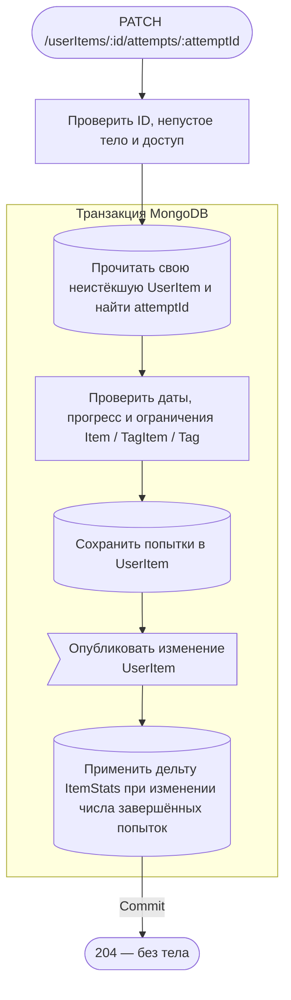

# Личная библиотека

[← Все эндпоинты](../endpoints.md) · [Контракт библиотеки](../contracts/librarySpec.md) · [Обозначения](readme.md)

Семь операций под `/userItems` проверяют access-cookie, активную UserSession и существующий User. Для них `:id` — **ID UserItem**, а `itemId` в создании — ID произведения Item. JSON передаётся с `Content-Type: application/json`; неизвестные поля запрещены. Общие ошибки: 400 — DTO/формат ObjectId; 401 — доступ к `/userItems`; 403 — CSRF; 429 — throttling. Успешные ответы содержат `Cache-Control: no-store`.

Изменения UserItem и его статистики выполняются одной MongoDB-транзакцией. После коммита изменения для [истории профиля](profile.md#profile-history) объединяются в Redis и записываются в `UserActivity` после пяти минут без изменений. ItemStats получает только ненулевые дельты оценок, избранного, завершённых попыток и обычных библиотечных статусов. SiteStats (тип SiteRatingsStats) обновляется только при изменении суммы или числа оценок. HTTP ждёт завершения транзакции.

Изменяющие операции отвечают 204 без тела.

## GET /users/:id

Публичный профиль по ObjectId пользователя с датой регистрации и сводкой библиотеки. Запрос доступен без cookie.

**Технические подробности.** [Контракт](../contracts/librarySpec.md#публичный-профиль) · [UserProfileService](../../../../src/endpoints/user/services/userProfileService/core/userProfile.service.ts) · [UserItemRepository](../../../../src/entities/userItem/services/userItemRepository/core/userItem.repository.ts)

## QUERY /users/:id/library

Публичная страница из пяти библиотечных статусов с поиском, фильтрами, сортировкой и курсором. ID в пути принадлежит владельцу библиотеки. Для первой порции на главной передай `inProgress`, `onHold` или `planned` из [continue](account.md#library-continue) и те же типы. При `status: "none"` запрос пропускается. Например, `QUERY /users/507f1f77bcf86cd799439011/library` с access-cookie и телом `{"statuses":{"anyOf":["inProgress"]},"types":["movie","series"],"limit":10}`.

Публично `progress` и `userItemId` равны `null`. Владелец с действующей сессией получает ID записи и значение прогресса последней попытки, если оно задано. В обоих представлениях `movieDuration` содержит длительность фильма в минутах при наличии данных. Пустая страница — `200 {"items":[],"nextCursor":null}`. Страницы отражают текущие данные. Запрос не меняет БД и не запускает фоновые задачи.

Для «Оценки» передай `{"isUnrated":true,"statuses":{"anyOf":["completed"]}}`. MongoDB отбирает записи с пустой или отсутствующей оценкой до ограничения страницы. Курсор продолжает после `createdAt` последней карточки по убыванию и ID UserItem по возрастанию при равенстве дат.

**Технические подробности.** [Контракт](../contracts/librarySpec.md#публичный-список-библиотеки) · [UserReadController](../../../../src/endpoints/user/controllers/userReadController/core/userRead.controller.ts) · [UserLibraryService](../../../../src/endpoints/user/services/userLibraryService/core/userLibrary.service.ts) · [UserItemRepository](../../../../src/entities/userItem/services/userItemRepository/core/userItem.repository.ts)

## POST /userItems

Добавить произведение в библиотеку с обычным статусом. **Пример:** `POST /userItems`, `{"itemId":"507f1f77bcf86cd799439011","status":"planned"}`, access cookie. **Ответ:** 204 без тела.

До транзакции проверяется неудалённый Item; для completed — ограничения завершения. Для inProgress/onHold/completed/dropped автоматически создаётся первая попытка; completed помечает её завершённой. Просроченный skipped той же пары user/item удаляется внутри транзакции; другая существующая запись не заменяется — 409 уникальности. Нет Item — 404; недопустимое завершение — 409. HTTP ждёт commit и попытку записи в Redis.

**Технические подробности:** UserItemController.create → UserItemService.create/createWithStatus/runMutation → UserItemRepository.write.deleteByFilter/create → UserItemEventsService.publishChanged. [Сервис](../../../../src/endpoints/userItem/services/userItemService/core/userItem.service.ts), [create DTO](../../../../src/endpoints/userItem/services/userItemService/dto/createUserItem.body.ts), [допустимые статусы создания](../../../../src/endpoints/userItem/services/userItemService/dto/status.body.ts).

## POST /userItems/skip

Отложить рекомендацию произведения на 90 дней. **Пример:** `POST /userItems/skip`, `{"itemId":"507f1f77bcf86cd799439011"}`, access cookie. **Ответ:** 204 без тела.

Создаётся новая запись без оценки, избранного, заметки и попыток. Свежий skipped/другая существующая запись пары user/item даёт 409, отсутствующий/удалённый Item — 404. Чистый skipped не вносит вклад в ItemStats/SiteStats, поэтому обработчик статистики пропускает запись агрегатов. MongoDB TTL позже физически удаляет просроченные skipped независимо от запроса. HTTP ждёт commit и попытку записи в Redis.

**Технические подробности:** UserItemController.skip → UserItemService.skip/createWithStatus, общий путь создания выше. [Exclusion DTO](../../../../src/endpoints/userItem/services/userItemService/dto/createExclusion.body.ts), [TTL-индекс](../../../../src/entities/userItem/schemas/userItem.schema.ts), [срок](../../../../src/endpoints/userItem/services/userItemService/static/USER_ITEM_SKIP_DURATION_MS.ts).

## POST /userItems/block

Бессрочно исключить произведение из рекомендаций. **Пример:** `POST /userItems/block`, `{"itemId":"507f1f77bcf86cd799439011"}`, access cookie. **Ответ:** 204 без тела.

Создание blocked не заменяет действующую запись пары user/item: 409. Для изменения существующей записи нужен PATCH /userItems/:id. Нет доступного Item — 404. Чистый blocked не входит в обычные счётчики библиотеки и не несёт оценки/избранного, поэтому обработчик статистики пропускает запись агрегатов. TTL не применяется. HTTP ждёт commit и попытку записи в Redis. Само создание исключения не добавляет запись в UserActivity.

**Технические подробности:** UserItemController.block → UserItemService.block/createWithStatus → те же репозитории, что в создании. [Контроллер](../../../../src/endpoints/userItem/controllers/userItemController/core/userItem.controller.ts), [сервис](../../../../src/endpoints/userItem/services/userItemService/core/userItem.service.ts), [статусы счётчиков](../../../../src/entities/userItem/static/USER_ITEM_LIBRARY_STATUSES.ts).

## PATCH /userItems/:id

Изменить статус, оценку, избранное или заметку. Для «Оценки» отправь `PATCH /userItems/507f1f77bcf86cd799439012` с телом `{"rating":8,"isCompletedAndUnratedRequired":true}` и access-cookie. Успешный ответ — 204 без тела.

rating — целое 1–10 или null для очистки; note допускает null. completed помечает последнюю попытку завершённой; переход в требующий попытку статус создаёт её, если попыток нет. skipped несовместим с оценкой/избранным/заметкой/попытками — 409. expiresAt обнуляется при выходе из skipped, при входе назначается 90 дней. Неверные даты/проценты/единицы попыток — 400; недопустимое завершение — 409. Отсутствующая, чужая или истёкшая skipped — одинаковый 404. Обработчик события применяет дельты в транзакции. HTTP ждёт commit и, если меняются статус, оценка или избранное, попытку записи в Redis.

При `isCompletedAndUnratedRequired: true` обязательна целая оценка 1–10. Если запись уже получила оценку или её статус отличается от `completed`, возвращается 409 без записи оценки и дельт. После конфликта конкурентной записи повтор транзакции читает актуальное состояние.

**Технические подробности:** UserItemController.update → UserItemService.update/mutate/changeStatus/validateUserItem/validateCompletion; UserItemRepository.read.findOne/write.updateByFilter фильтруют владельца и срок. [Сервис](../../../../src/endpoints/userItem/services/userItemService/core/userItem.service.ts), [DTO](../../../../src/endpoints/userItem/services/userItemService/dto/updateUserItem.body.ts).

## DELETE /userItems/:id

Физически удалить личную запись и все её вложенные попытки. **Пример:** `DELETE /userItems/507f1f77bcf86cd799439012`, без тела, access cookie. **Ответ:** 204 без тела.

Нет/чужая запись — 404; повторное удаление тоже 404. Удаление разрешено и для просроченного skipped, если TTL ещё не удалил его. Item не проверяется и не удаляется. Статистика вычитается из возвращённой удалённой записи в той же транзакции. Удаление отменяет ожидающие события для произведения в текущем окне Redis. Ранее записанные события истории сохраняются. HTTP ждёт commit и попытку записи в Redis.

**Технические подробности:** UserItemController.remove → UserItemService.remove/runMutation → UserItemRepository.write.deleteByFilter → UserItemEventsService.publishChanged с after=null. [Сервис](../../../../src/endpoints/userItem/services/userItemService/core/userItem.service.ts), [репозиторий](../../../../src/entities/userItem/services/userItemRepository/core/userItem.repository.ts).

## POST /userItems/:id/attempts

Добавить попытку просмотра или прохождения. **Пример:** `POST /userItems/507f1f77bcf86cd799439012/attempts`, `{"progress":30,"unit":"minute"}`, access cookie. **Ответ:** 204 без тела.

Новая попытка разрешена только inProgress/onHold/completed/dropped, иначе 409. По умолчанию isCompleted=false, progress=null, unit=minute, даты=null; `{}` допустим. Попытка **не меняет статус UserItem**. unit=episode разрешён только сериалам; percent не выше 100; завершение игры без определённого конца и незавершённого сезона запрещено по TagItem/Tag. Ошибки формата/дат/единиц — 400, ограничения завершения — 409, нет собственной активной записи — 404. Обработчик события обновляет статистику в той же транзакции. Изменения одних попыток оставляют окно истории в Redis без изменений, HTTP ждёт commit.

**Технические подробности:** UserItemController.createAttempt → UserItemService.createAttempt/mutate/validateCompletion → UserItemRepository и при необходимости ItemRepository/TagItemRepository.checkHasTagKeys → UserItemEventsService.publishChanged. [Сервис](../../../../src/endpoints/userItem/services/userItemService/core/userItem.service.ts), [DTO](../../../../src/endpoints/userItem/services/userItemService/dto/createAttempt.body.ts).

## PATCH /userItems/:id/attempts/:attemptId

Изменить прогресс, даты или завершённость конкретной попытки. **Пример:** `PATCH /userItems/507f1f77bcf86cd799439012/attempts/507f1f77bcf86cd799439013`, `{"progress":60}`, access cookie. **Ответ:** 204 без тела.

Пустое изменение — 400; неизвестная попытка/отсутствующая или чужая UserItem — 404. Те же ограничения дат/единиц/процентов и завершения, что при создании попытки; изменение попытки не меняет статус UserItem. В отличие от создания, отдельной проверки допустимости статуса для добавления здесь нет. ItemStats обновляется при изменении числа завершённых попыток. SiteStats и окно истории в Redis остаются без изменений. HTTP ждёт commit.

**Технические подробности:** UserItemController.updateAttempt → UserItemService.updateAttempt/mutate/validateUserItem/validateCompletion. [Контроллер](../../../../src/endpoints/userItem/controllers/userItemController/core/userItem.controller.ts), [сервис](../../../../src/endpoints/userItem/services/userItemService/core/userItem.service.ts), [DTO](../../../../src/endpoints/userItem/services/userItemService/dto/updateAttempt.body.ts).

Во всех семи мутациях событие передаёт снимки UserItem до и после записи. Ошибка обработчика статистики откатывает транзакцию. Обработчик истории регистрирует запись в Redis после commit только при изменении статуса, оценки или избранного, включая создание и удаление. Сбой Redis журналируется после сохранения UserItem.

**Исходники событий и обработчиков.** [UserItemEventsService](../../../../src/endpoints/userItem/services/userItemEventsService/core/userItemEvents.service.ts), [UserItemStatsService](../../../../src/endpoints/userItem/services/userItemStatsService/core/userItemStats.service.ts), [LibraryActivityService](../../../../src/endpoints/userItem/services/libraryActivityService/core/libraryActivity.service.ts), [ItemStatsRepository.applyChanges](../../../../src/entities/itemStats/services/itemStatsRepository/core/itemStats.repository.ts), [SiteRatingsStatsRepository.applyChanges](../../../../src/entities/siteStats/services/siteRatingsStatsRepository/core/siteRatingsStats.repository.ts).
